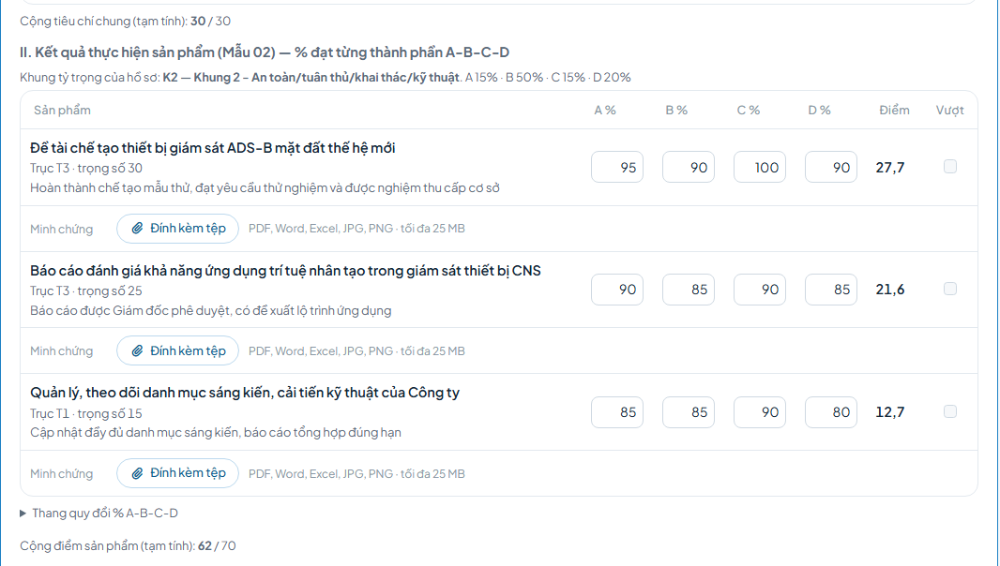

# Hướng dẫn cho người được đánh giá

Chương này dành cho cán bộ có hồ sơ đánh giá trong kỳ. Đăng nhập, chọn kỳ, trang hồ sơ và tải biểu mẫu: xem [Hướng dẫn chung](huong-dan-chung.md).

Trong mỗi kỳ, người được đánh giá làm 3 việc chính:
1. Đăng ký sản phẩm (Mẫu 01).
2. Tự chấm và nộp phiếu tự chấm (Mẫu 09A, 02, 09C, 9D).
3. Xem kết quả.

Các việc khác chỉ làm khi phát sinh (Phần B). Hồ sơ của chính mình không có nút xét duyệt.

## A. Việc chính

### 1. Đăng ký sản phẩm

Thời điểm: khi kỳ mở, trước hạn bước Đăng ký sản phẩm.

Cách làm:
1. Tại trang **Việc cần xử lý**, bấm **Đăng ký** ở dòng hồ sơ của mình.
2. Điền từng sản phẩm theo bảng dưới.
3. Bấm **Thêm chi tiết** ở mỗi sản phẩm, điền ba ô chi tiết.
4. Cần thêm sản phẩm thì bấm **Thêm dòng**; bỏ dòng thì bấm **Xóa** ở góc dòng.
5. Kiểm tra dòng Tổng trọng số ở chân khung bằng số tối đa (ví dụ 70 / 70).
6. Bấm **Nộp danh mục**, rồi bấm **Đồng ý**.

| Ô | Ghi gì |
|---|---|
| Tên sản phẩm, công việc | Tên sản phẩm cần hoàn thành trong quý |
| Loại việc | Trọng tâm hoặc Thường xuyên |
| Vai trò | Chủ trì hoặc Phối hợp |
| Trục kết quả | Nhóm kết quả của sản phẩm |
| Trọng số (điểm) | Số điểm của sản phẩm; tổng các dòng bằng số tối đa |
| Thời hạn / mốc quý | Thời điểm hoàn thành |
| Chuẩn đạt | Yêu cầu để sản phẩm được coi là đạt |
| Mã sản phẩm | Để trống thì hệ thống tự đánh mã |
| Tiêu chí vượt chuẩn | Bắt buộc; điều kiện để tính vượt chuẩn |
| Nguồn dữ liệu / minh chứng | Bắt buộc; tài liệu chứng minh kết quả |
| Thẩm quyền xác nhận | Bắt buộc; người, đơn vị xác nhận kết quả |

Sau khi xong: danh mục chuyển đi xét duyệt theo diện quyết định; khi được duyệt, hồ sơ chuyển sang bước tự chấm.

### 2. Tự chấm và nộp phiếu tự chấm

Thời điểm: sau khi danh mục được duyệt, trước hạn bước Tự chấm điểm, đề xuất mức.

Cách làm:
1. Tại trang **Việc cần xử lý**, bấm **Tự chấm** ở dòng hồ sơ của mình.
2. Chấm nhóm tiêu chí chung và kết quả từng sản phẩm theo bảng dưới.
3. Ghi tình hình, kết quả từng nhiệm vụ ở phần Nhiệm vụ và kết quả theo trục.
4. Bấm **Đính kèm tệp** ở dòng Minh chứng của sản phẩm hoặc của nhóm tiêu chí để gắn tài liệu.
5. Xem dòng Tổng tạm tính, chọn mức tự đề xuất; bấm **Xem trước bản in** nếu cần xem đoạn văn sẽ in.
6. Bấm **Nộp phiếu**, kiểm tra hộp xác nhận rồi bấm **Nộp phiếu**.

Chưa làm xong thì bấm **Lưu nháp**; cạnh nút ghi "Có thay đổi chưa lưu" khi còn nội dung chưa lưu.

| Ô | Ghi gì |
|---|---|
| Nhóm tiêu chí chung | Chọn Đảm bảo, Không đảm bảo hoặc Không áp dụng; hai lựa chọn sau phải ghi lý do |
| A %, B %, C %, D % (từng sản phẩm) | Nhập đủ bốn cột theo thang quy đổi dưới bảng; điểm tự tính |
| Vượt | Tích khi sản phẩm vượt chuẩn; phải đính kèm minh chứng |
| Nhiệm vụ theo trục | Tình hình, kết quả và mức (Mức 1, 2, 3) của từng nhiệm vụ; thêm bằng **Thêm nhiệm vụ**, **Thêm ý** |
| Dòng trục (Mẫu 9D) | Tình hình thực hiện, sản phẩm hoàn thành, đánh giá tiến độ, thời hạn, ghi chú; bấm **Lấy tình hình từ nhiệm vụ** để điền nhanh |
| Mức tự đề xuất | Để Hệ thống gợi ý là dùng mức theo điểm; chọn mức khác có thể phải ghi lý do |
| Ô không thuộc trường hợp bị khống chế mức xếp loại | Tích khi không bị kỷ luật, vi phạm, sự cố an toàn do lỗi chủ quan |

Tệp minh chứng là PDF, Word, Excel, JPG hoặc PNG, tối đa 25 MB.

Sau khi xong: hồ sơ chuyển sang Chi bộ xác nhận; phiếu không sửa được, trừ khi bị trả lại.

### 3. Xem kết quả

Thời điểm: sau khi Văn phòng Đảng ủy công bố.

Cách làm:
1. Mở hồ sơ của mình; mức xếp loại chính thức ghi ở đầu trang.
2. Hoặc mở menu **Kết quả đánh giá**; dòng của mình có nhãn Của tôi.

Không được đánh giá trong kỳ thì kết quả ghi Chưa xếp loại. Trước công bố, trên hồ sơ xem được mức và nhận xét của các bước đã qua.

Sau khi xong: không đồng ý kết quả thì gửi kiến nghị (Phần B).

## B. Khi phát sinh

- **Danh mục đi qua ai:** Trưởng, Phó phòng và tương đương, Bí thư, Phó Bí thư chi bộ là nhân viên: Trưởng đơn vị gửi, Phòng TCCB-LĐ rà soát, trình, Giám đốc duyệt (người là trưởng đơn vị thì không có bước gửi). Phó Giám đốc: Phòng TCCB-LĐ rà soát, trình, Chủ tịch duyệt. Chủ tịch, Giám đốc, Kiểm soát viên: cấp trên duyệt ngoài hệ thống.
- **Danh mục bị trả lại:** hồ sơ hiện lại ở trang Việc cần xử lý với nút **Đăng ký**. Sửa theo lý do, bấm **Nộp danh mục**; danh mục đi lại từ đầu.
- **Người duyệt thu hồi duyệt danh mục** (khi chưa nộp phiếu tự chấm): hồ sơ về bước đăng ký, khung đỏ ghi lý do. Sửa, bấm **Nộp danh mục** lại.
- **Điều chỉnh, chuyển tiếp hoặc loại trừ việc đã đăng ký (Mẫu 04):** làm sau khi danh mục được duyệt, trước khi nộp phiếu tự chấm; mỗi lúc chỉ một đề nghị chờ duyệt.
  1. Trên hồ sơ, tại khối Điều chỉnh việc trong quý, bấm **Đề nghị điều chỉnh**.
  2. Chọn việc và loại đề nghị (Điều chỉnh việc, Chuyển tiếp sang quý sau, Loại trừ việc); điều chỉnh thì sửa nội dung cần đổi.
  3. Đính kèm giấy tờ nếu có; nhập cột Sau trong bảng trọng số sao cho dòng Tổng bằng số tối đa.
  4. Ghi lý do, bấm **Gửi đề nghị**.

  Người duyệt danh mục (Giám đốc; hồ sơ Phó Giám đốc: Chủ tịch) xét; duyệt thì danh mục cập nhật ngay, không duyệt thì ghi lý do. Việc loại trừ, chuyển tiếp vẫn hiện trên phiếu tự chấm nhưng không chấm điểm.
- **Việc đột xuất phát sinh trong quý (Mẫu 05):** cùng thời điểm như điều chỉnh việc. Tại khối Điều chỉnh việc trong quý, bấm **Ghi nhận việc đột xuất**; điền tên việc, chuẩn đạt, trục, vai trò, thời hạn, trọng số; nhập cột Sau cho dòng Tổng bằng số tối đa; ghi lý do, bấm **Gửi đề nghị**. Cấp giao việc cũng ghi nhận được việc đột xuất trên hồ sơ.
- **Lấy phiếu Mẫu 04, 05:** bấm **Biểu mẫu** ở đầu trang hồ sơ; mỗi đề nghị điều chỉnh, mỗi việc đột xuất có một phiếu.
- **Danh mục do cấp trên duyệt** (Chủ tịch, Giám đốc, Kiểm soát viên):
  1. Cấp trên sửa danh mục đang chờ duyệt: bấm **Cập nhật danh mục**, sửa cho khớp, bấm **Lưu danh mục**.
  2. Cấp trên đồng ý điều chỉnh danh mục đã duyệt: tại khối Điều chỉnh việc trong quý, bấm **Ghi điều chỉnh đã duyệt**; nhập nội dung như đề nghị điều chỉnh, thêm cơ quan phê duyệt, số và ngày văn bản, đính kèm văn bản nếu có; bấm **Ghi và áp dụng**.

  Danh mục cập nhật ngay. Phòng TCCB-LĐ hoặc Văn phòng Đảng ủy cập nhật thay được.
- **Thêm, thay, gỡ minh chứng:** chưa nộp phiếu (kể cả khi bị trả lại) thì dùng **Thay**, **Gỡ** tự do; đã nộp thì chỉ thêm được tệp mới. Kỳ đã khóa dữ liệu (trừ hồ sơ được mở riêng) hoặc đã công bố thì không đính kèm được; sau công bố gửi tệp kèm kiến nghị. Báo sai định dạng thì lưu lại thành PDF hoặc ảnh.
- **Phiếu tự chấm bị trả lại** (Chi bộ, Phòng TCCB-LĐ hoặc người thẩm định trả lại): tại trang Việc cần xử lý, bấm **Tự chấm**; đọc lý do trong khung đỏ ở đầu trang, sửa phiếu, bấm **Nộp phiếu**. Hồ sơ đi lại từ bước Chi bộ xác nhận. Kỳ đã khóa dữ liệu thì nộp trước thời hạn mở riêng ghi ở đầu trang; quá hạn thì báo Phòng TCCB-LĐ gia hạn.
- **Giải trình sau thẩm định (Mẫu 10):** không bắt buộc; làm sau thẩm định, trước quyết định. Tại khối Giải trình của cá nhân, bấm **Ghi giải trình**, ghi nội dung, bấm **Lưu**. Giải trình được in vào phiếu thẩm định. Hồ sơ do cấp trên thẩm định thì không có Mẫu 10.
- **Không đồng ý kết quả đã công bố:** tại khối Kiến nghị trên hồ sơ, bấm **Gửi kiến nghị**; ghi nội dung, tích bước liên quan, đính kèm minh chứng nếu có, bấm **Gửi kiến nghị**. Mỗi lúc chỉ một kiến nghị. Khi có trả lời, trang Việc cần xử lý có nhóm Kiến nghị đã được trả lời; bấm **Xem trả lời** để đọc.
- **Xác nhận kế hoạch khắc phục (Mẫu 17)** (khi xếp loại Hoàn thành nhiệm vụ hoặc Không hoàn thành nhiệm vụ và kế hoạch đã được duyệt): tại trang Việc cần xử lý, nhóm Kế hoạch chờ bạn xác nhận, bấm **Xác nhận kế hoạch**; đọc kế hoạch, ghi ý kiến nếu có, bấm **Xác nhận cam kết khắc phục**. Bấm **Tải Word** ở đầu khối kế hoạch để tải bản in.

## C. Câu hỏi thường gặp

- Không thấy nút Đăng ký, Tự chấm? Nút chỉ hiện khi đến lượt; xem dải vàng trên hồ sơ (chưa đến bước hoặc đã quá hạn).
- Hồ sơ không có bước nào đó? Các bước tùy diện quyết định ghi ở khối Thông tin trên trang hồ sơ; bước cấp trên thực hiện làm ngoài hệ thống.
- Không nộp được danh mục? Tổng trọng số chưa bằng số tối đa hoặc còn thiếu ô trong phần chi tiết.
- Không nộp được phiếu tự chấm? Còn sản phẩm chưa đủ % A-B-C-D, tiêu chí chưa ghi lý do, sản phẩm tích Vượt chưa có minh chứng, hoặc chọn mức khác mức theo điểm mà chưa ghi lý do.
- Không gửi được đề nghị điều chỉnh? Đã có một đề nghị đang chờ duyệt, hoặc đã nộp phiếu tự chấm.
