# Hướng dẫn cho người được đánh giá

Áp dụng cho cán bộ có hồ sơ đánh giá trong kỳ. Thực hiện theo thứ tự; việc chưa đến lượt thì bỏ qua.

## I. Quy định chung

- Thanh tiến trình ở đầu trang hồ sơ ghi bước đang chờ (**Chờ: …**, người thực hiện) và **Hạn**.
- Người được đánh giá chỉ đăng ký sản phẩm, đề nghị điều chỉnh việc, tự chấm, giải trình, gửi kiến nghị, xác nhận kế hoạch khắc phục; hồ sơ của mình không có nút xét duyệt.
- Nút chỉ hiện khi đến lượt. Không có nút: xem dải vàng trên hồ sơ (chưa đến bước hoặc đã quá hạn).
- Các bước tùy **Diện quyết định** (khối **Thông tin** cuối trang hồ sơ). Bước **Cấp trên thực hiện** làm ngoài hệ thống, Văn phòng Đảng ủy ghi nhận kết quả.
- Trước công bố, xem được mức và nhận xét của các bước đã qua trên hồ sơ.
- Lỗi, nội dung khó hiểu: ghi vào `phieu-gop-y.xlsx` (mỗi vấn đề một dòng, kèm ảnh chụp màn hình nếu có).

## II. Đăng nhập lần đầu

1. Mở địa chỉ hệ thống do Quản trị cung cấp.
2. Nhập **Tên đăng nhập**, **Mật khẩu** (mật khẩu tạm) → **Đăng nhập**. Máy dùng riêng thì tích **Ghi nhớ phiên làm việc trên thiết bị này**.

3. Tại trang **Đổi mật khẩu**, nhập **Mật khẩu hiện tại**, **Mật khẩu mới**, **Xác nhận mật khẩu mới** → **Đổi mật khẩu**. Mật khẩu mới tối thiểu 8 ký tự, có chữ và số.

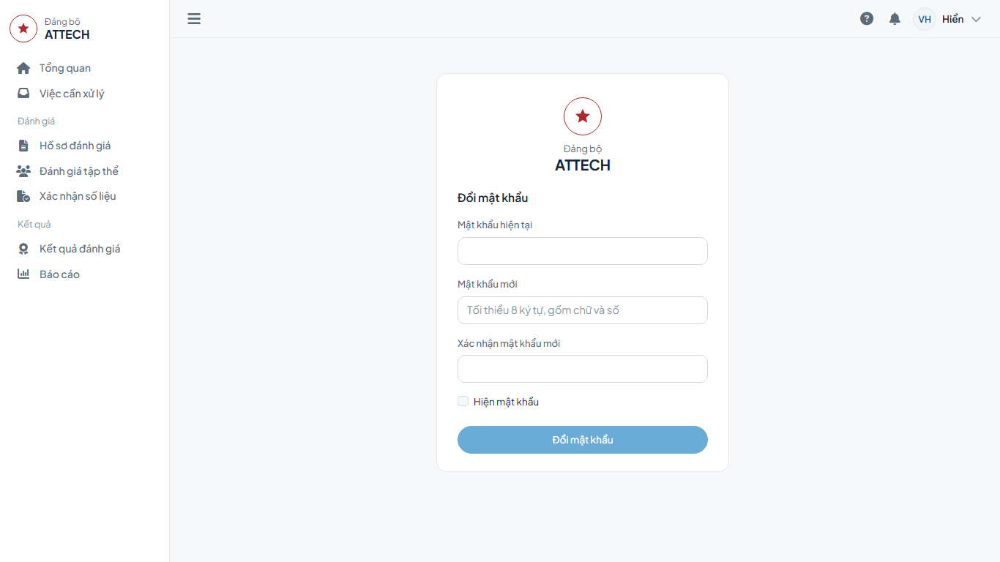

**Lưu ý:**
- Sai mật khẩu 5 lần liên tiếp: tài khoản khóa 15 phút; chờ hoặc báo Quản trị mở khóa. Quên mật khẩu: báo Quản trị đặt lại.
- Đổi mật khẩu: bấm tên người dùng (góc trên bên phải) → **Tài khoản** → **Mật khẩu**. Đăng xuất: bấm tên người dùng → **Đăng xuất**.

## III. Tổng quan và Việc cần xử lý

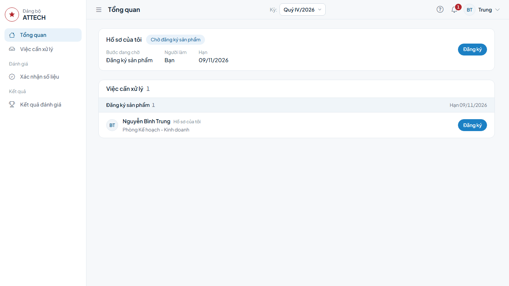

- Thẻ **Hồ sơ của tôi** (trang **Tổng quan**): bước đang chờ, người thực hiện, hạn, số bước đã qua, kết quả kỳ trước (bấm để mở hồ sơ kỳ đó).
- Khối và menu **Việc cần xử lý**: việc đang chờ, chia nhóm, kèm hạn; quá hạn màu đỏ. Bấm nút cuối dòng (**Đăng ký**, **Tự chấm**, **Xác nhận kế hoạch**…) để mở hồ sơ.
- Chuông góc trên bên phải: số đỏ là số việc đang chờ.
- Ô **Kỳ** ở thanh trên chọn kỳ đang xem; có ở Tổng quan, Việc cần xử lý, Hồ sơ đánh giá, Đánh giá tập thể, Xác nhận số liệu, Duyệt kết quả, Kết quả đánh giá, Báo cáo.
- Khối **Lịch kỳ**: hạn từng bước theo diện; bước đang chờ có nhãn **Bạn đang ở đây**. **Xem chi tiết**: ngày hạn theo từng diện quyết định.

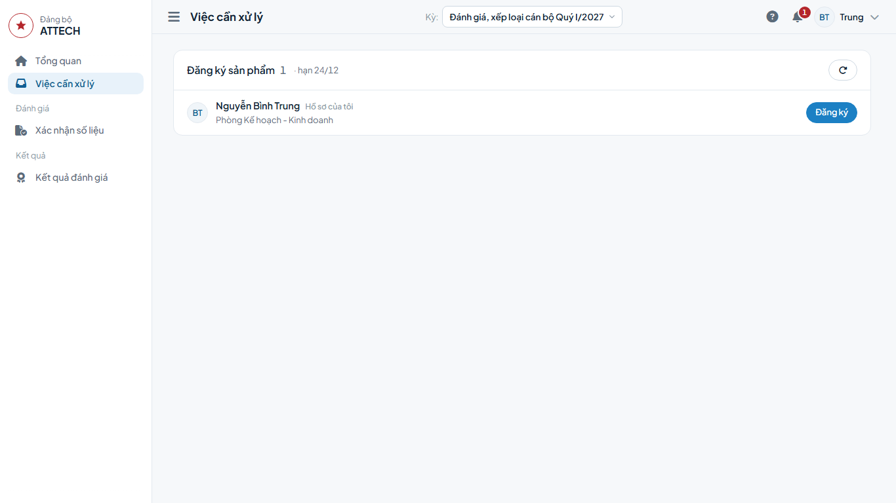

## IV. Đăng ký sản phẩm (Mẫu 01)

**Thời điểm:** khi kỳ mở; hạn tại bước **Đăng ký sản phẩm**.

1. **Việc cần xử lý** → dòng hồ sơ → **Đăng ký**. Khung **Nộp danh mục sản phẩm** có sẵn 3 dòng trống.

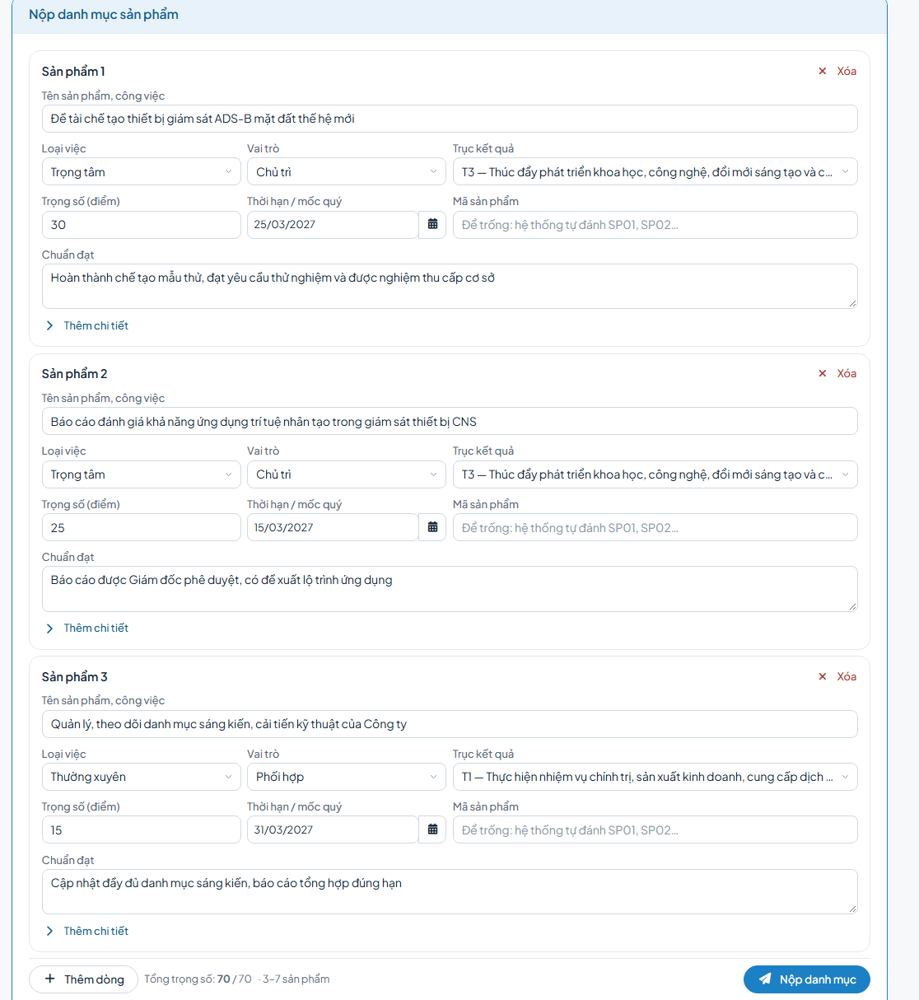

2. Điền từng sản phẩm: **Tên sản phẩm, công việc**; **Loại việc** (Trọng tâm / Thường xuyên); **Vai trò** (Chủ trì / Phối hợp); **Trục kết quả**; **Trọng số (điểm)**; **Thời hạn / mốc quý**; **Chuẩn đạt**; **Mã sản phẩm** (để trống thì tự đánh SP01, SP02… khi lưu; mã đã có giữ nguyên, không trùng trong hồ sơ).
3. Bấm **Thêm chi tiết**, điền **Tiêu chí vượt chuẩn**, **Nguồn dữ liệu / minh chứng**, **Thẩm quyền xác nhận** (bắt buộc cả ba).
4. Thêm sản phẩm: **Thêm dòng**. Bỏ dòng: **Xóa** ở góc dòng.

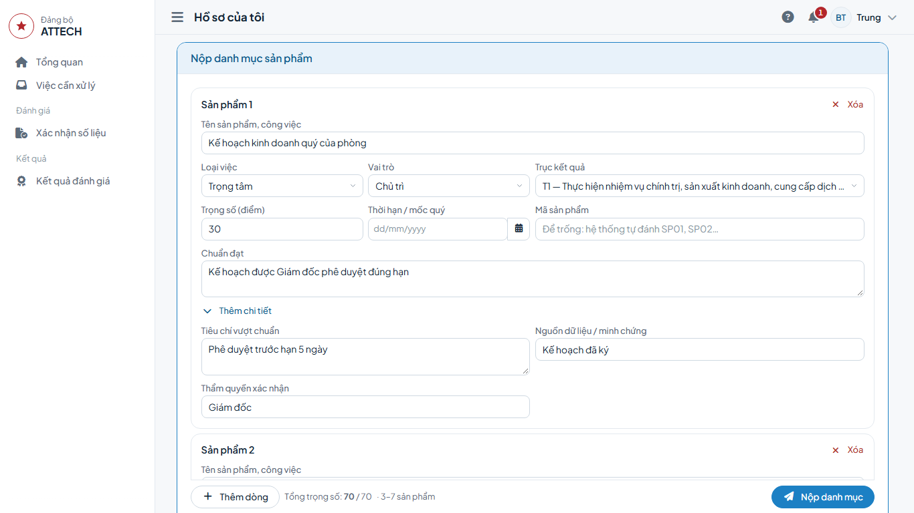

5. Dòng **Tổng trọng số** ở chân khung phải bằng số tối đa (ví dụ **70 / 70**); số sản phẩm cho phép ghi bên cạnh.
6. Bấm **Nộp danh mục** → **Đồng ý**.

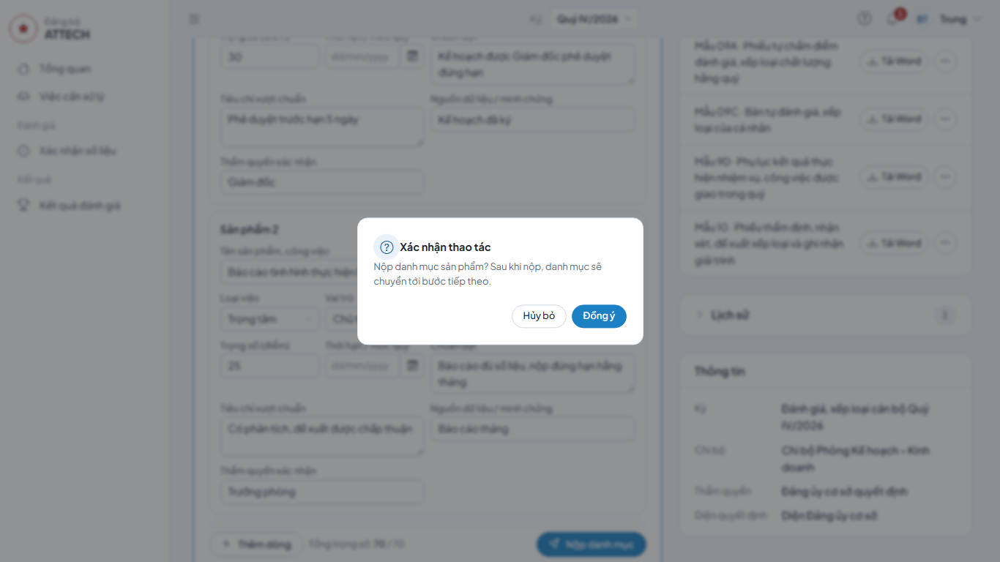

**Kết quả:** danh mục chuyển xét duyệt theo diện; sau khi được duyệt, hồ sơ chuyển sang **Tự chấm điểm, đề xuất mức**.

| Người được đánh giá | Danh mục đi qua |
|---|---|
| Trưởng phòng, Phó phòng và tương đương; Bí thư, Phó Bí thư chi bộ là nhân viên | Trưởng đơn vị gửi → Phòng TCCB-LĐ rà soát, trình → Giám đốc duyệt (trưởng đơn vị thì bỏ bước gửi) |
| Phó Giám đốc | Phòng TCCB-LĐ rà soát, trình → Chủ tịch duyệt |
| Chủ tịch, Giám đốc, Kiểm soát viên | Cấp trên duyệt ngoài hệ thống; Văn phòng Đảng ủy ghi nhận (xem mục V, **Danh mục do cấp trên duyệt**) |

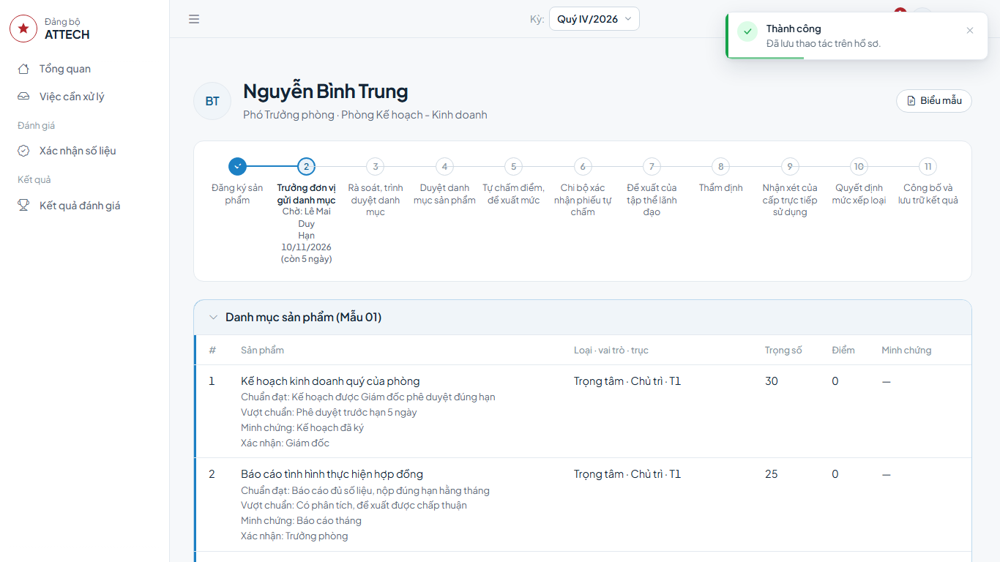

**Lưu ý:**
- Bị **Trả lại danh mục** (người gửi, rà soát hoặc duyệt): hồ sơ hiện lại ở **Việc cần xử lý** với nút **Đăng ký**; sửa theo lý do, **Nộp danh mục** lại; danh mục đi lại từ đầu.
- Bị thu hồi duyệt (ngay sau duyệt, khi chưa nộp phiếu tự chấm): hồ sơ về **Đăng ký sản phẩm**, khung đỏ ghi lý do; sửa, **Nộp danh mục** lại.

## V. Điều chỉnh việc trong quý

**Thời điểm:** sau khi danh mục được duyệt, trước khi nộp phiếu tự chấm. Mỗi lúc chỉ một đề nghị chờ duyệt.

1. Mở hồ sơ → khối **Điều chỉnh việc trong quý** → **Đề nghị điều chỉnh** (việc đã đăng ký) hoặc **Ghi nhận việc đột xuất** (việc mới).
2. Đề nghị điều chỉnh (Mẫu 04): chọn **Việc**, **Loại đề nghị** (**Điều chỉnh việc**, **Chuyển tiếp sang quý sau**, **Loại trừ việc**). **Điều chỉnh việc** thì sửa nội dung cần đổi (tên, chuẩn đạt, trục, vai trò, thời hạn…). Có giấy tờ: **Đính kèm minh chứng** tại **Hồ sơ, minh chứng kèm theo (tùy chọn)**.
3. Việc đột xuất (Mẫu 05): điền tên việc, chuẩn đạt, trục, vai trò, thời hạn, trọng số; mã sản phẩm tự đánh tiếp. Cấp giao việc cũng ghi nhận được việc đột xuất trên hồ sơ.

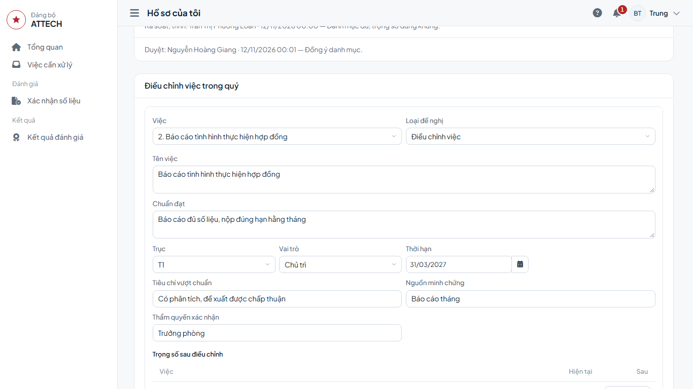

4. Bảng **Trọng số sau điều chỉnh**: nhập cột **Sau**; dòng **Tổng** phải bằng số tối đa.
5. Ghi **Lý do / nguyên nhân** → **Gửi đề nghị**.

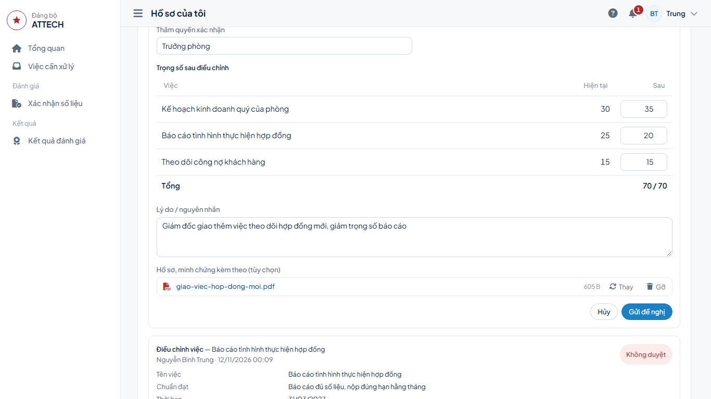

**Kết quả:** đề nghị có nhãn **Chờ duyệt**; người duyệt danh mục (Giám đốc; hồ sơ Phó Giám đốc: Chủ tịch) xét. Duyệt: danh mục cập nhật ngay, nhãn **Đã duyệt**. Không duyệt: nhãn **Không duyệt** kèm lý do. Việc loại trừ, chuyển tiếp vẫn hiện trên phiếu nhưng không chấm điểm. Mỗi đề nghị có phiếu Mẫu 04 (hoặc 05) trong **Biểu mẫu**.

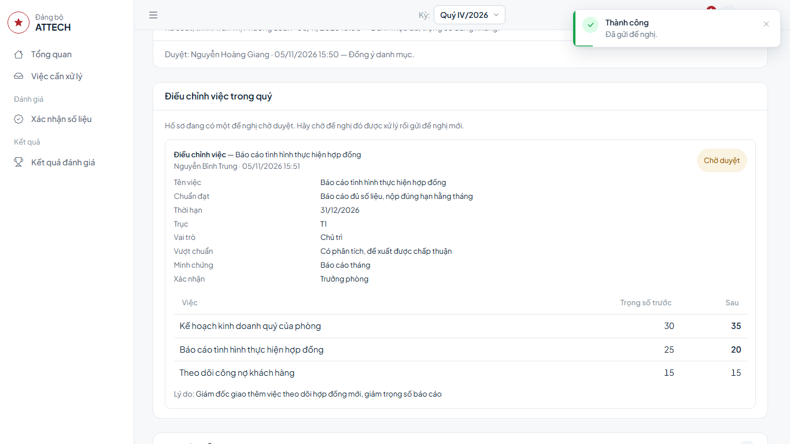

**Danh mục do cấp trên duyệt** (Chủ tịch, Giám đốc, Kiểm soát viên):
- Đang chờ duyệt, cấp trên sửa danh mục: **Cập nhật danh mục** → sửa cho khớp → **Lưu danh mục** (Phòng TCCB-LĐ hoặc Văn phòng Đảng ủy cập nhật thay được).
- Đã duyệt, cấp trên đồng ý điều chỉnh: **Ghi điều chỉnh đã duyệt**, nhập thêm **Cơ quan phê duyệt**, **Số văn bản**, **Ngày văn bản**, đính kèm văn bản nếu có → **Ghi và áp dụng**; danh mục cập nhật ngay.

## VI. Tự chấm điểm (Mẫu 02, 09A, 09C, 9D)

**Thời điểm:** sau khi danh mục được duyệt; hạn tại bước **Tự chấm điểm, đề xuất mức**.

1. **Việc cần xử lý** → dòng hồ sơ → **Tự chấm**. Khung **Nộp phiếu tự chấm** hiện ở đầu trang.

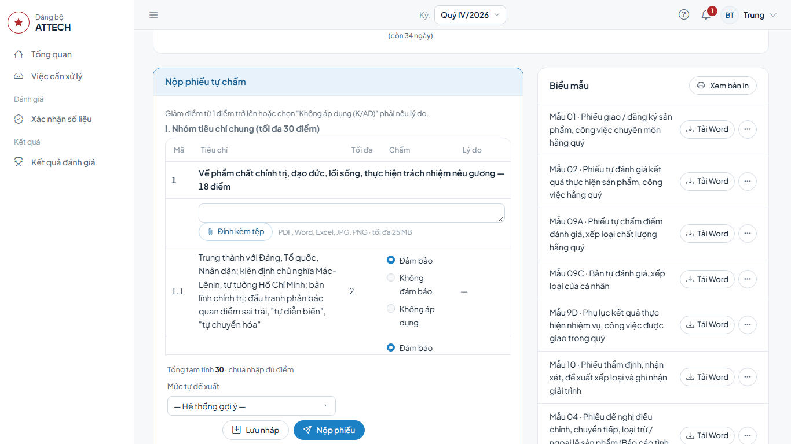

2. **I. Nhóm tiêu chí chung:** chọn **Đảm bảo**, **Không đảm bảo** hoặc **Không áp dụng**; hai lựa chọn sau bắt buộc ghi **Lý do**.
3. **II. Kết quả thực hiện sản phẩm (Mẫu 02):** nhập % ở cả bốn cột **A %**, **B %**, **C %**, **D %**; **Điểm** tự tính. Tham khảo **Thang quy đổi % A-B-C-D** dưới bảng.
4. Sản phẩm vượt chuẩn: tích **Vượt**, bắt buộc đính kèm minh chứng (mục VII).

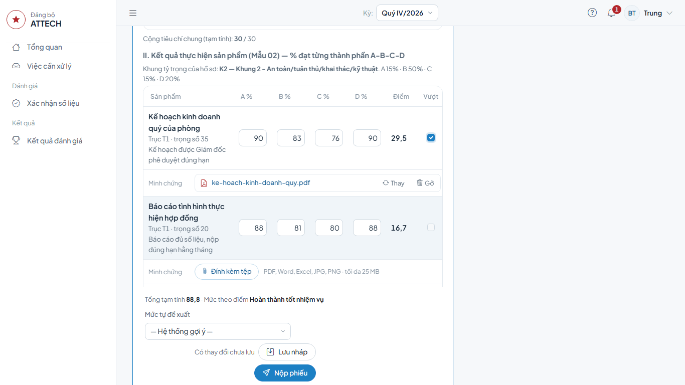

5. **Mẫu 09C**, **Nhiệm vụ và kết quả theo trục (Mẫu 09C, 9D):** việc đã đăng ký được điền sẵn theo trục. Ghi tình hình, kết quả, chọn **Mức** (Mức 1, 2, 3); thêm bằng **Thêm nhiệm vụ**, **Thêm ý**. Phần **Dòng Trục … — Mẫu 9D** ghi **Tình hình thực hiện**, **Sản phẩm hoàn thành**, **Đánh giá tiến độ**, **Thời hạn hoàn thành**, **Ghi chú**; **Lấy tình hình từ nhiệm vụ** để điền nhanh.

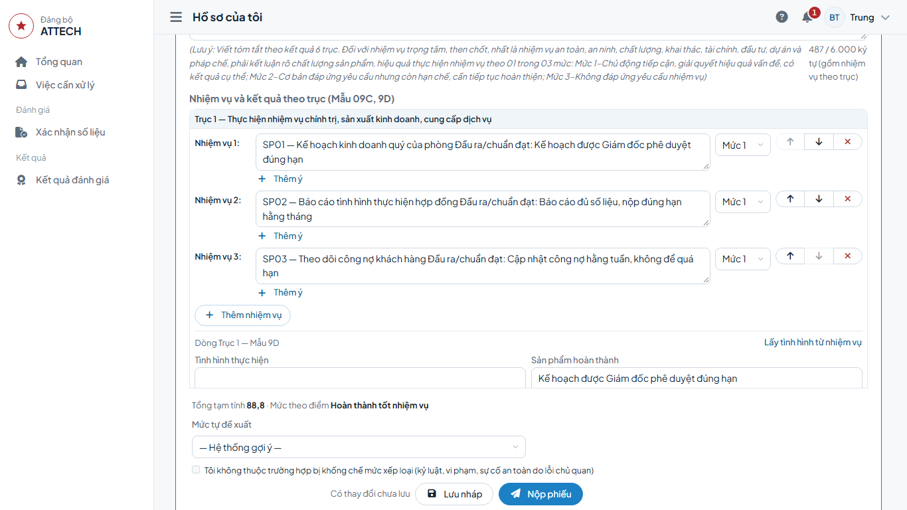

6. Dòng **Tổng tạm tính** ghi điểm và mức theo điểm. **Mức tự đề xuất** để **— Hệ thống gợi ý —** là dùng mức theo điểm; chọn mức khác có thể phải ghi **Lý do đề xuất mức**.
7. Không bị kỷ luật, vi phạm, sự cố an toàn do lỗi chủ quan: tích **Tôi không thuộc trường hợp bị khống chế mức xếp loại** (dùng khi xét **Hoàn thành xuất sắc**, in ở Mẫu 09A).
8. **Xem trước bản in** để xem đoạn văn sẽ in.

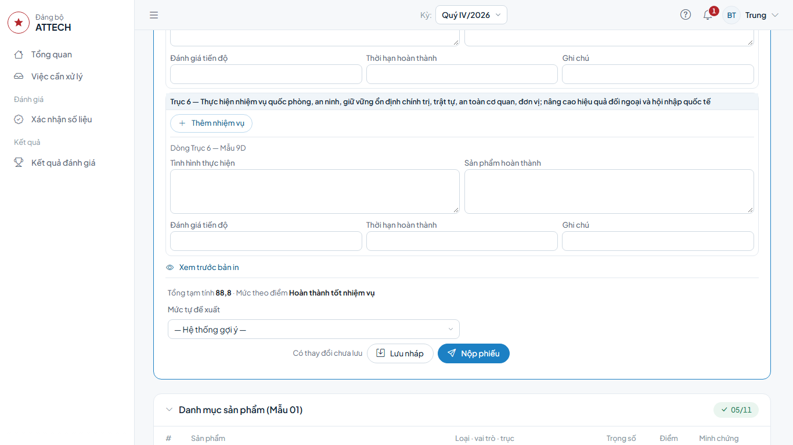

9. Chưa xong: **Lưu nháp** (cạnh nút ghi "Có thay đổi chưa lưu" khi còn nội dung chưa lưu).
10. Xong: **Nộp phiếu**; hộp **Nộp phiếu tự chấm** ghi tổng điểm, mức đề xuất, sản phẩm chưa có minh chứng → **Nộp phiếu**.

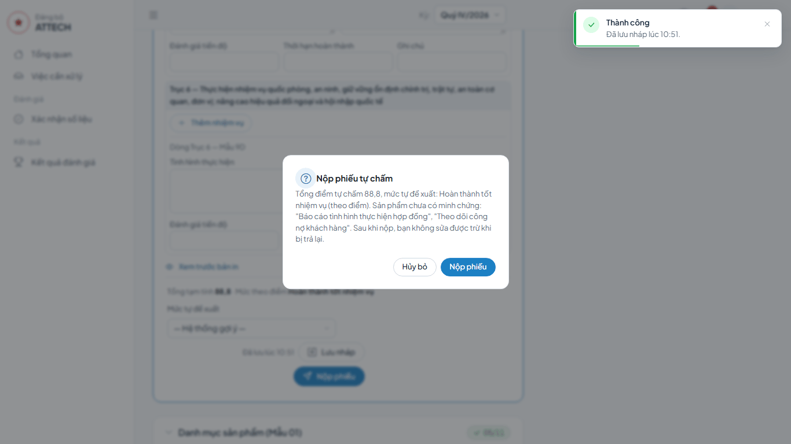

**Kết quả:** chuyển sang **Chi bộ xác nhận phiếu tự chấm**; phiếu không sửa được, trừ khi bị trả lại.

## VII. Đính kèm minh chứng

**Thời điểm:** trong phiếu tự chấm, trước khi nộp.

1. Bấm **Đính kèm tệp** ở dòng **Minh chứng** dưới sản phẩm, hoặc dưới tên nhóm tiêu chí (minh chứng chung của nhóm).
2. Chọn tệp PDF, Word, Excel, JPG, PNG, tối đa 25 MB.

**Kết quả:** tệp hiện tên kèm **Thay**, **Gỡ**.

**Lưu ý:**
- Chưa nộp phiếu (kể cả bị trả lại): thêm, thay, gỡ tự do. Đã nộp: chỉ thêm tệp mới.
- Kỳ khóa dữ liệu (trừ hồ sơ mở riêng) hoặc đã công bố: không đính kèm được; sau công bố gửi tệp kèm kiến nghị (mục XI).
- Báo sai định dạng: lưu lại thành PDF hoặc ảnh rồi đính kèm.

## VIII. Hồ sơ bị trả lại

- Chi bộ hoặc Phòng TCCB-LĐ trả lại: đầu trang có khung đỏ **Bị trả lại:** kèm lý do; **Việc cần xử lý** có nút **Tự chấm**. Sửa → **Nộp phiếu** lại.
- Trả lại ở bước thẩm định: nộp lại thì đi lại Chi bộ xác nhận, đề xuất của tập thể, thẩm định.
- Kỳ khóa dữ liệu: đầu trang ghi **Hồ sơ được mở riêng đến …**; nộp trước hạn đó, quá hạn thì báo Phòng TCCB-LĐ gia hạn.

## IX. Giải trình sau thẩm định

**Thời điểm:** sau thẩm định, trước quyết định; không bắt buộc.

1. Mở hồ sơ → khối **Giải trình của cá nhân** → **Ghi giải trình** (điểm thẩm định chênh nhiều so với tự chấm thì khối nhắc số điểm chênh).
2. Ghi nội dung → **Lưu**.

**Kết quả:** giải trình hiện kèm tên, thời gian; in vào phiếu thẩm định (Mẫu 10).

## X. Xem kết quả

**Thời điểm:** sau khi Văn phòng Đảng ủy công bố.

- Trang hồ sơ hiện mức xếp loại chính thức.
- Menu **Kết quả đánh giá**: kết quả được phép xem; dòng của mình có nhãn **Của tôi**, không đánh giá trong kỳ thì ghi **Chưa xếp loại**.

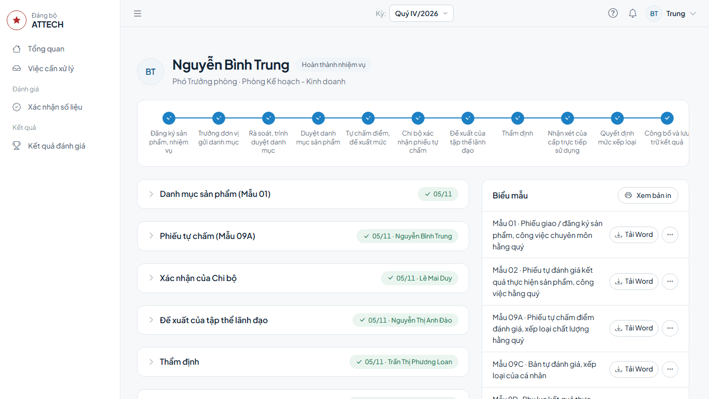

## XI. Gửi kiến nghị

**Thời điểm:** sau công bố, khi không đồng ý kết quả.

1. Mở hồ sơ (từ **Tổng quan** hoặc **Kết quả đánh giá**) → khối **Kiến nghị** → **Gửi kiến nghị**.
2. Ghi **Nội dung kiến nghị**, tích bước tại **Kiến nghị liên quan tới bước**, đính kèm minh chứng nếu có → **Gửi kiến nghị**.

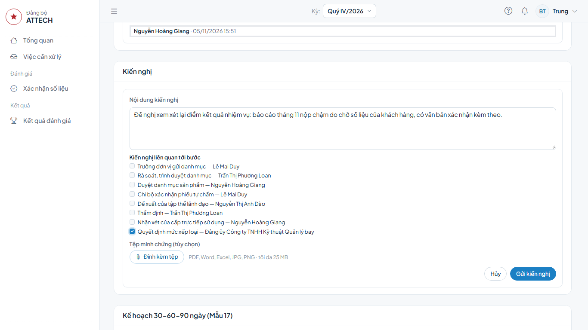

**Kết quả:** kiến nghị ghi "Đã gửi, chờ xem xét"; kết quả trong danh sách ghi "Đang xem xét kiến nghị".

**Lưu ý:**
- Mỗi lúc chỉ một kiến nghị; có trả lời mới gửi kiến nghị khác.
- Có trả lời: chuông có nhóm **Kiến nghị đã trả lời**; **Việc cần xử lý** có nhóm **Kiến nghị đã được trả lời** → **Xem trả lời**; nội dung hiện trong khối **Kiến nghị**.

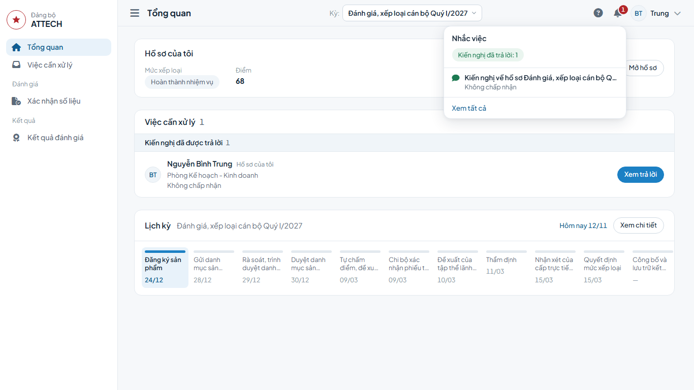

## XII. Xác nhận kế hoạch khắc phục 30-60-90 ngày (Mẫu 17)

**Thời điểm:** khi xếp loại **Hoàn thành nhiệm vụ** hoặc **Không hoàn thành nhiệm vụ**, sau khi lãnh đạo đơn vị lập và cấp trên duyệt kế hoạch.

1. **Việc cần xử lý** → nhóm **Kế hoạch chờ bạn xác nhận** → **Xác nhận kế hoạch**.
2. Đọc khối **Kế hoạch 30-60-90 ngày (Mẫu 17)**: hạn chế, mục tiêu, biện pháp từng mốc 30, 60, 90 ngày.
3. Ghi **Ý kiến** (nếu có) → **Xác nhận cam kết khắc phục**.

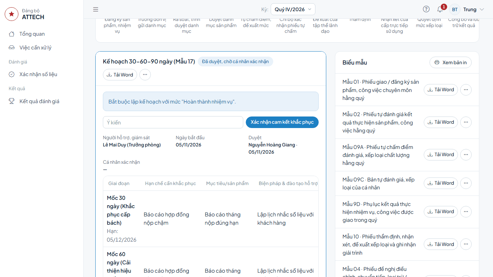

**Kết quả:** dòng **Cá nhân xác nhận** ghi tên, ngày; **Tải Word** ở đầu khối để tải kế hoạch.

## XIII. Tải biểu mẫu

1. Bấm **Biểu mẫu** ở đầu trang hồ sơ (cạnh họ tên).
2. Bấm **Tải Word** cạnh mẫu; **⋯** có **Tải PDF** và **Excel** (Mẫu 01, 02, 09A, 9D, 10). **Xem bản in**: xem trước trên màn hình.

**Lưu ý:** có phiếu Mẫu 04, 05 cho mỗi đề nghị điều chỉnh, việc đột xuất. Hồ sơ do cấp trên thẩm định không có Mẫu 10.
