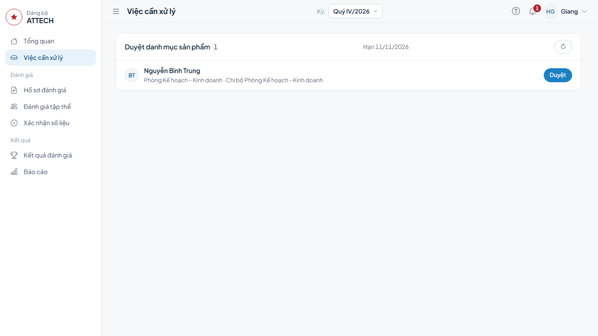
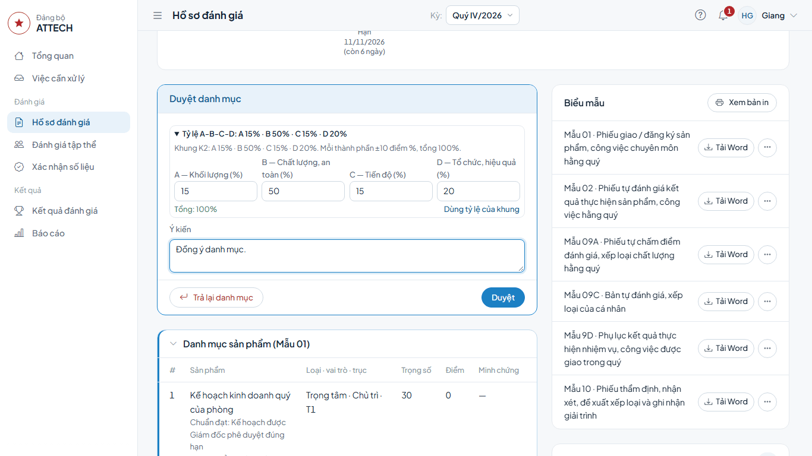
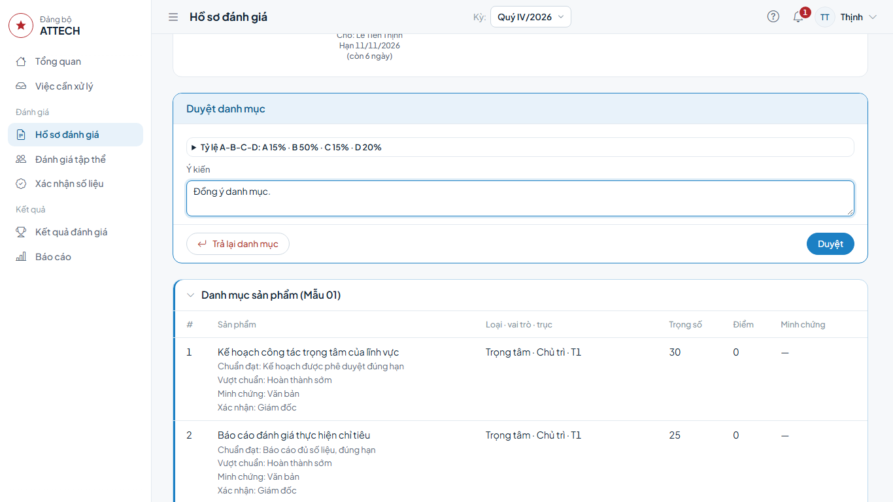
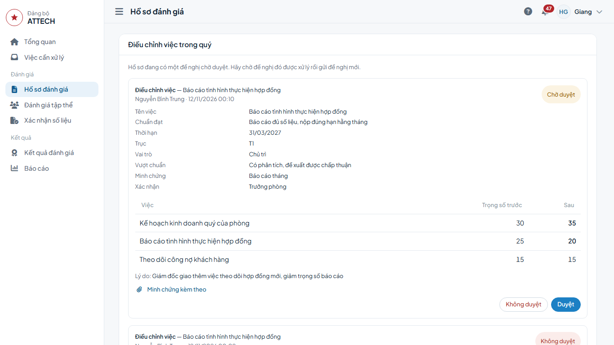
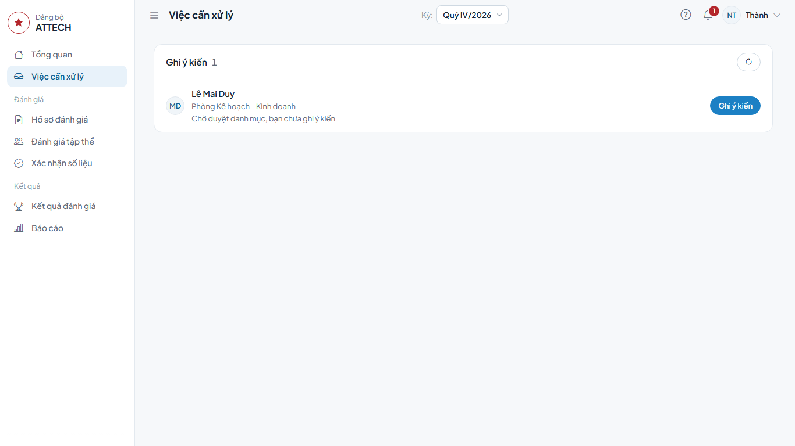

# Hướng dẫn cho Giám đốc, Chủ tịch (cấp trực tiếp sử dụng)

Dành cho:

- **Giám đốc**: duyệt danh mục sản phẩm, duyệt điều chỉnh việc và nhận xét hồ sơ Trưởng phòng, Phó phòng và tương đương;
- **Chủ tịch**: duyệt danh mục và nhận xét hồ sơ Phó Giám đốc;
- **Phó Giám đốc phụ trách**: ghi ý kiến về danh mục, về mức đề xuất của cán bộ thuộc lĩnh vực mình phụ trách (mục 4).

Hồ sơ của chính bạn: làm theo [Hướng dẫn cho người được đánh giá](can-bo.md).

Gặp lỗi hoặc chỗ khó hiểu: ghi vào phiếu góp ý `phieu-gop-y.xlsx`.

## Cần biết trước

- Việc chờ bạn ở **Việc cần xử lý**; chuông góc trên bên phải cho biết số việc.
- Việc được giao cho người ở cấp gần hồ sơ nhất. Khi người đó vắng, bạn (cấp trên) vẫn mở hồ sơ và làm được: menu **Hồ sơ đánh giá** → tìm hồ sơ → mở.
- Không ai làm bước trên hồ sơ của chính mình.

## 1. Duyệt danh mục sản phẩm

**Khi nào:** sau khi Phòng TCCB-LĐ trình duyệt; hạn ở bước **Duyệt danh mục sản phẩm**.

1. **Việc cần xử lý** → nhóm **Duyệt danh mục sản phẩm** → dòng cán bộ → bấm **Duyệt**.

2. Xem khối **Danh mục sản phẩm (Mẫu 01)**; dưới danh mục ghi ai đã gửi, ai đã rà soát, trình và ý kiến của họ. Phó Giám đốc phụ trách đã ghi ý kiến thì đọc ở khối **Ý kiến trước phê duyệt** cuối trang.
3. Ở khung **Duyệt danh mục**: dòng **Tỷ lệ A-B-C-D** là khung tỷ trọng của hồ sơ. Cần điều chỉnh thì bấm vào dòng đó, sửa các ô % (trong giới hạn ghi bên trên, tổng 100%); bấm **Dùng tỷ lệ của khung** để trả về như cũ.
4. Ghi **Ý kiến** (nếu có) → bấm **Duyệt** → **Đồng ý**.

Danh mục của Phó Giám đốc do Chủ tịch duyệt, cách làm như trên.

**Xong thì thấy:** thanh tiến trình chuyển sang **Tự chấm điểm, đề xuất mức**; dưới danh mục ghi **Duyệt:** tên bạn.

**Duyệt nhầm:** mở lại hồ sơ → khung **Thu hồi duyệt danh mục** → **Thu hồi duyệt** → **Đồng ý**. Chỉ người đã bấm duyệt làm được, khi kỳ đang mở, ngay sau khi duyệt và trước khi cán bộ nộp phiếu tự chấm (chưa có điều chỉnh việc nào). Hồ sơ về cán bộ ở bước đăng ký; cán bộ nộp lại thì danh mục đi lại các bước gửi, rà soát, duyệt.

**Danh mục chưa đạt:** bấm **Trả lại danh mục** → ghi **Lý do (bắt buộc)** → **Trả lại**. Hồ sơ về cán bộ để sửa và nộp lại.

### Duyệt điều chỉnh việc trong quý

Khi cán bộ gửi đề nghị điều chỉnh việc, việc hiện ở **Việc cần xử lý**, nhóm **Duyệt điều chỉnh việc** → bấm **Duyệt điều chỉnh**.

1. Ở khối **Điều chỉnh việc trong quý**, đọc đề nghị: nội dung mới, bảng **Trọng số trước** / **Sau**, **Lý do**.
2. Đồng ý thì bấm **Duyệt**. Không đồng ý: bấm **Không duyệt**, ghi **Lý do không duyệt** → bấm **Không duyệt** lần nữa.

**Xong thì thấy:** đề nghị đổi nhãn **Đã duyệt**, danh mục của cán bộ cập nhật ngay.

**Giao việc đột xuất (Mẫu 05):** khi bạn giao thêm việc cho cán bộ sau khi danh mục đã duyệt, mở hồ sơ cán bộ → khối **Điều chỉnh việc trong quý** → **Ghi nhận việc đột xuất** → điền việc mới, bảng **Trọng số sau điều chỉnh**, **Lý do / nguyên nhân** → **Gửi đề nghị**, rồi bấm **Duyệt** đề nghị đó.

## 2. Nhận xét của cấp trực tiếp sử dụng

**Khi nào:** sau khi Phòng TCCB-LĐ thẩm định. Hồ sơ Phó Giám đốc không thẩm định trong hệ thống: Chủ tịch nhận xét ngay sau đề xuất của tập thể lãnh đạo Công ty. Hồ sơ Bí thư, Phó Bí thư chi bộ là nhân viên không có bước này.

1. **Việc cần xử lý** → nhóm **Nhận xét của cấp trực tiếp sử dụng** → dòng cán bộ → bấm **Nhận xét**.

2. Xem các khối bên dưới: **Phiếu tự chấm (Mẫu 09A)**, **Xác nhận của Chi bộ**, **Đề xuất của tập thể lãnh đạo**, **Thẩm định**. Bấm tiêu đề khối để mở. Kết luận điều kiện Hoàn thành xuất sắc và khống chế mức xem ở phiếu thẩm định (nút **Biểu mẫu** → Mẫu 10). Cán bộ đã giải trình thì đọc ở khối **Ý kiến và giải trình**.
3. Trong khung **Nhận xét**: ô **Mức đề xuất** đã điền sẵn mức thẩm định (hoặc mức sau họp thống nhất), đổi nếu bạn đề xuất khác; ghi **Nhận xét**. Ô **Nhận xét** có dấu \* thì phải nêu lý do vì mức khác mức theo điểm.
4. Bấm **Ghi nhận nhận xét** → **Đồng ý**.

**Xong thì thấy:** hồ sơ chuyển sang **Quyết định mức xếp loại**, chờ Văn phòng Đảng ủy (hồ sơ Phó Giám đốc: chờ Văn phòng Đảng ủy ghi nhận quyết định của cấp trên).

Hồ sơ Chủ tịch, Giám đốc, Kiểm soát viên: duyệt danh mục, thẩm định, nhận xét, quyết định đều do cấp trên làm; Văn phòng Đảng ủy ghi nhận kết quả, bạn không làm bước nào trên các hồ sơ này.

## 3. Duyệt kế hoạch khắc phục 30-60-90 ngày (Mẫu 17)

**Khi nào:** sau khi công bố, lãnh đạo đơn vị đã lập kế hoạch cho cán bộ xếp loại **Hoàn thành nhiệm vụ** hoặc **Không hoàn thành nhiệm vụ**.

1. **Việc cần xử lý** → nhóm **Kế hoạch 30-60-90 ngày** → dòng ghi "Kế hoạch đang lập, chưa duyệt" → bấm **Duyệt kế hoạch**.
2. Đọc kế hoạch trong khối **Kế hoạch 30-60-90 ngày (Mẫu 17)**.
3. Đồng ý thì bấm **Duyệt kế hoạch**. Cần sửa thì báo người lập.

**Xong thì thấy:** kế hoạch ghi **Đã duyệt, chờ cá nhân xác nhận**; dòng **Duyệt** có tên bạn.

## 4. Ghi ý kiến trước phê duyệt (Phó Giám đốc phụ trách)

**Khi nào:** trước khi Giám đốc duyệt danh mục, hoặc trước khi Giám đốc nhận xét. Ý kiến không chặn bước nào; người duyệt đọc ý kiến trên hồ sơ.

1. **Việc cần xử lý** → nhóm **Ghi ý kiến** → bấm **Ghi ý kiến** ở dòng cán bộ (hoặc mở hồ sơ từ menu **Hồ sơ đánh giá**). Dòng ghi bước đang chờ, ví dụ "Chờ duyệt danh mục, bạn chưa ghi ý kiến".

2. Khối **Ý kiến trước phê duyệt** → bấm **Ghi ý kiến**.
3. Loại ý kiến đã chọn sẵn theo bước của hồ sơ (**về danh mục** hoặc **về đề xuất mức**); đổi nếu cần.
4. Ghi **Nội dung ý kiến** → bấm **Lưu**.

