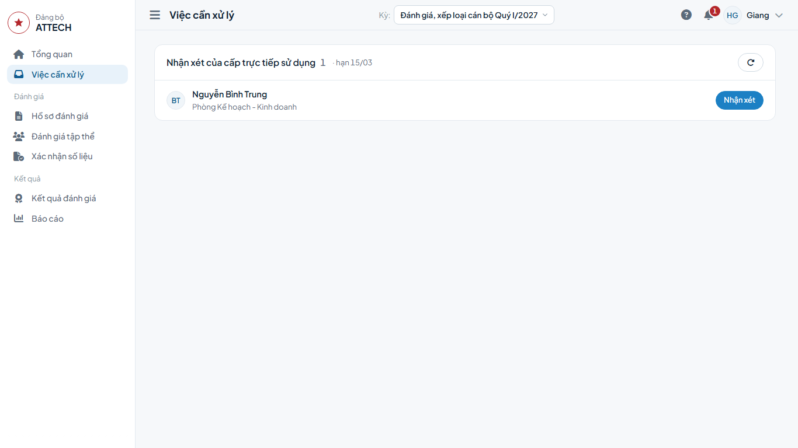
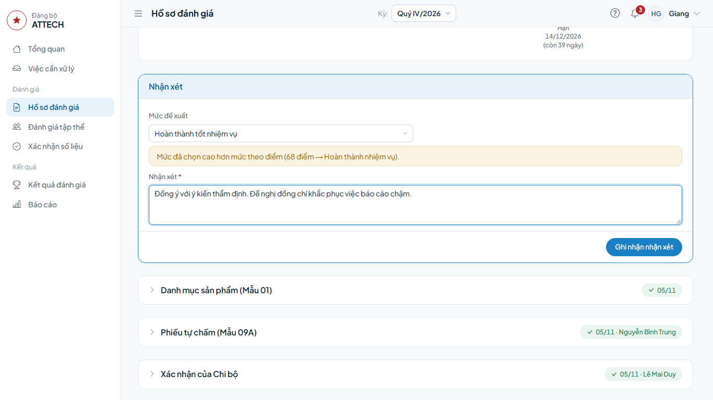
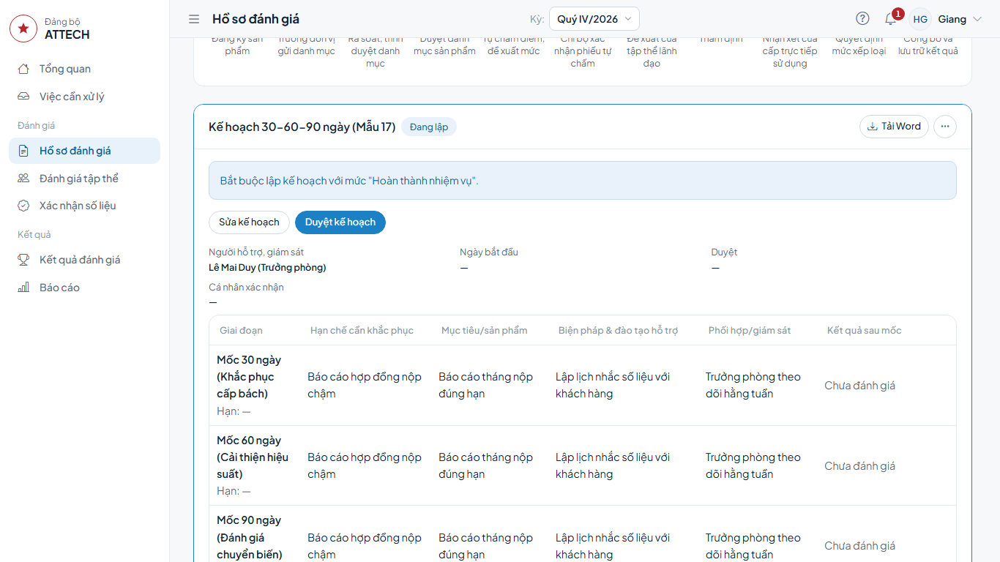
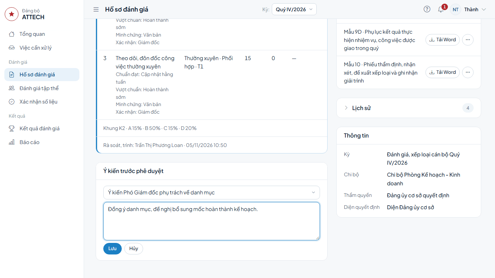

# Hướng dẫn cho Giám đốc, Chủ tịch (cấp trực tiếp sử dụng)

Dành cho:

- **Giám đốc**: duyệt danh mục sản phẩm và nhận xét hồ sơ Trưởng phòng, Phó phòng và tương đương;
- **Chủ tịch**: duyệt danh mục và nhận xét hồ sơ Phó Giám đốc;
- **Phó Giám đốc phụ trách**: ghi ý kiến về danh mục, về mức đề xuất của cán bộ thuộc lĩnh vực mình phụ trách (mục 4).

Hồ sơ của chính bạn: làm theo [Hướng dẫn cho người được đánh giá](can-bo.md).

Gặp lỗi hoặc chỗ khó hiểu: ghi vào phiếu góp ý `phieu-gop-y.xlsx`.

## Cần biết trước

- Việc chờ bạn ở **Việc cần xử lý**; chuông góc trên bên phải cho biết số việc.
- Việc được giao cho người ở cấp gần hồ sơ nhất. Khi người đó vắng, bạn (cấp trên) vẫn mở hồ sơ và làm được: menu **Hồ sơ đánh giá** → tìm hồ sơ → mở.
- Không ai làm bước trên hồ sơ của chính mình.

## 1. Duyệt danh mục sản phẩm

(đang cập nhật)

## 2. Nhận xét của cấp trực tiếp sử dụng

**Khi nào:** sau khi Phòng TCCB-LĐ thẩm định.

1. **Việc cần xử lý** → nhóm **Nhận xét của cấp trực tiếp sử dụng** → dòng cán bộ → bấm **Nhận xét**.

2. Xem các khối bên dưới: **Phiếu tự chấm (Mẫu 09A)**, **Xác nhận của Chi bộ**, **Đề xuất của tập thể lãnh đạo**, **Thẩm định**. Bấm tiêu đề khối để mở.
3. Trong khung **Nhận xét, đề xuất**: ô **Mức đề xuất** đã điền sẵn mức thẩm định, đổi nếu bạn đề xuất khác; ghi **Nhận xét**.
4. Bấm **Ghi nhận nhận xét** → **Đồng ý**.

**Xong thì thấy:** hồ sơ chuyển sang **Quyết định mức xếp loại**, chờ Văn phòng Đảng ủy.

## 3. Duyệt kế hoạch khắc phục 30-60-90 ngày (Mẫu 17)

**Khi nào:** sau khi công bố, lãnh đạo đơn vị đã lập kế hoạch cho cán bộ xếp loại **Hoàn thành nhiệm vụ** hoặc **Không hoàn thành nhiệm vụ**.

1. **Việc cần xử lý** → nhóm **Kế hoạch 30-60-90 ngày** → dòng ghi "Kế hoạch đang lập, chưa duyệt" → bấm **Duyệt kế hoạch**.
2. Đọc kế hoạch trong khối **Kế hoạch 30-60-90 ngày (Mẫu 17)**.
3. Đồng ý thì bấm **Duyệt kế hoạch**. Cần sửa thì bấm **Sửa kế hoạch**, sửa rồi **Lưu kế hoạch**.

**Xong thì thấy:** kế hoạch ghi **Đã duyệt, chờ cá nhân xác nhận**; dòng **Duyệt** có tên bạn.

## 4. Ghi ý kiến trước phê duyệt (Phó Giám đốc phụ trách)

**Khi nào:** trước khi Giám đốc duyệt danh mục, hoặc trước khi quyết định mức. Ý kiến không chặn bước nào; người duyệt đọc ý kiến trên hồ sơ.

1. Mở hồ sơ: menu **Hồ sơ đánh giá** → tìm cán bộ → bấm vào tên.
2. Khối **Ý kiến trước phê duyệt** → bấm **Ghi ý kiến**.
3. Chọn **Loại ý kiến**: **Ý kiến Phó Giám đốc phụ trách về danh mục** hoặc **Ý kiến Phó Giám đốc phụ trách về đề xuất mức**.
4. Ghi **Nội dung ý kiến** → bấm **Lưu**.

