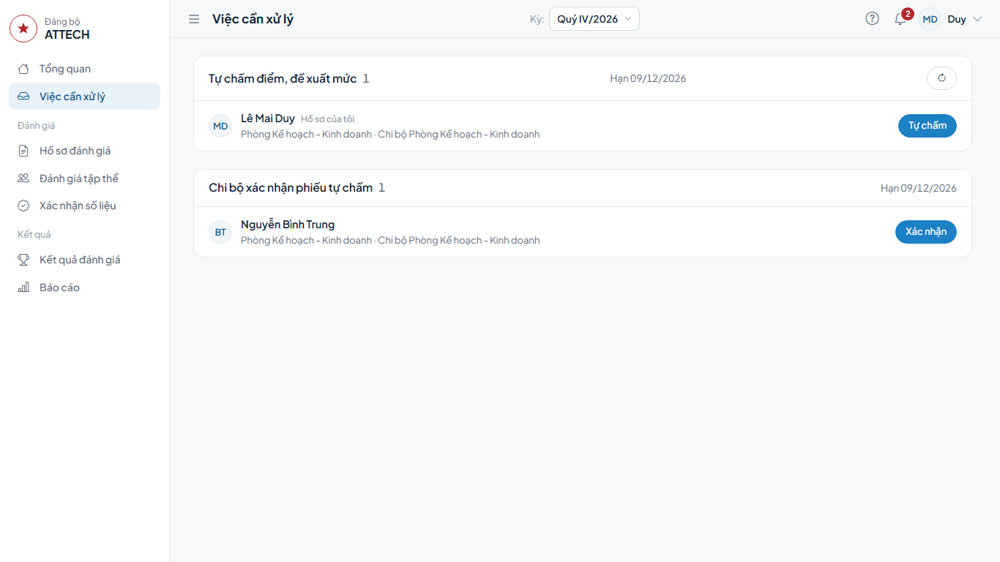
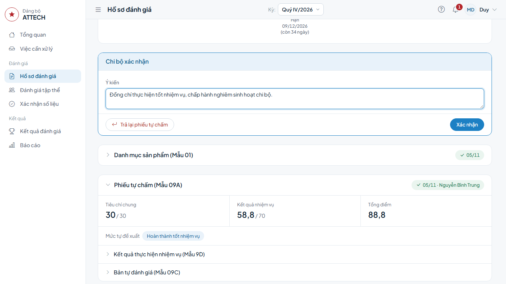
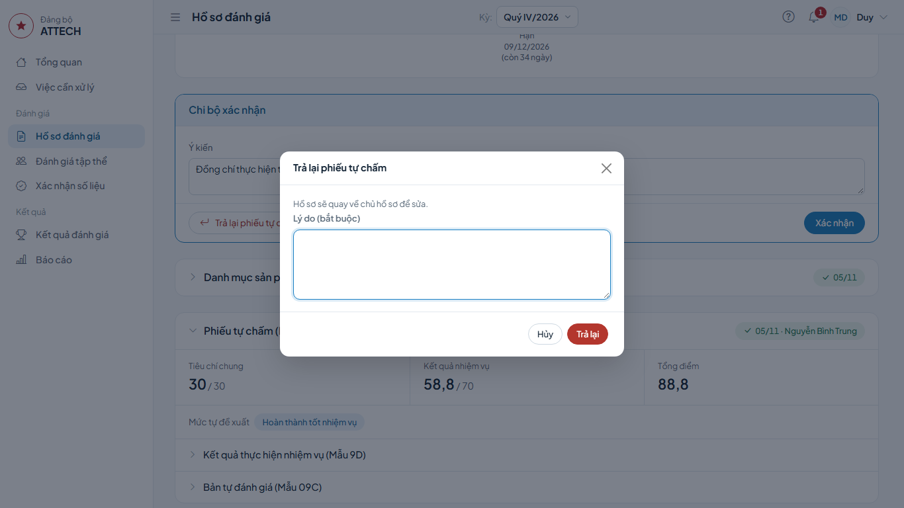

# Hướng dẫn cho Chi bộ

Dành cho Bí thư, Phó Bí thư chi bộ (hoặc người được giao) xác nhận phiếu tự chấm của đảng viên trong chi bộ.

Hồ sơ của chính bạn: làm theo [Hướng dẫn cho người được đánh giá](can-bo.md).

Gặp lỗi hoặc chỗ khó hiểu: ghi vào phiếu góp ý `phieu-gop-y.xlsx`.

## Cần biết trước

- Bạn chỉ xác nhận sau khi cán bộ đã nộp phiếu tự chấm.
- Việc được giao cho người ở cấp gần hồ sơ nhất và hiện ở **Việc cần xử lý** của người đó. Khi người đó vắng, cấp trên vẫn mở hồ sơ và làm được.
- Không ai xác nhận hồ sơ của chính mình. Hồ sơ của Bí thư do Phó Bí thư (hoặc người được giao) xác nhận.

## 1. Xác nhận phiếu tự chấm

**Khi nào:** hồ sơ ở bước **Chi bộ xác nhận phiếu tự chấm**; hạn ghi ở đầu nhóm.

1. Bấm **Việc cần xử lý** → nhóm **Chi bộ xác nhận phiếu tự chấm** → dòng cán bộ → bấm **Xác nhận**.

2. Xem phiếu ở khối **Phiếu tự chấm (Mẫu 09A)** ngay dưới: tiêu chí chung, kết quả nhiệm vụ, tổng điểm, mức tự đề xuất. Bấm **Kết quả thực hiện nhiệm vụ (Mẫu 9D)**, **Bản tự đánh giá (Mẫu 09C)** để mở chi tiết. Muốn xem bản in: nút **Biểu mẫu** ở đầu trang hồ sơ → **Tải Word**, hoặc **Xem bản in**.
3. Trong khung **Chi bộ xác nhận**, ghi **Ý kiến** (nếu có) → bấm **Xác nhận** → **Đồng ý**.

**Xong thì thấy:** khối **Xác nhận của Chi bộ** có dấu tích kèm tên bạn; hồ sơ chuyển sang bước **Đề xuất của tập thể lãnh đạo** (hoặc **Trưởng đơn vị đề xuất**).

## 2. Trả lại để cán bộ sửa

Phiếu còn sai, thiếu:

1. Trong khung **Chi bộ xác nhận**, bấm **Trả lại phiếu tự chấm**.
2. Ghi **Lý do (bắt buộc)**: sai ở đâu, cần sửa gì.
3. Bấm **Trả lại**.

**Xong thì thấy:** hồ sơ quay về cán bộ ở bước tự chấm, kèm lý do bạn ghi. Khi cán bộ nộp lại, hồ sơ lại hiện ở **Việc cần xử lý** của bạn.
