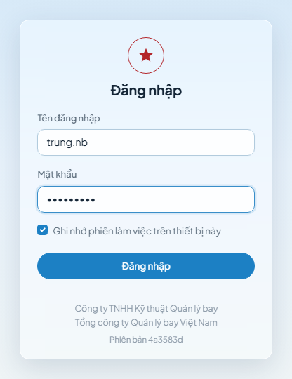
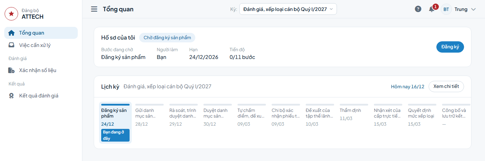
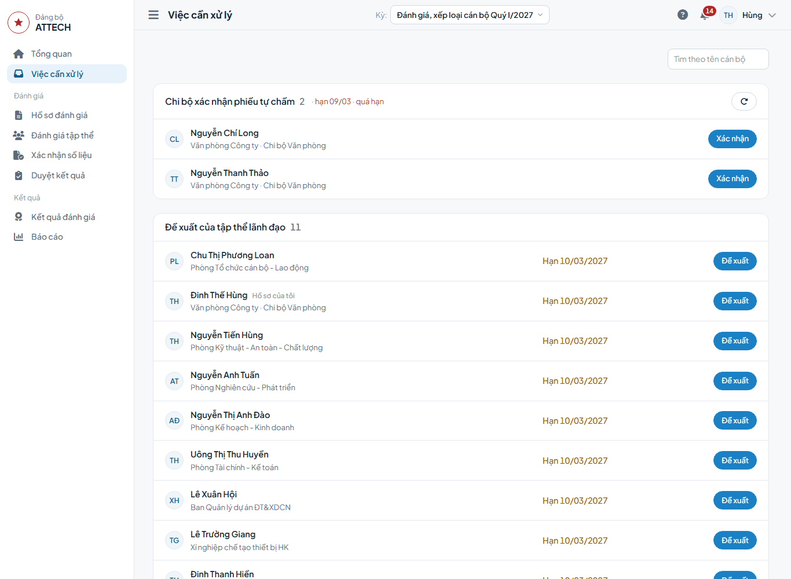
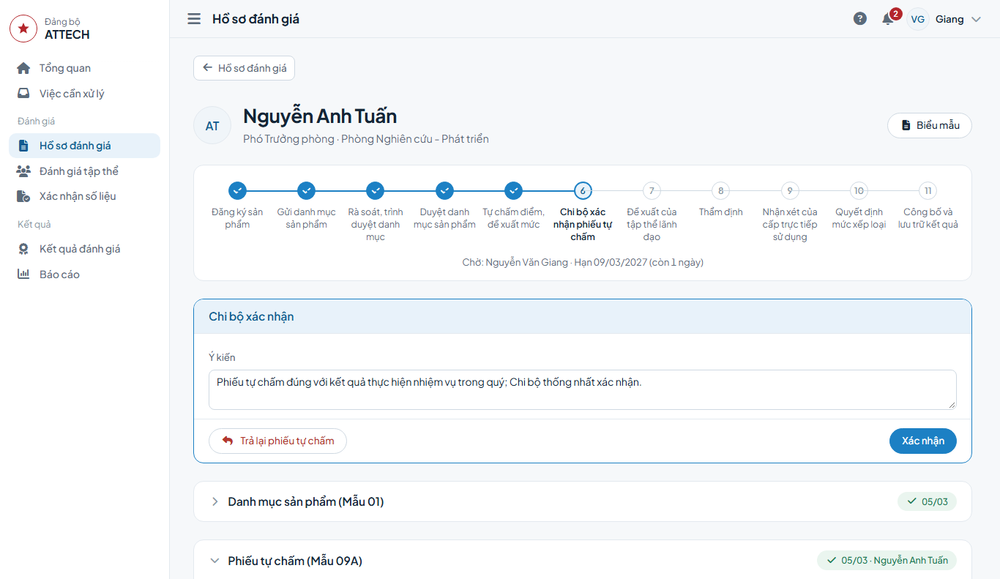

# Hướng dẫn chung

Chương này dành cho mọi người dùng; đọc trước các chương theo vai trò.

## 1. Luồng đánh giá

Mọi hồ sơ đánh giá đi theo 11 bước. Các diện quyết định chỉ khác nhau ở bước nào làm trong hệ thống, bước nào cấp trên làm, bước nào không có. Diện quyết định của từng cán bộ ghi ở khối Thông tin trên trang hồ sơ.

| Bước | Trưởng, Phó phòng và tương đương | Bí thư, Phó Bí thư chi bộ là nhân viên | Phó Giám đốc | Chủ tịch, Giám đốc, Kiểm soát viên |
|---|---|---|---|---|
| 1. Đăng ký sản phẩm (Mẫu 01) | Cán bộ | Cán bộ | Cán bộ | Cán bộ |
| 2. Gửi danh mục | Trưởng đơn vị | Trưởng đơn vị | Không có | Không có |
| 3. Rà soát, trình duyệt danh mục | Phòng TCCB-LĐ | Phòng TCCB-LĐ | Phòng TCCB-LĐ | Không có |
| 4. Duyệt danh mục | Giám đốc | Giám đốc | Chủ tịch | *Cấp trên* (HĐTV Tổng công ty) |
| 5. Tự chấm, đề xuất mức (Mẫu 02, 09A, 09C, 9D) | Cán bộ | Cán bộ | Cán bộ | Cán bộ |
| 6. Chi bộ xác nhận | Chi bộ | Chi bộ | Chi bộ | Chi bộ |
| 7. Đề xuất mức (Mẫu 11, 12, 13) | Tập thể lãnh đạo đơn vị | Trưởng đơn vị đề xuất | Tập thể lãnh đạo Công ty | Tập thể lãnh đạo Công ty |
| 8. Thẩm định (Mẫu 10) | Phòng TCCB-LĐ | Phòng TCCB-LĐ | Không có | *Cấp trên* (Ban Tổ chức Đảng ủy Tổng công ty) |
| 9. Nhận xét của cấp trực tiếp sử dụng | Giám đốc | Không có | Chủ tịch | *Cấp trên* (HĐTV Tổng công ty) |
| 10. Quyết định mức (Mẫu 14, 15A, 15B, Quyết định) | Đảng ủy Công ty | Đảng ủy Công ty | *Cấp trên* (BTV Đảng ủy Tổng công ty) | *Cấp trên* (BTV Đảng ủy Tổng công ty) |
| 11. Công bố (Mẫu 16) | Văn phòng Đảng ủy | Văn phòng Đảng ủy | Văn phòng Đảng ủy | Văn phòng Đảng ủy |

- *Cấp trên*: thực hiện ngoài hệ thống; Văn phòng Đảng ủy ghi nhận kết quả vào hồ sơ.
- Trước khi quyết định mức: họp thống nhất (Mẫu 20), lập phiếu kiểm tra (Mẫu 19).
- Hạn từng bước theo diện quyết định ghi ở khối Lịch kỳ trên trang **Tổng quan**.

Các trường hợp phát sinh:
- Trả lại: ở các bước danh mục thì hồ sơ về đăng ký lại; ở bước Chi bộ xác nhận và thẩm định thì về tự chấm. Người trả lại phải ghi lý do.
- Điều chỉnh trong quý: điều chỉnh việc (Mẫu 04), ghi nhận việc đột xuất (Mẫu 05); người duyệt danh mục xét duyệt.
- Chưa xếp loại: Phòng TCCB-LĐ đánh dấu kèm lý do; hồ sơ bỏ qua các bước, chờ công bố.
- Xác nhận số liệu: khi cần, Phòng TCCB-LĐ lập Mẫu 03 gửi phòng, đơn vị chuyên môn xác nhận.
- Hồ sơ tập thể: Chi bộ, Đảng bộ bộ phận lập Mẫu 06, 07, 08.
- Sau công bố: cán bộ gửi kiến nghị; kiến nghị được chấp nhận thì hồ sơ được mở lại. Cán bộ xếp mức Hoàn thành nhiệm vụ hoặc Không hoàn thành nhiệm vụ có kế hoạch khắc phục (Mẫu 17).

Cách thao tác từng bước ghi trong chương của từng vai trò.

## 2. Đăng nhập, đổi mật khẩu, đăng xuất

### Đăng nhập lần đầu

1. Mở địa chỉ hệ thống do Quản trị cung cấp.
2. Nhập tên đăng nhập và mật khẩu tạm do Quản trị cấp.
3. Máy dùng riêng thì tích ô Ghi nhớ phiên làm việc trên thiết bị này.
4. Bấm **Đăng nhập**.
5. Tại trang Đổi mật khẩu, nhập mật khẩu tạm, mật khẩu mới (hai lần), bấm **Đổi mật khẩu**.

Mật khẩu mới có tối thiểu 8 ký tự, gồm chữ và số.

Sau khi xong: hệ thống mở trang **Tổng quan**.

### Đổi mật khẩu

1. Bấm tên người dùng ở góc trên bên phải, chọn **Tài khoản**.
2. Chọn thẻ **Mật khẩu**.
3. Nhập mật khẩu hiện tại, mật khẩu mới (hai lần), bấm **Đổi mật khẩu**.

Trang Tài khoản còn có thẻ **Thông tin cá nhân** và **Vai trò** (vai trò, phạm vi được giao).

### Đăng xuất

Bấm tên người dùng ở góc trên bên phải, chọn **Đăng xuất**. Máy dùng chung thì đăng xuất sau mỗi lần làm việc.

### Khi phát sinh

- Nhập sai mật khẩu 5 lần liên tiếp thì tài khoản bị khóa 15 phút; chờ hết thời gian hoặc báo Quản trị mở khóa.
- Quên mật khẩu thì báo Quản trị đặt lại mật khẩu tạm.

## 3. Màn hình chính

Thanh trên cùng gồm: nút menu (màn hình hẹp), tên trang, ô Kỳ, nút **Hướng dẫn** (dấu hỏi), chuông **Nhắc việc**, tên người dùng. Menu bên trái chỉ hiện các mục được phân quyền.

| Nhóm menu | Mục |
|---|---|
| (đầu menu) | Tổng quan, Việc cần xử lý |
| Đánh giá | Hồ sơ đánh giá, Đánh giá tập thể, Xác nhận số liệu, Duyệt kết quả |
| Kết quả | Kết quả đánh giá, Báo cáo |
| Thiết lập | Kỳ đánh giá, Bộ tiêu chí, Danh mục tổ chức |
| Hệ thống | Tài khoản, Vai trò, Người thực hiện, Nhập dữ liệu, Nhật ký hệ thống, Thông tin đơn vị, Biểu mẫu Word |

### Tổng quan

- Hồ sơ của tôi (người có hồ sơ trong kỳ): bước đang chờ, người làm, hạn, tiến độ, điểm, kết quả kỳ trước. Đến lượt mình thì nút bên phải ghi tên việc (**Đăng ký**, **Tự chấm**…).
- Việc cần xử lý: việc đang chờ, chia nhóm theo bước. Bấm **Xem tất cả** để mở trang Việc cần xử lý.
- Lịch kỳ: hạn từng bước; bước đang chờ của mình có nhãn Bạn đang ở đây. Bấm **Xem chi tiết** để xem hạn các bước theo từng diện quyết định; diện của mình có nhãn Của bạn.
- Tiến độ trong phạm vi (người xem được hồ sơ của người khác): số hồ sơ, số quá hạn theo tổ chức Đảng; danh sách cán bộ đang quá hạn.

### Việc cần xử lý

- Việc đang chờ chia nhóm theo bước, kèm số lượng và hạn; việc quá hạn ghi màu đỏ.
- Bấm nút cuối dòng (**Đăng ký**, **Tự chấm**, **Xác nhận**, **Thẩm định**…) để mở hồ sơ tại khu thao tác.
- Danh sách dài thì gõ tên vào ô Tìm theo tên cán bộ. Nút làm mới (mũi tên tròn) tải lại danh sách.
- Không còn việc thì trang ghi Không có việc nào đang chờ bạn.

### Chọn kỳ

Ô Kỳ ở thanh trên chọn kỳ đánh giá đang xem. Dữ liệu các trang đánh giá, kết quả, báo cáo đổi theo kỳ được chọn. Kỳ không còn mở thì ghi trạng thái trong ngoặc (ví dụ Khóa dữ liệu, Đã đóng).

### Chuông Nhắc việc

- Số đỏ trên chuông là số việc đang chờ.
- Bấm chuông để xem dòng tổng hợp (quá hạn, sắp tới hạn, kiến nghị, kế hoạch…) và danh sách việc; bấm một việc để mở.
- Bấm **Xem tất cả** để mở trang Việc cần xử lý.

### Nút Hướng dẫn

Bấm nút dấu hỏi ở thanh trên để mở trang Hướng dẫn sử dụng. Chọn chương ở Mục lục; gõ từ cần tìm vào ô Tìm trong hướng dẫn.

## 4. Trang hồ sơ

Mở hồ sơ từ trang **Việc cần xử lý**, **Tổng quan**, **Hồ sơ đánh giá** hoặc **Kết quả đánh giá**.

Đầu trang ghi họ tên, chức vụ, đơn vị, mức xếp loại (sau công bố), nút **Biểu mẫu** và nút **⋯** (thao tác ít dùng, chỉ hiện với người có quyền).

### Thanh tiến trình

- Thanh hiện các bước của diện quyết định; bước không áp dụng không hiện.
- Bước đã qua có dấu tích; bước đang chờ được tô màu; bước cấp trên thực hiện có biểu tượng mũi tên ra ngoài.
- Dòng dưới thanh ghi người đang phải làm (đến lượt mình thì ghi Bạn) và hạn còn lại.
- Rê chuột lên một bước để xem ngày hoàn thành, người thực hiện; bấm vào bước để chuyển tới phần nội dung của bước đó.
- Màn hình hẹp chỉ hiện bước đang chờ và dải tiến độ.

### Dải thông báo

Dải thông báo nằm trên thanh tiến trình, chỉ hiện khi có nội dung.

| Dải | Ý nghĩa | Việc cần làm |
|---|---|---|
| Đỏ, Bị trả lại kèm lý do | Hồ sơ bị trả lại | Sửa theo lý do, nộp lại |
| Xám, Chưa xếp loại kèm lý do | Hồ sơ được đánh dấu chưa xếp loại | Chờ công bố |
| Xanh, Hồ sơ được mở riêng đến … | Kỳ đã khóa dữ liệu, hồ sơ được mở riêng | Hoàn thành trước thời hạn ghi trên dải |
| Vàng, Thời hạn mở riêng hồ sơ đã hết | Hết thời hạn mở riêng | Báo Phòng TCCB-LĐ gia hạn |
| Vàng có biểu tượng khóa | Thao tác chưa thực hiện được (thiếu biên bản, phiếu kiểm tra, còn phiếu xác nhận số liệu đang mở…) | Hoàn thành việc ghi trong lý do |
| Xanh, không có biểu tượng | Lưu ý, không chặn thao tác | Đọc trước khi làm |
| Vàng có nút **Tải lại** | Hồ sơ vừa được người khác thay đổi | Bấm **Tải lại**, kiểm tra rồi làm lại |

### Các khối nội dung

- Khu thao tác ở đầu cột trái, tiêu đề là tên việc đang đến lượt; chỉ hiện khi người xem có việc trên hồ sơ.
- Các khối theo bước: danh mục sản phẩm, phiếu tự chấm, xác nhận của Chi bộ, đề xuất của tập thể lãnh đạo, thẩm định, nhận xét của cấp trực tiếp sử dụng, quyết định và công bố. Bấm tiêu đề để mở hoặc thu gọn.
- Các khối theo việc phát sinh: điều chỉnh việc trong quý, xác nhận số liệu, ý kiến trước phê duyệt (giải trình của cá nhân), kiến nghị, kế hoạch 30-60-90 ngày.
- Cột phải: Biểu mẫu, Lịch sử, Thông tin (Chi bộ, thẩm quyền, diện quyết định).
- Khối Lịch sử ghi từng thao tác: tên thao tác, thời gian, người thực hiện, lý do (khi trả lại, mở lại), mức và điểm trước, sau khi thay đổi. Bấm **Xem tất cả** để xem toàn bộ.

### Tải biểu mẫu của hồ sơ

1. Bấm **Biểu mẫu** ở đầu trang hồ sơ.
2. Bấm **Tải Word** cạnh mẫu cần tải; nút **⋯** cạnh mẫu có **Tải PDF**, **Excel**.
3. Muốn xem trước trên màn hình thì bấm **Xem bản in**.

Biểu mẫu luôn lấy số liệu mới nhất của hồ sơ tại thời điểm tải.

## 5. Biểu mẫu tải ở đâu

Biểu mẫu áp dụng cho kỳ do bộ tiêu chí của kỳ quyết định. Chỉ người có quyền xem dữ liệu tương ứng mới thấy nút tải.

| Mẫu | Tên | Tải ở đâu | Định dạng |
|---|---|---|---|
| 01 | Phiếu giao / đăng ký sản phẩm, công việc chuyên môn hằng quý | Trang hồ sơ, nút **Biểu mẫu** | Word, PDF, Excel |
| 02 | Phiếu tự đánh giá kết quả thực hiện sản phẩm, công việc hằng quý | Trang hồ sơ, nút **Biểu mẫu** | Word, PDF, Excel |
| 03 | Phiếu xác nhận số liệu | Trang phiếu xác nhận số liệu, nút **⋯** | Word, PDF |
| 04 | Phiếu đề nghị điều chỉnh, chuyển tiếp, loại trừ sản phẩm | Trang hồ sơ, nút **Biểu mẫu** (mỗi đề nghị một phiếu) | Word, PDF |
| 05 | Phiếu ghi nhận nhiệm vụ bổ sung, đột xuất | Trang hồ sơ, nút **Biểu mẫu** (mỗi việc một phiếu) | Word, PDF |
| 06, 07 | Báo cáo kết quả tập thể; Báo cáo tự đánh giá của tập thể | **Đánh giá tập thể**, thẻ **Hồ sơ tập thể**, nút **⋯**; hoặc trang **Báo cáo** | Word, PDF |
| 08 | Báo cáo tổng hợp kết quả thực hiện nhiệm vụ của cơ quan, đơn vị | **Đánh giá tập thể**, thẻ **Hồ sơ tập thể**, nút **⋯**; hoặc trang **Báo cáo** | Excel, Word, PDF |
| 09A | Phiếu tự chấm | Trang hồ sơ, nút **Biểu mẫu** | Word, PDF, Excel |
| 09C | Bản tự đánh giá, xếp loại của cá nhân | Trang hồ sơ, nút **Biểu mẫu** | Word, PDF |
| 9D | Phụ lục kết quả thực hiện nhiệm vụ trong quý | Trang hồ sơ, nút **Biểu mẫu** | Word, PDF, Excel |
| 10 | Phiếu thẩm định, nhận xét, đề xuất xếp loại và ghi nhận giải trình | Trang hồ sơ, nút **Biểu mẫu** | Word, PDF, Excel |
| 11 | Phiếu đánh giá, xếp loại cán bộ (phiếu kín) | **Đánh giá tập thể**, thẻ **Biên bản hội nghị**, nút **⋯**; hoặc trang **Báo cáo** | Word, PDF |
| 12, 13 | Biên bản hội nghị; Biên bản kiểm phiếu | **Đánh giá tập thể**, thẻ **Biên bản hội nghị**, nút **⋯** | Word, PDF |
| 14, 15A, 15B | Danh sách đánh giá và đề xuất xếp loại; Tổng hợp kết quả theo mã chức danh | Trang **Báo cáo** | Excel, PDF |
| 16 | Báo cáo kết quả đánh giá, xếp loại chất lượng cán bộ quý | Trang **Báo cáo**, nút **Soạn báo cáo** | Word, PDF |
| 17 | Kế hoạch hỗ trợ, khắc phục và phát triển 30-60-90 ngày | Trang hồ sơ, khối kế hoạch, nút **Tải Word** | Word, PDF |
| 19 | Phiếu kiểm tra | **Duyệt kết quả**, thẻ **Kiểm tra**, nút **⋯** trên trang phiếu | Word, PDF |
| 20 | Biên bản họp thống nhất | **Duyệt kết quả**, thẻ **Họp thống nhất**, nút **⋯** trên trang biên bản | Word, PDF |
| — | Quyết định xếp loại cán bộ của Đảng ủy, kèm phụ lục kết quả | Trang **Báo cáo**, dòng Quyết định | Word, PDF |

- Trên trang Báo cáo, phạm vi gồm nhiều tổ chức thì chọn tổ chức Đảng ở ô phạm vi đầu bảng trước khi tải.
- Tên tệp tải về gồm số mẫu, tên viết tắt đơn vị, họ tên (phiếu cá nhân) và kỳ, viết không dấu.

## 6. Thuật ngữ

| Thuật ngữ | Nghĩa |
|---|---|
| Kỳ đánh giá | Một quý đánh giá; lần lượt ở trạng thái Dự thảo, Đang mở, Khóa dữ liệu, Đã đóng. |
| Khóa dữ liệu | Kỳ đã qua điểm chốt dữ liệu; chỉ làm tiếp được các bước từ thẩm định trở đi. |
| Hồ sơ đánh giá | Hồ sơ của một người được đánh giá trong một kỳ. |
| Diện quyết định | Cách đi của hồ sơ theo nhóm cán bộ: bước nào làm trong hệ thống, bước nào cấp trên làm, bước nào không có, hạn từng bước. |
| Cấp trên thực hiện | Bước do cấp trên làm ngoài hệ thống; Văn phòng Đảng ủy ghi nhận kết quả. |
| Danh mục sản phẩm | Các sản phẩm, công việc cán bộ đăng ký đầu kỳ (Mẫu 01). |
| Trục kết quả | Nhóm phân loại sản phẩm, dùng khi đăng ký và tự đánh giá theo trục (Mẫu 09C, 9D). |
| Phiếu tự chấm | Phiếu tự chấm điểm, xếp loại chất lượng hằng quý (Mẫu 09A). |
| Mức xếp loại | Hoàn thành xuất sắc nhiệm vụ, Hoàn thành tốt nhiệm vụ, Hoàn thành nhiệm vụ, Không hoàn thành nhiệm vụ, Chưa xếp loại. |
| Trả lại | Đưa hồ sơ về bước trước để sửa, kèm lý do. |
| Mở riêng hồ sơ | Cho một hồ sơ làm tiếp khi kỳ đã khóa dữ liệu, có thời hạn. |
| Phạm vi | Phần tổ chức một vai trò được giao: toàn công ty, một đơn vị chính quyền hoặc một tổ chức Đảng (gồm cả cấp dưới). |

## 7. Câu hỏi chung

- Không thấy nút thao tác trên hồ sơ? Chưa đến lượt, việc đã quá hạn hoặc tài khoản không được giao việc ở bước này; xem dòng dưới thanh tiến trình và dải thông báo.
- Không thấy một mục trên menu, hoặc không thấy hồ sơ của kỳ cần làm? Kiểm tra ô Kỳ đã chọn đúng kỳ; menu chỉ hiện mục được phân quyền, cần thêm quyền thì báo Quản trị.
- Đổi mật khẩu báo chưa khớp mật khẩu mới? Tắt bộ gõ tiếng Việt rồi gõ lại; tích Hiện mật khẩu để kiểm tra.
- Tải PDF không thành công? Tải bản Word; báo Quản trị nếu cần bản PDF.
- Gặp lỗi hoặc nội dung khó hiểu? Ghi vào phiếu góp ý, mỗi vấn đề một dòng, kèm ảnh chụp màn hình nếu có.
