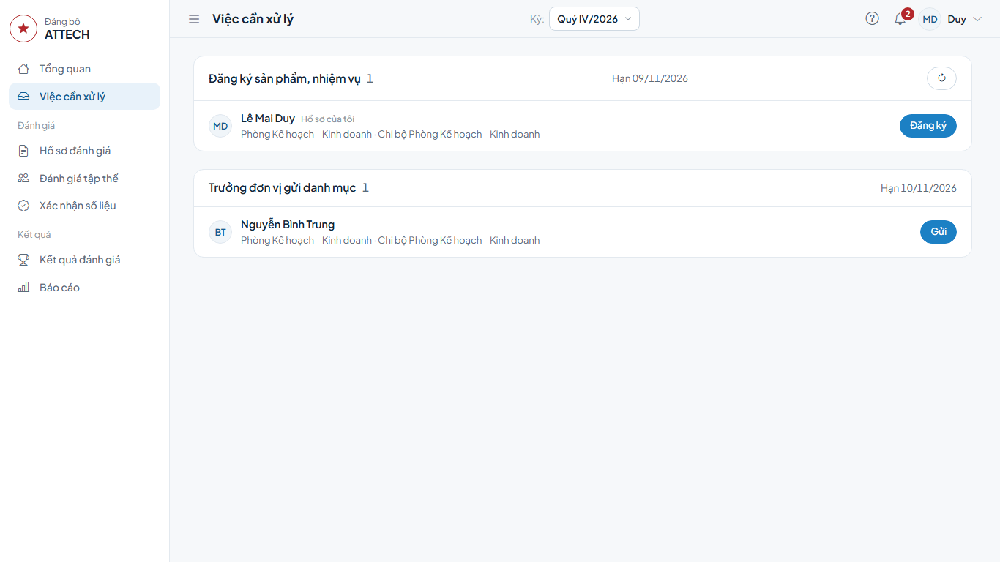
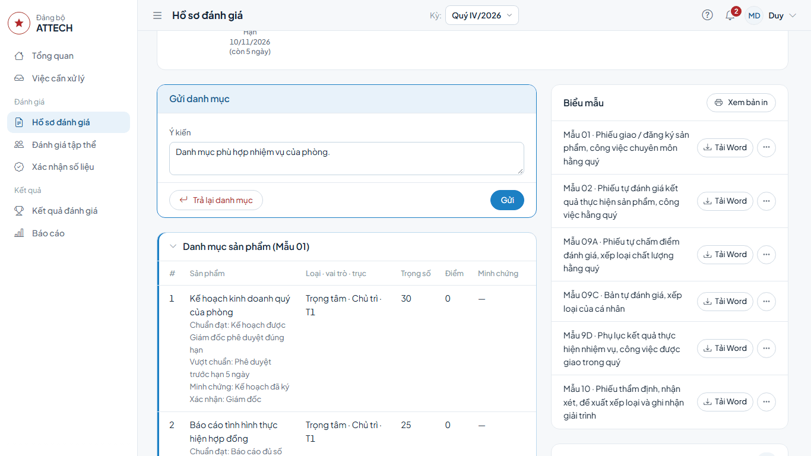
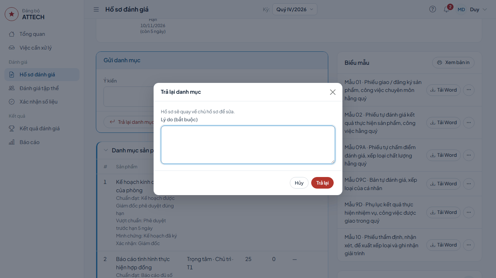
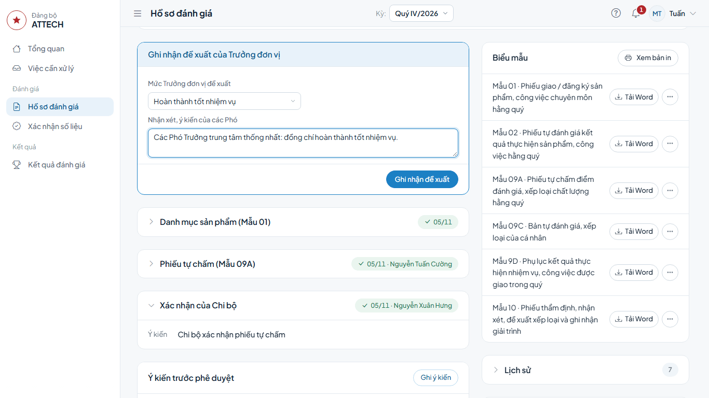
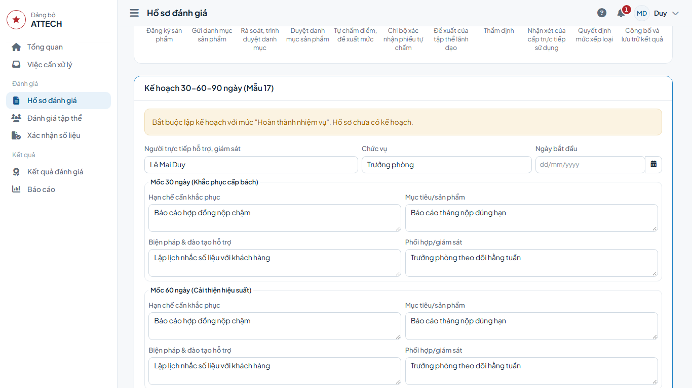

# Hướng dẫn cho lãnh đạo đơn vị

Dành cho Trưởng phòng, Trưởng trung tâm và tương đương. Việc của bạn trên hồ sơ của cán bộ trong đơn vị:

- gửi danh mục sản phẩm của cán bộ lên Phòng TCCB-LĐ (mục 2);
- đề xuất mức cho người là Bí thư/Phó Bí thư chi bộ đồng thời là nhân viên đơn vị, sau khi tập thể lãnh đạo họp, kiểm phiếu (mục 3);
- lập kế hoạch khắc phục 30-60-90 ngày cho người xếp loại thấp (mục 4).

Hồ sơ của chính bạn: làm theo [Hướng dẫn cho người được đánh giá](can-bo.md).

Gặp lỗi hoặc chỗ khó hiểu: ghi vào phiếu góp ý `phieu-gop-y.xlsx`.

## Cần biết trước

- Việc được giao cho người ở cấp gần hồ sơ nhất và hiện ở **Việc cần xử lý** của người đó. Khi người đó vắng, cấp trên vẫn mở hồ sơ và làm được.
- Không ai làm bước xét duyệt trên hồ sơ của chính mình.
- Muốn xem mọi hồ sơ trong đơn vị (không chỉ hồ sơ chờ bạn): menu **Hồ sơ đánh giá**, lọc theo Phòng, Chi bộ, trạng thái.
- Trang **Tổng quan** có khối **Tiến độ trong phạm vi**: số hồ sơ của đơn vị theo bước, số quá hạn và sắp đến hạn, danh sách **Chậm hạn** kèm người phải làm. Bấm một con số để mở danh sách hồ sơ đã lọc.

## 1. Mở việc

1. Bấm **Việc cần xử lý**. Mỗi nhóm là một loại việc, ghi hạn ở đầu nhóm.
2. Bấm nút ở cuối dòng của cán bộ để mở hồ sơ. Khung việc của bạn ở ngay dưới thanh tiến trình.

## 2. Gửi danh mục sản phẩm

**Khi nào:** khi cán bộ trong đơn vị nộp danh mục sản phẩm; hạn ở bước **Gửi danh mục sản phẩm**. Danh mục của chính bạn không qua bước này.

1. **Việc cần xử lý** → nhóm **Gửi danh mục sản phẩm** → dòng cán bộ → bấm **Gửi**.
2. Xem danh mục ở khối **Danh mục sản phẩm (Mẫu 01)** bên dưới.
3. Ở khung **Gửi danh mục**, ghi **Ý kiến** (nếu có) → bấm **Gửi** → **Đồng ý**.

**Xong thì thấy:** thanh tiến trình chuyển sang **Rà soát, trình duyệt danh mục** (Phòng TCCB-LĐ). Dưới danh mục ghi **Gửi:** tên bạn, thời gian và ý kiến.

**Danh mục chưa đạt:** bấm **Trả lại danh mục** → ghi **Lý do (bắt buộc)** → **Trả lại**. Hồ sơ về lại cán bộ để sửa.

Đề nghị điều chỉnh việc trong quý của cán bộ do Giám đốc duyệt, không qua bạn.

## 3. Trưởng đơn vị đề xuất mức

**Khi nào:** với cán bộ là Bí thư hoặc Phó Bí thư chi bộ đồng thời là nhân viên của đơn vị (ví dụ Đài trưởng kiêm Bí thư chi bộ). Tập thể lãnh đạo đơn vị họp, kiểm phiếu người đó cùng hội nghị và cùng biên bản với các cán bộ khác; sau đó bạn (ví dụ Trưởng trung tâm Bảo đảm kỹ thuật) đề xuất mức.

**Trước khi làm:** thư ký hội nghị đã lập biên bản (Mẫu 12/13) của đơn vị, xem [Hướng dẫn cho thư ký hội nghị](thu-ky.md).

1. **Việc cần xử lý** → nhóm **Trưởng đơn vị đề xuất** → dòng cán bộ → bấm **Đề xuất**.
2. Xem phiếu tự chấm và xác nhận của Chi bộ ở các khối bên dưới.
3. Chọn **Mức Trưởng đơn vị đề xuất**.
4. Ô **Biên bản hội nghị (Mẫu 12/13) \***: chọn biên bản của đơn vị; nhập số phiếu của hồ sơ này ở các ô **Xuất sắc**, **Tốt**, **Hoàn thành**, **Không hoàn thành**, **Chưa xếp loại**, **Không hợp lệ**. Dòng dưới các ô cho biết mức theo kết quả kiểm phiếu.
5. Ghi **Lý do, nhận xét của Trưởng đơn vị**. Mức bạn chọn khác kết quả kiểm phiếu thì ô đổi thành **Lý do đề xuất khác kết quả kiểm phiếu** và bắt buộc ghi.
6. Bấm **Ghi nhận đề xuất** → **Đồng ý**.

**Xong thì thấy:** hồ sơ chuyển sang **Thẩm định**, chờ Phòng TCCB-LĐ. Trên hồ sơ, phần đề xuất ghi mức và **Lý do, nhận xét của Trưởng đơn vị**. Với diện này, đề xuất của bạn là đề xuất của cấp trực tiếp sử dụng: in ở Mẫu 14 cột 10, Mẫu 11 cột 7 và ô **Người trực tiếp sử dụng** của Mẫu 10.

**Nút Ghi nhận đề xuất bị khóa:** dưới ô biên bản ghi "Chưa có biên bản họp ở bước này" thì nhờ thư ký lập biên bản trước. Ô biên bản không có dấu \* thì không bắt buộc gắn biên bản.

## 4. Lập kế hoạch khắc phục 30-60-90 ngày (Mẫu 17)

**Khi nào:** sau khi công bố, với cán bộ xếp loại **Hoàn thành nhiệm vụ** hoặc **Không hoàn thành nhiệm vụ**.

1. **Việc cần xử lý** → nhóm **Kế hoạch 30-60-90 ngày** → dòng cán bộ ghi "Chưa có kế hoạch" → bấm **Lập kế hoạch**.
2. Trong khối **Kế hoạch 30-60-90 ngày (Mẫu 17)**, bấm **Lập kế hoạch**.
3. Nhập **Người trực tiếp hỗ trợ, giám sát**, **Chức vụ**, **Ngày bắt đầu**.
4. Với mỗi mốc (**Mốc 30 ngày**, **Mốc 60 ngày**, **Mốc 90 ngày**), ghi **Hạn chế cần khắc phục**, **Mục tiêu/sản phẩm**, **Biện pháp & đào tạo hỗ trợ**, **Phối hợp/giám sát**.
5. Bấm **Lưu kế hoạch**.

**Xong thì thấy:** kế hoạch ở trạng thái **Đang lập**, dòng "Kế hoạch do bạn lập, chờ người khác duyệt." Cần sửa thì bấm **Sửa kế hoạch** khi chưa duyệt. Người lập không tự duyệt; cấp trên bấm **Duyệt kế hoạch**, sau đó cán bộ xác nhận cam kết.

**Sau mỗi mốc:** mở lại khối kế hoạch, chọn kết quả của mốc, ghi ghi chú → bấm **Ghi kết quả**. Ghi lần lượt từng mốc; chưa tới **Ngày bắt đầu** thì chưa ghi được. Ở mốc cuối, nút là **Ghi kết quả & đóng kế hoạch**. Bản in Mẫu 17 ghi ngày bắt đầu và hạn của từng mốc.
