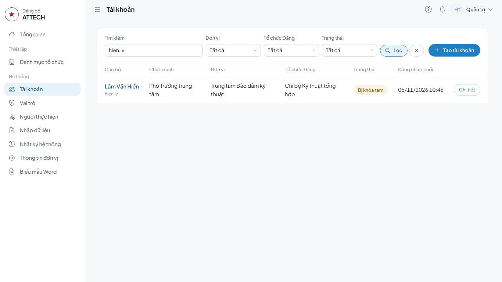
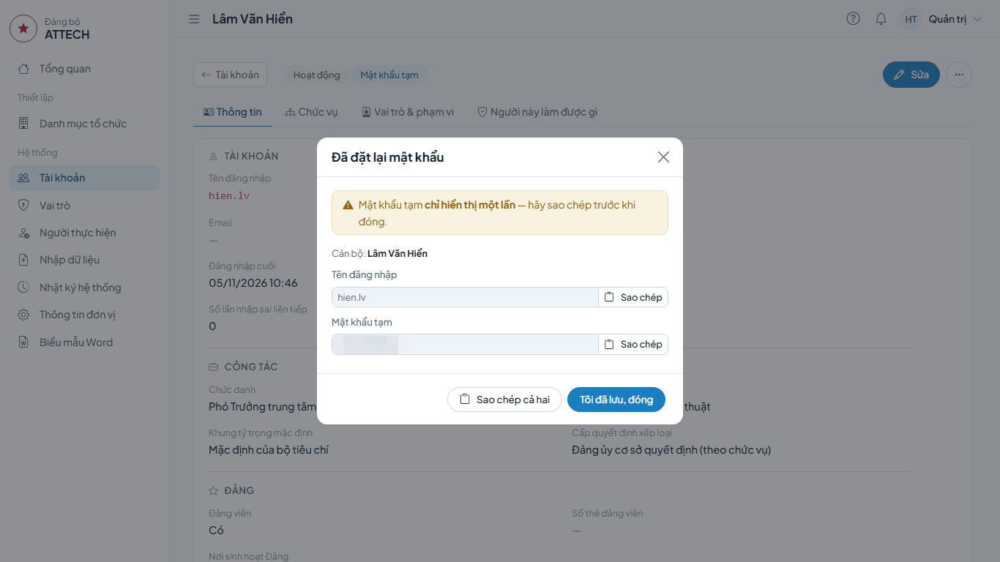
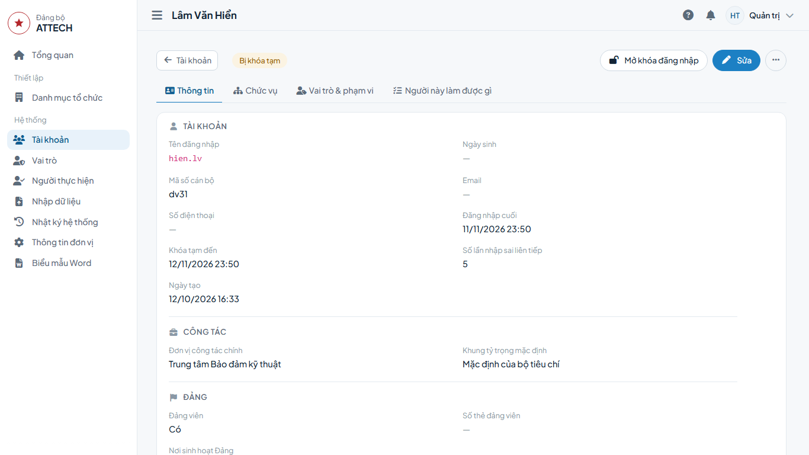
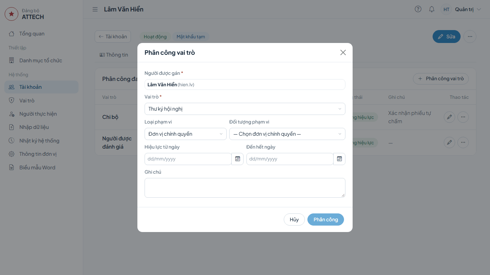
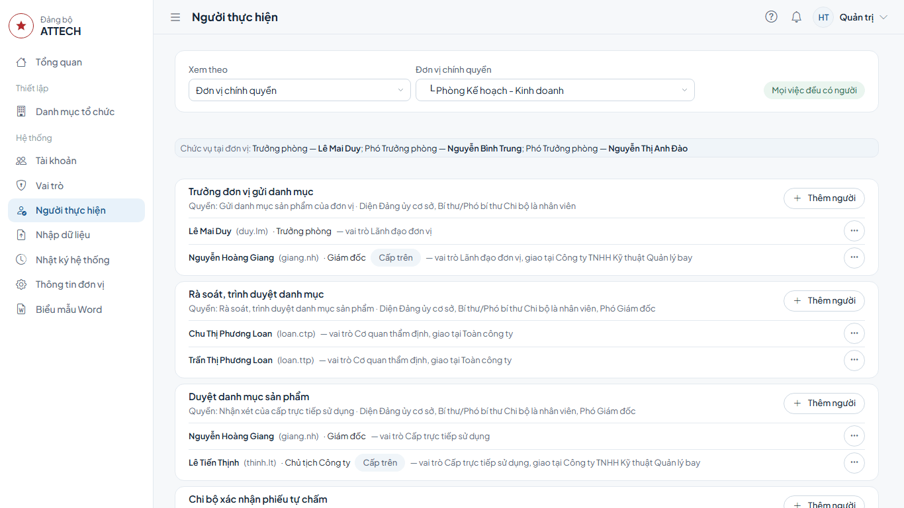

# Hướng dẫn cho Quản trị

Dành cho bộ phận CNTT: cấp và đặt lại mật khẩu, mở khóa, gán vai trò, xem ai làm việc gì ở từng đơn vị; khai báo cán bộ, chức vụ, danh mục tổ chức, vai trò; nhập dữ liệu, thông tin đơn vị, file mẫu Word.

Gặp lỗi hoặc chỗ khó hiểu: ghi vào phiếu góp ý `phieu-gop-y.xlsx`.

## Cần biết trước

- Mỗi lần gán vai trò gồm: người + vai trò + phạm vi + thời hạn. Phạm vi là **Toàn công ty**, một **Đơn vị chính quyền** hoặc một **Tổ chức Đảng**, và bao trùm mọi đơn vị con.
- Việc trên hồ sơ được giao cho người ở cấp gần hồ sơ nhất. Người ở cấp trên (nhãn **Cấp trên** ở trang **Người thực hiện**) vẫn làm được khi người gần nhất vắng.
- Không ai tự gán vai trò cho chính mình.

## 1. Mở tài khoản của một cán bộ

1. Menu **Hệ thống** → **Tài khoản**.
2. Gõ tên hoặc tên đăng nhập vào ô **Tìm kiếm** → bấm **Lọc** → bấm tên cán bộ (hoặc **Chi tiết** cuối dòng).

Trang tài khoản có các thẻ **Thông tin**, **Chức vụ**, **Vai trò & phạm vi**, **Người này làm được gì**. Thẻ **Thông tin** cho biết **Đăng nhập cuối**, **Khóa tạm đến**, **Số lần nhập sai liên tiếp**.

## 2. Cấp hoặc đặt lại mật khẩu tạm

Dùng khi cấp tài khoản cho người thử lần đầu, hoặc khi người dùng quên mật khẩu.

1. Mở tài khoản (mục 1) → nút **⋯** ở đầu trang → **Đặt lại mật khẩu** → **Đặt lại**.
2. Hộp hiện **Tên đăng nhập** và **Mật khẩu tạm**. Bấm **Sao chép** và gửi cho người dùng. Mật khẩu tạm chỉ hiển thị một lần.

**Xong thì thấy:** mật khẩu cũ hết hiệu lực, mọi phiên của người đó bị đăng xuất. Lần đăng nhập kế tiếp, người dùng phải đổi mật khẩu.

Tài khoản mới: trang **Tài khoản** → **Tạo tài khoản**; sau khi tạo, hệ thống cũng hiện mật khẩu tạm một lần.

## 3. Mở khóa đăng nhập

Người dùng nhập sai mật khẩu 5 lần liên tiếp bị khóa 15 phút.

1. Mở tài khoản → bấm **Mở khóa đăng nhập** ở đầu trang (chỉ hiện khi đang bị khóa hoặc đã nhập sai) → **Mở khóa**.

Người dùng không nhớ mật khẩu thì đặt lại mật khẩu (mục 2).

## 4. Gán vai trò và phạm vi

1. Mở tài khoản → thẻ **Vai trò & phạm vi** → bấm **Phân công vai trò**.
2. Hộp **Phân công vai trò**:
   - chọn **Vai trò**;
   - **Loại phạm vi**: **Toàn công ty**, đơn vị chính quyền hoặc tổ chức Đảng;
   - **Đối tượng phạm vi**: chọn đơn vị hoặc tổ chức Đảng cụ thể;
   - **Hiệu lực từ ngày**, **Đến hết ngày** (để trống là không hết hạn); **Ghi chú**.
3. Bấm **Phân công**.

**Xong thì thấy:** dòng mới trong **Phân công đang và sắp hiệu lực**. Thẻ **Người này làm được gì** liệt kê quyền đang có hiệu lực. Phân công có **Hiệu lực từ ngày** ở tương lai thì đến ngày đó mới có quyền; qua **Đến hết ngày** thì tự hết quyền.

- Sửa thời hạn: bấm **Sửa thời hạn, ghi chú** ở dòng phân công → **Lưu**.
- Thôi giao: **Kết thúc phân công** → **Kết thúc**. Gán nhầm: **Gỡ phân công** → **Gỡ**.

**Cán bộ giúp việc đánh giá:** gán cho nhân viên Phòng TCCB-LĐ (chức vụ **Nhân viên Nhân sự**) mà Trưởng phòng phân công giúp việc đánh giá. Cán bộ công tác Đảng ở Văn phòng (chức vụ **Nhân viên công tác Đảng, đoàn thể và thi đua**) thì gán vai trò **Cán bộ giúp việc Đảng ủy** theo cùng các bước: làm được như dưới đây trừ rà soát danh mục, thêm lập hồ sơ tập thể Mẫu 06, 07, 08.

1. Kiểm tra thẻ **Chức vụ** của tài khoản đã có đúng chức vụ trên.
2. Thẻ **Vai trò & phạm vi** → **Phân công vai trò** → **Vai trò**: **Cán bộ giúp việc đánh giá** (cán bộ công tác Đảng: **Cán bộ giúp việc Đảng ủy**); **Loại phạm vi**: **Toàn công ty**; **Ghi chú**: văn bản hoặc người phân công → **Phân công**.
3. Người đó làm được rà soát danh mục, thẩm định, thư ký hội nghị tập thể lãnh đạo cấp Công ty, biên bản họp thống nhất, phiếu kiểm tra, xem hồ sơ, kết quả và xuất báo cáo; không quản lý kỳ, bộ tiêu chí.
4. Hết phân công (chuyển việc, thôi giao): **Kết thúc phân công** ngay ở dòng vai trò này.

**Cập nhật danh mục theo kết quả cấp trên duyệt:** quyền **Cập nhật danh mục sản phẩm theo kết quả cấp trên duyệt** có sẵn ở vai trò **Cơ quan thẩm định**, **Cán bộ giúp việc đánh giá**, **Cán bộ giúp việc Đảng ủy**, **Văn phòng Đảng ủy**. Người có quyền này sửa được danh mục của hồ sơ do cấp trên duyệt (Chủ tịch, Giám đốc, Kiểm soát viên) và ghi điều chỉnh đã được cấp trên phê duyệt; không làm được trên hồ sơ của chính mình.

## 5. Xem người thực hiện các bước

Dùng để kiểm tra mỗi việc ở một đơn vị đã có người làm, và ai đang được giao.

1. Menu **Hệ thống** → **Người thực hiện**.
2. Ô **Xem theo**: chọn **Đơn vị chính quyền** hoặc **Tổ chức Đảng**, rồi chọn đơn vị cần xem ở ô bên cạnh.
3. Danh sách việc tính theo các hồ sơ của kỳ đang chọn, gồm cả **Gửi danh mục sản phẩm** và **Rà soát, trình duyệt danh mục**. Mỗi việc liệt kê người thực hiện:
   - người không có nhãn là người ở cấp gần nhất, việc hiện ở **Việc cần xử lý** của họ;
   - nhãn **Cấp trên**: người ở cấp trên, làm được khi người gần nhất vắng;
   - nhãn **Chưa có người**: việc chưa ai làm, cần thêm người;

**Thêm người cho một việc:** bấm **Thêm người** ở việc đó → hộp **Thêm người thực hiện**: chọn **Người thực hiện** (có nút **Chọn nhanh** theo người giữ chức vụ), **Vai trò**, **Đến hết ngày**, **Ghi chú** → bấm **Thêm**.

**Bỏ người khỏi một việc:** nút **⋯** cạnh tên người đó → **Gỡ khỏi việc này** → **Gỡ**. Chỉ gỡ được người được gán tại chính đơn vị đang xem.

Khi mọi việc đều có người, trang ghi **Mọi việc đều có người**.

Mỗi đơn vị tổ chức hội nghị tập thể lãnh đạo cần ít nhất một người lập được biên bản hội nghị (thư ký phòng, trung tâm; cấp Công ty là **Cán bộ giúp việc đánh giá**). Thiếu thì Phòng TCCB-LĐ thấy cảnh báo khi chuẩn bị mở kỳ: gán vai trò **Thư ký hội nghị** cho người được cử ở đơn vị đó.

Chế độ **Toàn công ty** chỉ liệt kê người được gán ở phạm vi Toàn công ty; việc chưa gán ở phạm vi này mang nhãn **Chưa gán Toàn công ty**, không có nghĩa là kỳ thiếu người. Đủ người hay chưa xem ở liên kết **Kiểm tra người thực hiện của kỳ**.

## 6. Việc cần xử lý ở Tổng quan

Người có quyền **Quản lý tài khoản** thấy khối **Quản trị cần xử lý** ở trang **Tổng quan**. Khối chỉ liệt kê mục có số khác 0:

- tài khoản đang bị khóa, tài khoản chưa đăng nhập lần nào;
- vai trò hết hạn trong 30 ngày tới;
- đảng viên chưa có tổ chức Đảng, người sinh hoạt tại tổ chức Đảng có tổ chức con, người tham gia đánh giá chưa có chức vụ;
- bước chưa có người thực hiện của kỳ đang mở (nếu có thêm quyền quản lý kỳ toàn công ty).

Người quản lý kỳ toàn công ty không có quyền Quản lý tài khoản chỉ thấy khối **Kỳ đánh giá cần xử lý**, khi kỳ đang mở còn bước chưa có người thực hiện.

Bấm một mục để mở trang **Tài khoản** đã lọc sẵn (ô **Cần xử lý**) hoặc trang kỳ, với danh sách bước thiếu người đã mở sẵn ở thẻ **Tiến độ**. Dòng trên cùng ghi số tài khoản đã đăng nhập trong 7 ngày. Người có quyền xem nhật ký thấy thêm **Hoạt động gần đây** bên dưới.

Nhóm **Kiến nghị chưa có người xử lý** ở **Việc cần xử lý**: kiến nghị mà không còn ai ngoài người liên quan có quyền xử lý. Bấm **Gán vai trò** để mở trang **Người thực hiện** và thêm người.

## 7. Thông tin cán bộ và chức vụ

**Thông tin cán bộ:** mở tài khoản → bấm **Sửa** ở đầu trang. Nhập **Mã số cán bộ** (in trên biểu mẫu), **Đơn vị công tác chính**, **Nơi sinh hoạt Đảng**, **Khung tỷ trọng mặc định** → **Lưu**.

**Chức vụ:** thẻ **Chức vụ** → **Thêm chức vụ**:

1. Chọn chức vụ, **Nơi giữ chức vụ**, **Từ ngày**, **Đến hết ngày** (để trống là không thời hạn).
2. Tích **Chức vụ chính (bỏ đánh dấu = kiêm nhiệm)** cho chức vụ chính. Một người giữ được nhiều chức vụ; chức vụ chính in trước.
3. Bấm **Lưu**. Thôi giữ chức vụ: nút **⋯** ở dòng → **Kết thúc**. Nhập nhầm: **⋯** → **Xóa (nhập nhầm)**.

**Thẩm quyền** (Đảng ủy cơ sở quyết định hay cấp trên quyết định) tự suy ra từ chức vụ. Cần đặt khác: bấm **Thay đổi** cạnh ô **Thẩm quyền**, chọn thẩm quyền, ghi **Lý do** → **Lưu**. Chọn **Theo chức vụ** để trả về như cũ.

Đổi chức vụ, thẩm quyền sau khi người đó đã ở trong kỳ đang chạy không tự đổi hồ sơ trong kỳ; Phòng TCCB-LĐ sửa trên trang kỳ nếu cần.

## 8. Danh mục tổ chức

Menu **Danh mục tổ chức** (nhóm **Thiết lập**), các thẻ:

- **Đơn vị chính quyền**, **Tổ chức Đảng**: cây nhiều cấp. **Thêm … gốc**, hoặc **⋯** ở một dòng → **Thêm … cấp dưới**; **Sửa** để đổi tên hoặc đổi cấp trên.
- **Loại đơn vị**: các loại dùng cho hai cây trên.
- **Chức vụ**: **Thêm chức vụ** hoặc **Sửa**. Các ô chính:
  - **Chức danh khi in**: chữ in trên biểu mẫu, dùng `{don_vi}` cho tên đơn vị gắn với chức vụ (ví dụ `Trưởng {don_vi}`); để trống thì in tên chức vụ;
  - **Mã chức danh** (M1–M26), dùng cho Mẫu 15A, 15B và trần Xuất sắc;
  - **Thẩm quyền quyết định xếp loại mặc định**, **Diện quyết định khi thêm vào kỳ**;
  - **Kiểu trình bày biểu mẫu tự đánh giá** (Mẫu 09C, 9D).
- **Kiểu trình bày biểu mẫu**: cách in Mẫu 09C, 9D.
- **Ngày nghỉ**: ngày lễ, Tết để tính hạn các bước.

## 9. Vai trò

Menu **Hệ thống** → **Vai trò**. Bấm **Phân quyền** ở dòng vai trò để tích, bỏ quyền → **Lưu quyền**. Vai trò mới: **Tạo vai trò**. Đổi quyền của vai trò có hiệu lực ngay với mọi người đang được gán vai trò đó.

## 10. Nhập dữ liệu từ Excel

1. Menu **Hệ thống** → **Nhập dữ liệu**.
2. Chọn loại dữ liệu → **Tải file mẫu**, điền theo mẫu.
3. Chọn file → **Kiểm tra file**. Bảng kết quả ghi từng dòng **Tạo mới**, **Cập nhật** hoặc **Lỗi**. Còn dòng lỗi thì sửa file rồi kiểm tra lại.
4. Bấm **Nhập dữ liệu** → **Nhập dữ liệu**.
5. Có tài khoản mới: bấm **Tải file mật khẩu tạm** ngay; file chỉ tải được một lần.

## 11. Thông tin đơn vị

Menu **Hệ thống** → **Thông tin đơn vị**: **Tên tổ chức Đảng cấp trên**, **Tên Đảng bộ**, **Tên đầy đủ của công ty**, **Tên đơn vị chủ quản cấp trên**, **Tên viết tắt**, **Địa danh**, **Cơ quan thẩm định**, **Số văn bản hướng dẫn**, **Ngày văn bản hướng dẫn** → **Lưu**. Các tên này in trên mọi biểu mẫu, báo cáo.

## 12. File mẫu Word

Menu **Hệ thống** → **Biểu mẫu Word**.

1. Ở dòng biểu mẫu, bấm **Tải lên**.
2. Chọn file `.docx` → **Kiểm tra**. Hệ thống báo tag thiếu (chặn) và cảnh báo (không chặn).
3. Để tích **Kích hoạt ngay** nếu muốn dùng ngay → **Tải lên**.

Dòng biểu mẫu có nút **⋯**: **Lịch sử phiên bản** (bấm **Kích hoạt** để dùng lại bản cũ), **Danh mục tag**, **Tải file gốc**, **Dùng file gốc**.

## 13. Nhật ký và sao lưu

- **Nhật ký hệ thống** (menu **Hệ thống**): ai đã sửa gì, lúc nào; lọc theo **Đối tượng**, **Thao tác**.
- Sao lưu và khôi phục dữ liệu làm trên máy chủ, không có trên giao diện. Người vận hành máy chủ làm theo tài liệu vận hành; trước mỗi lần nâng cấp phải có bản sao lưu mới.
