# Hướng dẫn cho Phòng TCCB-LĐ

Dành cho cán bộ Phòng Tổ chức cán bộ - Lao động: quản lý kỳ đánh giá, rà soát danh mục, thẩm định, lập biên bản họp thống nhất (Mẫu 20) và phiếu kiểm tra (Mẫu 19).

Hồ sơ của chính bạn: làm theo [Hướng dẫn cho người được đánh giá](can-bo.md).

Gặp lỗi hoặc chỗ khó hiểu: ghi vào phiếu góp ý `phieu-gop-y.xlsx`.

## Cần biết trước

- Không ai làm bước trên hồ sơ của chính mình. Biên bản họp thống nhất và phiếu kiểm tra tự bỏ hồ sơ của người lập; người lập không tự chốt, tự xác nhận.
- Việc chờ bạn ở **Việc cần xử lý**. Muốn xem mọi hồ sơ: menu **Hồ sơ đánh giá**.

## Phần A. Lập và mở kỳ

### A1. Tạo kỳ

1. Menu **Kỳ đánh giá** (nhóm **Thiết lập**) → bấm **Tạo kỳ**.
2. Hộp **Tạo kỳ đánh giá**: chọn **Năm**, **Quý**; **Từ ngày**, **Đến ngày** và **Tên kỳ** tự điền, sửa nếu cần; chọn **Bộ tiêu chí**.
3. Bấm **Tạo kỳ**.

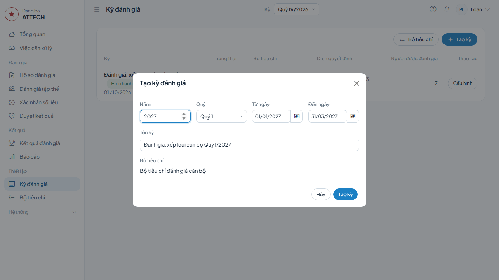

**Xong thì thấy:** trang kỳ ở trạng thái **Dự thảo**, có khối **Chuẩn bị mở kỳ** và các thẻ **Người được đánh giá**, **Người thực hiện các bước**, **Bộ tiêu chí**, **Diện quyết định**.

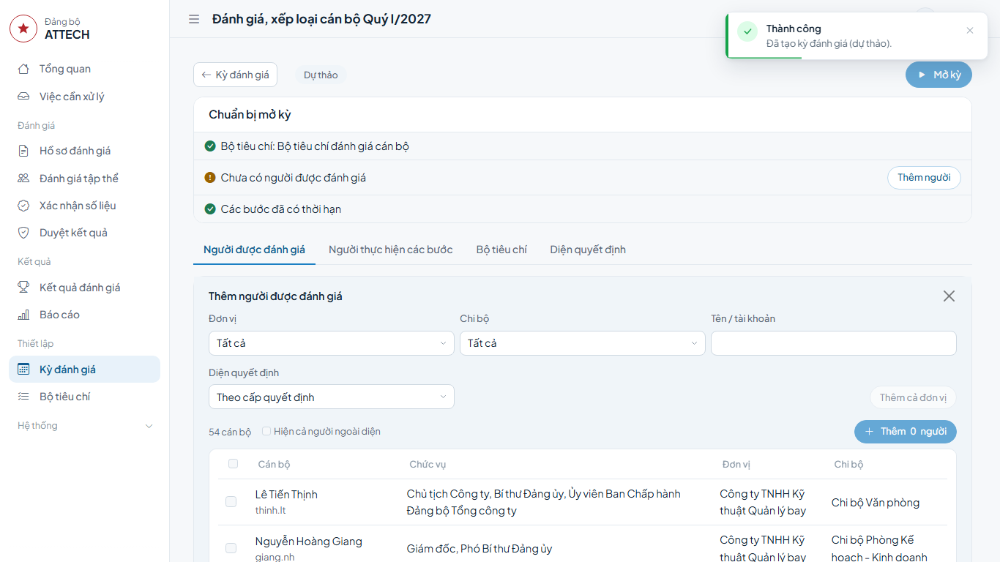

### A2. Thêm người được đánh giá

1. Thẻ **Người được đánh giá** → bấm **Thêm người**.
2. Chọn **Đơn vị** (và **Chi bộ** nếu cần) để lọc.
3. Bấm **Thêm cả đơn vị**; hoặc tích từng người rồi bấm **Thêm … người**. Danh sách chỉ hiện người thuộc diện đánh giá.

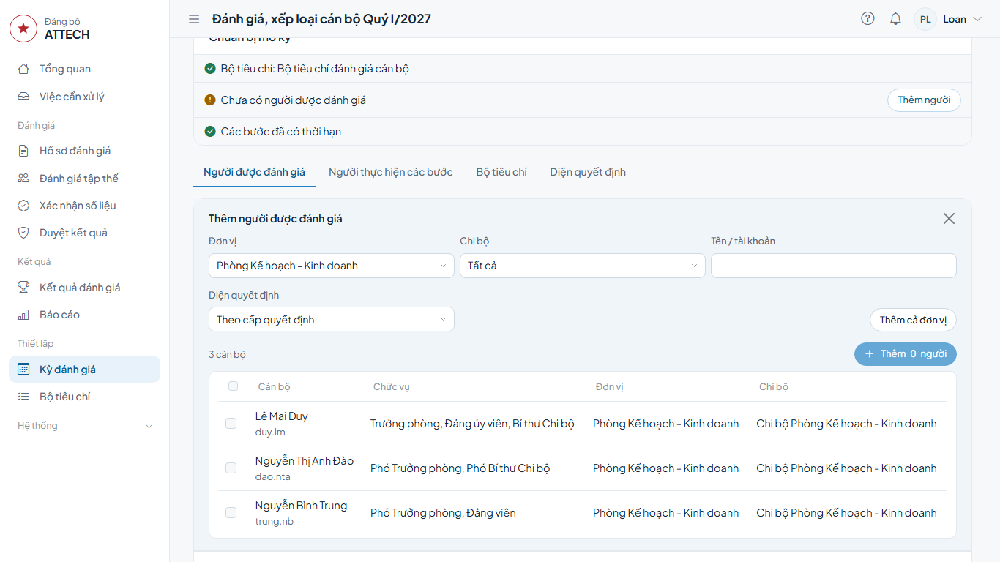

4. Xem cột **Diện quyết định** của từng người (tự gán theo chức vụ). Sai thì bấm **⋯** ở dòng đó → **Đổi diện quyết định**.

Thêm nhầm: **⋯** ở dòng → **Bỏ khỏi kỳ**.

### A3. Xem hạn các bước

1. Thẻ **Diện quyết định**: mỗi diện có hạn của từng bước, hệ thống tự điền khi tạo kỳ.
2. Sửa hạn nếu lịch khác → bấm **Lưu**. Bấm **Tính lại thời hạn** để tính lại theo quy tắc.

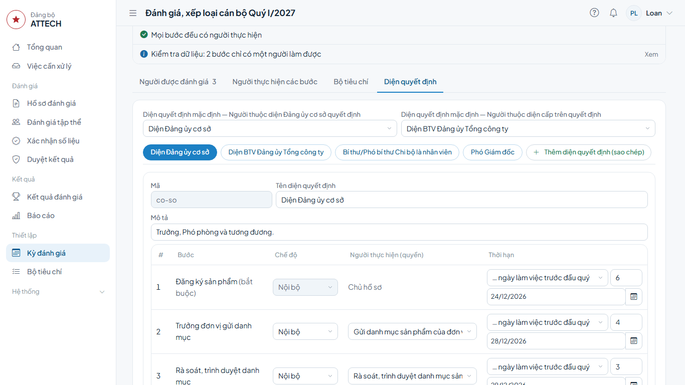

### A4. Kiểm tra và mở kỳ

1. Khối **Chuẩn bị mở kỳ**: mọi dòng phải có dấu tích xanh, gồm cả **Mọi bước đều có người thực hiện**. Còn bước chưa có người thì nhờ Quản trị phân công.
2. Bấm **Mở kỳ** ở đầu trang → hộp **Mở kỳ đánh giá** → **Mở kỳ**.

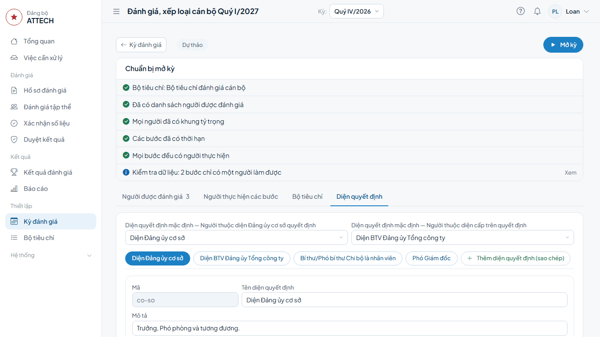

**Xong thì thấy:** kỳ chuyển **Đang mở**; cán bộ thấy việc đăng ký ở **Việc cần xử lý**. Từ lúc này chỉ sửa được thời hạn các bước.

### A5. Đánh dấu Chưa xếp loại

Người không đánh giá trong kỳ (nghỉ dài ngày, mới bổ nhiệm dưới 1 tháng…). Làm sau khi mở kỳ:

1. Trang kỳ → thẻ **Người được đánh giá** → **⋯** ở dòng người đó → **Không đánh giá (Chưa xếp loại)**.
2. Ghi **Lý do (bắt buộc)** → bấm **Đánh dấu**.

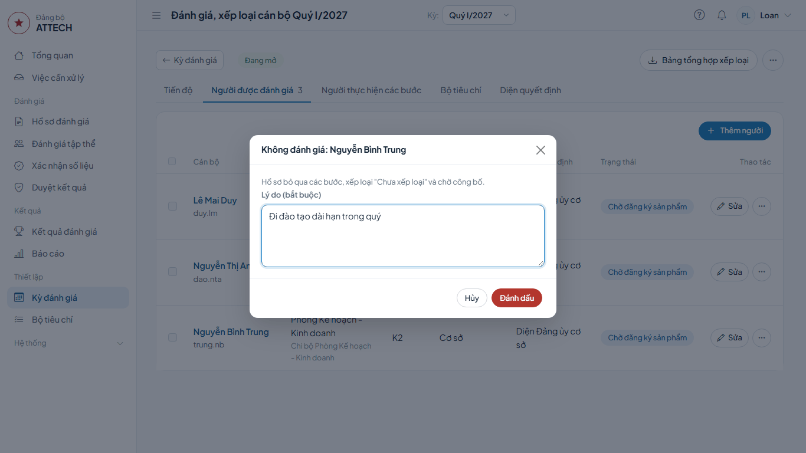

**Xong thì thấy:** dòng có nhãn **Chưa xếp loại** kèm lý do. Hồ sơ bỏ qua các bước, chờ Văn phòng Đảng ủy công bố; người đó không phải làm gì. Đánh dấu nhầm: **⋯** → **Bỏ đánh dấu Chưa xếp loại** (khi chưa công bố).

Trên trang hồ sơ cũng đánh dấu được: nút **⋯** cạnh nút **Biểu mẫu** ở đầu trang → **Không đánh giá (Chưa xếp loại)**.

## Phần B. Rà soát danh mục sản phẩm

**Khi nào:** sau khi Trưởng đơn vị gửi danh mục (danh mục của Trưởng đơn vị thì ngay sau khi nộp); hạn ở bước **Rà soát, trình duyệt danh mục**.

1. **Việc cần xử lý** → nhóm **Rà soát, trình duyệt danh mục** → dòng cán bộ → bấm **Trình duyệt**.

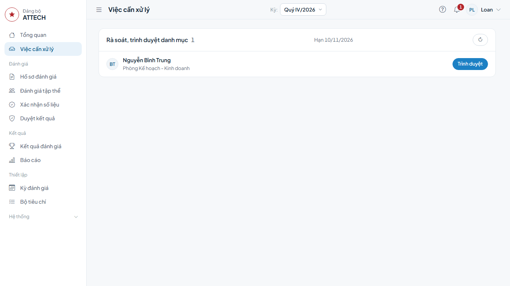

2. Xem khối **Danh mục sản phẩm (Mẫu 01)**: tên, loại việc, trục, trọng số, chuẩn đạt, khung tỷ trọng.
3. Kết quả họp rà soát hoặc rà soát hợp lệ cần lưu lại: khối **Ý kiến trước phê duyệt** cuối trang → **Ghi ý kiến** → chọn loại (**Kết quả họp rà soát danh mục** hoặc **Kết quả rà soát hợp lệ**), ghi nội dung → **Lưu**.
4. Ở khung **Trình duyệt danh mục**, ghi **Ý kiến** (nếu có) → bấm **Trình duyệt** → **Đồng ý**.

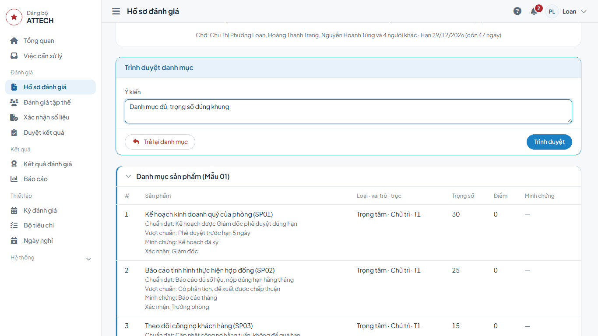

**Xong thì thấy:** thanh tiến trình chuyển sang **Duyệt danh mục sản phẩm**, chờ Giám đốc (danh mục của Phó Giám đốc: Chủ tịch). Dưới danh mục ghi **Rà soát, trình:** tên bạn và thời gian.

**Danh mục chưa đạt:** bấm **Trả lại danh mục** → ghi **Lý do (bắt buộc)** → **Trả lại**. Hồ sơ về lại cán bộ để sửa.

## Phần C. Thẩm định

**Khi nào:** hồ sơ ở bước **Thẩm định**, sau khi tập thể (hoặc Trưởng đơn vị) đã đề xuất.

1. **Việc cần xử lý** → nhóm **Thẩm định** → dòng cán bộ → bấm **Thẩm định**.

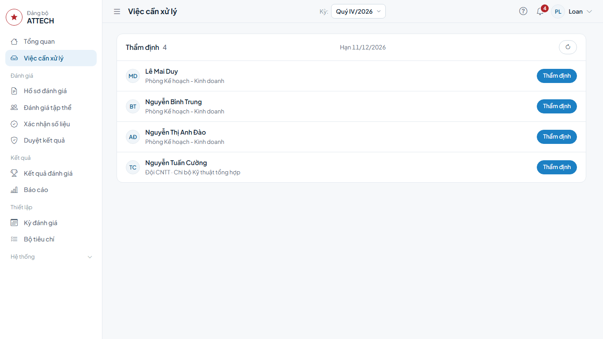

2. Bảng sản phẩm: dưới tên mỗi sản phẩm ghi loại (và **Vượt chuẩn** nếu có); cột **Tự chấm** là kết quả cán bộ tự đánh giá. Ở cột **Mức thẩm định, nhận xét**, chọn mức cho từng sản phẩm (Mức 1, Mức 2, Mức 3; bắt buộc đủ), ghi **Nhận xét** ngắn ở ô bên dưới nếu cần.
3. **Chấm tiêu chí chung:** để **Theo nhóm** thì nhập 2 điểm **Tiêu chí chung** và **Kết quả nhiệm vụ** (đã điền sẵn điểm tự chấm, sửa nếu khác). Chọn **Từng tiêu chí** nếu muốn chấm lại từng tiêu chí con.
4. Ô **Tổng** tự tính. Chọn **Mức đề xuất**; ghi **Ý kiến thẩm định**.
5. Điểm chênh lệch nhiều so với tự chấm, hoặc đổi mức: ô **Giải trình** có dấu \* (bắt buộc). Ghi rõ căn cứ.
6. Bấm **Ghi nhận thẩm định** → **Đồng ý**.

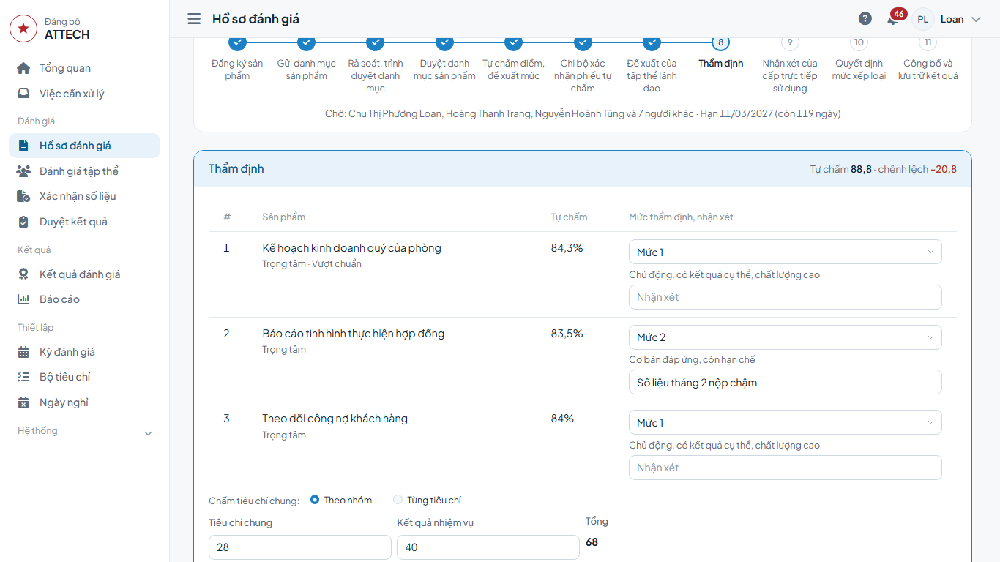

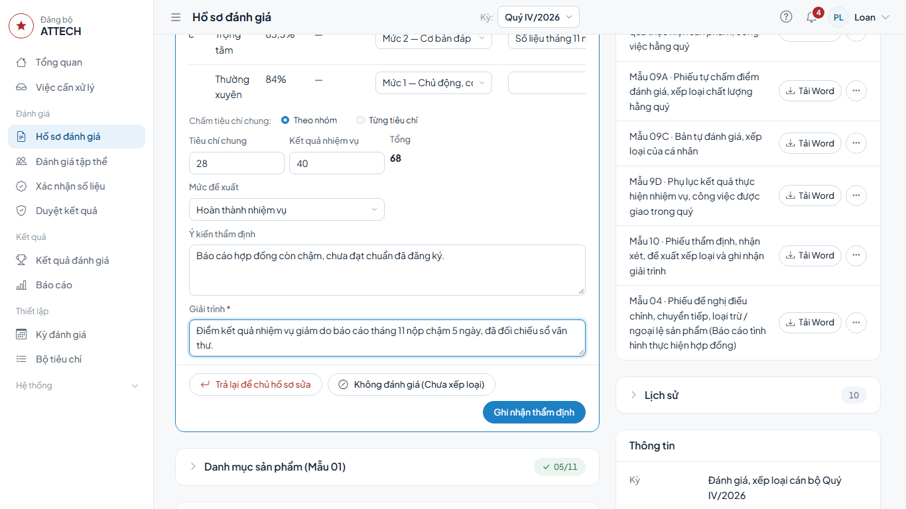

**Xong thì thấy:** hồ sơ chuyển sang bước nhận xét của cấp trực tiếp sử dụng (hoặc quyết định, tùy diện).

**Cần cán bộ sửa phiếu:** bấm **Trả lại để chủ hồ sơ sửa**, ghi lý do → **Trả lại**.

**Cần phòng chuyên môn xác nhận số liệu:** khối **Xác nhận số liệu** trên hồ sơ → **Yêu cầu xác nhận** → chọn việc, ghi nội dung → **Gửi yêu cầu**. Khi còn phiếu chưa xác nhận xong, nút **Ghi nhận thẩm định** bị khóa.

## Phần D. Biên bản họp thống nhất (Mẫu 20)

**Khi nào:** sau thẩm định và nhận xét, trước khi Văn phòng Đảng ủy ghi quyết định. Mỗi biên bản gom các hồ sơ cùng nhóm chức danh (ví dụ Trưởng phòng và tương đương).

1. Menu **Duyệt kết quả** → thẻ **Họp thống nhất** → bấm **Lập biên bản**.
2. Hộp **Lập biên bản**: ghi **Nhóm chức danh / phạm vi**; lọc theo diện, đơn vị nếu cần; tích các hồ sơ (hoặc **Chọn tất cả**) → bấm **Lập biên bản**. Hộp chỉ liệt kê hồ sơ đang chờ quyết định và thuộc diện phải họp thống nhất.

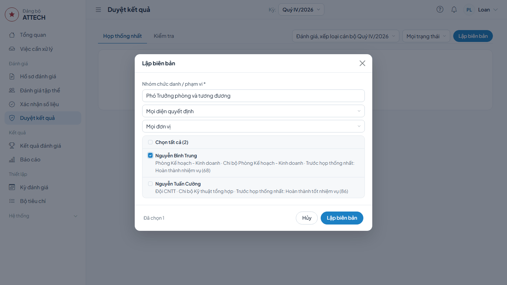

3. Trang **Biên bản họp thống nhất**, phần **Cuộc họp**: **Ngày họp**, **Địa điểm**, **Chủ trì**, **Thư ký**, **Phạm vi, số lượng hồ sơ**. Ô có dấu * là bắt buộc.
4. **Hồ sơ trong biên bản**: cột **Sau họp thống nhất** ghi mức sau họp nếu cuộc họp thống nhất đổi mức. Thiếu người thì **Thêm hồ sơ**, thừa thì **Gỡ**.
5. **Thành phần tham dự**: bấm **Thêm người**, ghi **Họ tên**, **Tư cách** từng người dự; **Ý kiến bảo lưu** nếu có.
6. **Kết quả chung**: tự tổng hợp; ghi **Chênh lệch đáng chú ý**, **Kết luận sơ bộ** nếu có. **Trường hợp thảo luận**: thêm người được bàn riêng. **Kết luận bổ sung**: ghi kết luận khác. Biên bản chỉ có một hồ sơ thì ghi lý do ở đây.
7. Đính kèm tệp (nếu có) → bấm **Lưu**.

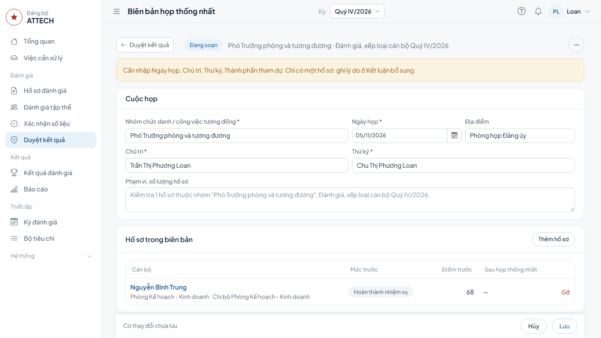

**Xong thì thấy:** biên bản ở trạng thái **Đang soạn**, chờ Văn phòng Đảng ủy bấm **Chốt biên bản**. Dòng ở đầu trang ghi những gì còn thiếu (ngày họp, chủ trì, thư ký, thành phần tham dự; lý do khi chỉ có một hồ sơ), tính theo nội dung đang nhập; còn thiếu thì không chốt được. Đã đủ nhưng chưa lưu thì dòng ghi **Lưu biên bản trước khi chốt.**: bấm **Lưu**.

## Phần E. Phiếu kiểm tra (Mẫu 19)

**Khi nào:** sau khi chốt biên bản họp thống nhất, trước khi ghi quyết định.

1. Menu **Duyệt kết quả** → thẻ **Kiểm tra** → bấm **Lập phiếu**.
2. Ghi **Nhóm chức danh / phạm vi**, tích hồ sơ → bấm **Lập phiếu**.
3. Phần **Nội dung kiểm tra**: mỗi mục trong 10 mục chọn **Đạt**, **Chưa đạt** hoặc **K/AD**; ghi **Minh chứng / biện pháp** khi cần.
4. **Kết luận**: **Đủ điều kiện trình phê duyệt** hoặc **Cần hoàn thiện**.
5. Bấm **Gửi xác nhận** → **Gửi xác nhận**.

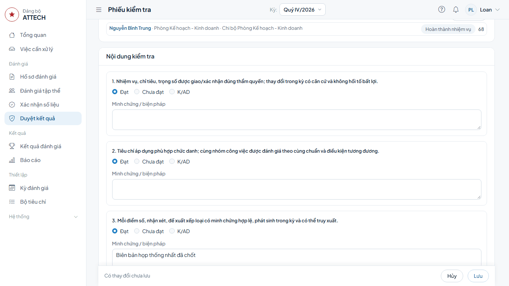

**Xong thì thấy:** phiếu chờ xác nhận; bạn không sửa được nữa. Văn phòng Đảng ủy bấm **Xác nhận**.

## Phần F. Theo dõi, khóa và đóng kỳ

- **Tiến độ:** trang kỳ → thẻ **Tiến độ**; bấm nhãn **Quá hạn** hoặc **Sắp đến hạn** để thấy ai đang chậm. Dòng đầu thẻ cho biết bộ tiêu chí của kỳ và còn bước nào thiếu người thực hiện.
- **Tổng quan:** khối **Tiến độ trong phạm vi** đếm hồ sơ toàn công ty theo bước, theo tổ chức Đảng, và liệt kê hồ sơ **Chậm hạn** kèm người phải làm. Khối **Quản trị cần xử lý** báo **Bước chưa có người thực hiện** của kỳ đang mở; bấm vào để mở thẳng thẻ **Người thực hiện các bước** của kỳ.
- **Khóa dữ liệu:** khi mọi hồ sơ đã có biên bản họp thống nhất và phiếu kiểm tra: trang kỳ → **⋯** → **Khóa dữ liệu** → **Khóa dữ liệu**. Từ lúc này cán bộ không sửa hồ sơ được nữa; chỉ các bước từ thẩm định trở đi tiếp tục. Còn thiếu thì **⋯** → **Mở lại kỳ**, làm xong rồi khóa lại.
- **Đóng kỳ:** khi mọi hồ sơ đã công bố: **⋯** → **Đóng kỳ** → **Đóng kỳ**.
