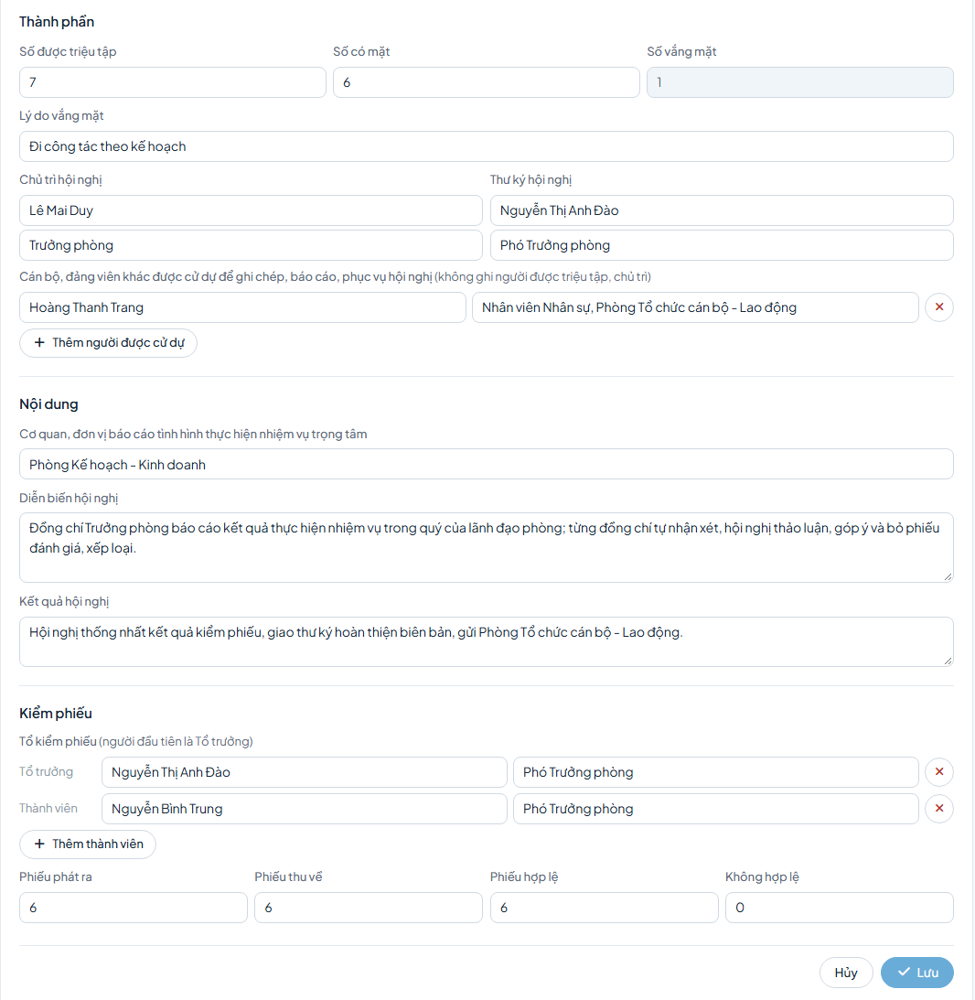

# Hướng dẫn cho thư ký hội nghị

Chương này dành cho thư ký hội nghị tập thể lãnh đạo phòng, trung tâm và cấp Công ty (cấp Công ty: cán bộ Phòng TCCB-LĐ hoặc công tác Đảng được phân công, vai trò Cán bộ giúp việc đánh giá hoặc Cán bộ giúp việc Đảng ủy).

Trong mỗi kỳ, thư ký làm 2 việc chính:
1. Lập biên bản hội nghị (Mẫu 12/13).
2. Ghi đề xuất của tập thể vào từng hồ sơ.

Các việc khác chỉ làm khi phát sinh (Phần B).

Hội nghị bỏ phiếu kín như thường lệ; thư ký ghi biên bản và kết quả vào hệ thống. Hồ sơ của chính mình: xem [Hướng dẫn cho người được đánh giá](can-bo.md).

## A. Việc chính

### 1. Lập biên bản hội nghị (Mẫu 12/13)

Thời điểm: sau khi họp và kiểm phiếu, trước khi ghi đề xuất vào hồ sơ.

Cách làm:
1. Vào menu **Đánh giá tập thể**, thẻ **Biên bản hội nghị**.
2. Bấm **Lập biên bản**.
3. Điền các ô theo bảng dưới đây; người dự để ghi chép, phục vụ thì bấm **Thêm người được cử dự**; Tổ kiểm phiếu thì bấm **Thêm thành viên** (người đầu là Tổ trưởng).
4. Với Mẫu 13, nhập số phiếu cho ít nhất một hồ sơ tại phần Số phiếu theo từng hồ sơ.
5. Bấm **Lưu**.

| Ô | Ghi gì |
|---|---|
| Biểu mẫu | Mẫu 12 — Biên bản hội nghị hoặc Mẫu 13 — Biên bản kiểm phiếu |
| Hội nghị | Tập thể lãnh đạo, quản lý (đề xuất) |
| Đơn vị tổ chức | Phòng / đơn vị (rồi chọn đơn vị) hoặc Cấp Công ty, theo bảng bên dưới |
| Căn cứ Quy chế làm việc của, Bắt đầu, Kết thúc, Địa điểm | Thông tin hội nghị |
| Số được triệu tập, Số có mặt, Lý do vắng mặt | Thành phần; số vắng mặt tự tính |
| Chủ trì hội nghị, Thư ký hội nghị | Họ tên kèm chức vụ |
| Cơ quan, đơn vị báo cáo tình hình thực hiện nhiệm vụ trọng tâm; Diễn biến hội nghị; Kết quả hội nghị | Nội dung hội nghị |
| Phiếu phát ra, Phiếu thu về, Phiếu hợp lệ, Không hợp lệ | Kết quả kiểm phiếu; hợp lệ cộng không hợp lệ bằng thu về |

| Hội nghị | Hồ sơ được xét | Đơn vị tổ chức |
|---|---|---|
| Tập thể lãnh đạo phòng, trung tâm | Cán bộ của đơn vị | Phòng / đơn vị |
| Tập thể lãnh đạo Công ty | Chủ tịch, Giám đốc, Phó Giám đốc, Kiểm soát viên | Cấp Công ty |
| Đảng ủy (quyết định) | Hồ sơ thuộc diện Đảng ủy quyết định | Tổ chức Đảng |

Sau khi xong: biên bản hiện trong thẻ Biên bản hội nghị và dùng được cho hồ sơ cán bộ thuộc đơn vị đã chọn và đơn vị cấp dưới. Tải bản in: bấm **⋯** ở dòng biên bản, chọn **Tải Mẫu 12 (Word)** hoặc **Tải Mẫu 13 (Word)** (khi đã có số phiếu của hồ sơ).

### 2. Ghi đề xuất của tập thể

Thời điểm: sau khi lập biên bản hội nghị.

Cách làm:
1. Vào **Việc cần xử lý**, nhóm Đề xuất của tập thể lãnh đạo.
2. Bấm **Đề xuất** ở dòng cán bộ.
3. Điền các ô tại khung Ghi nhận đề xuất của tập thể theo bảng dưới đây.
4. Kiểm tra dòng bên dưới số phiếu: tổng phiếu/số có mặt và mức theo kiểm phiếu (quá nửa số có mặt, cộng dồn từ mức cao); mức chọn phải khớp.
5. Bấm **Ghi nhận đề xuất**, rồi bấm **Đồng ý**.

| Ô | Ghi gì |
|---|---|
| Mức tập thể đề xuất | Mức theo kết quả kiểm phiếu |
| Nhận xét của tập thể | Nhận xét |
| Biên bản hội nghị (Mẫu 12/13) | Biên bản đã lập; Mẫu 13 đã có số phiếu của người này thì chọn sẵn |
| Xuất sắc, Tốt, Hoàn thành, Không hoàn thành, Chưa xếp loại, Không hợp lệ | Số phiếu của người này |

Sau khi xong: hồ sơ chuyển Phòng TCCB-LĐ thẩm định.

## B. Khi phát sinh

- **In phiếu kín trắng (Mẫu 11) trước hội nghị:** vào menu **Báo cáo**, dòng Mẫu 11, bấm **Tải Word**; phiếu có danh sách cán bộ được xét. Đã lập biên bản thì có thể tải tại menu **Đánh giá tập thể**, thẻ **Biên bản hội nghị**, bấm **⋯** ở dòng biên bản, chọn **Tải Mẫu 11 phiếu trắng (Word)**.
- **Sửa biên bản:** bấm **Sửa** ở dòng biên bản.
- **Hội nghị Đảng ủy:** khi lập biên bản chọn Hội nghị là Đảng ủy/Chi ủy cơ sở (quyết định), Đơn vị tổ chức là Tổ chức Đảng rồi chọn Đảng ủy. Văn phòng Đảng ủy chọn biên bản này khi ghi quyết định.
- **Ô biên bản trên hồ sơ không có dấu \*:** không bắt buộc gắn biên bản; muốn ghi số phiếu thì tích Ghi kết quả kiểm phiếu của hồ sơ này.
- **Mức khác mức theo điểm tự chấm:** hệ thống hiện dòng nhắc; ô Nhận xét của tập thể có dấu \* thì bắt buộc ghi lý do.
- **Bí thư, Phó Bí thư chi bộ là nhân viên đơn vị:** kiểm phiếu cùng hội nghị, cùng biên bản; Mẫu 11 in mức ở cột 7, cột 5 để trống. Đề xuất do Trưởng đơn vị ghi, xem [Hướng dẫn cho lãnh đạo đơn vị](lanh-dao-don-vi.md).
- **Hồ sơ của chính thư ký:** khi biên bản họp bắt buộc, thư ký được ghi đề xuất theo đúng kết quả kiểm phiếu; không được trả lại hồ sơ của chính mình.
- **Mẫu 06, 07, 08:** do Phòng TCCB-LĐ lập, xem [Hướng dẫn cho Phòng TCCB-LĐ](tham-dinh.md). Tên Thủ trưởng đơn vị và Bí thư ở Mẫu 06 lấy theo người giữ chức vụ trong hệ thống tại kỳ đánh giá; ô Họ và tên người đứng đầu, Chức vụ chỉ dùng khi hệ thống chưa có người giữ chức vụ đứng đầu.

## C. Câu hỏi thường gặp

- Nút Ghi nhận đề xuất bị khóa, ghi "Chưa có biên bản họp ở bước này"? Lập biên bản với hội nghị Tập thể lãnh đạo, quản lý (đề xuất), rồi mở lại hồ sơ.
- Thông báo "Chọn biên bản họp và nhập kết quả kiểm phiếu của hồ sơ này"? Chọn biên bản và nhập số phiếu của hồ sơ.
- Ghi nhận không thành công do chưa có biên bản ghi kết quả kiểm phiếu? Biên bản không thuộc đơn vị của cán bộ hoặc chưa có số phiếu; chọn đúng biên bản, nhập số phiếu.
- Tổng số phiếu vượt số có mặt? Kiểm tra lại số phiếu hoặc ô Số có mặt trong biên bản.
