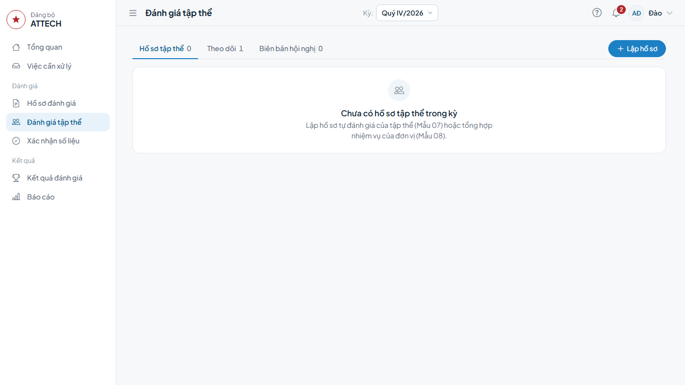
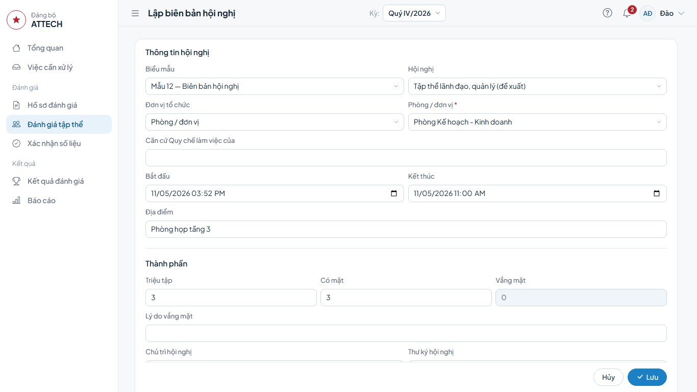
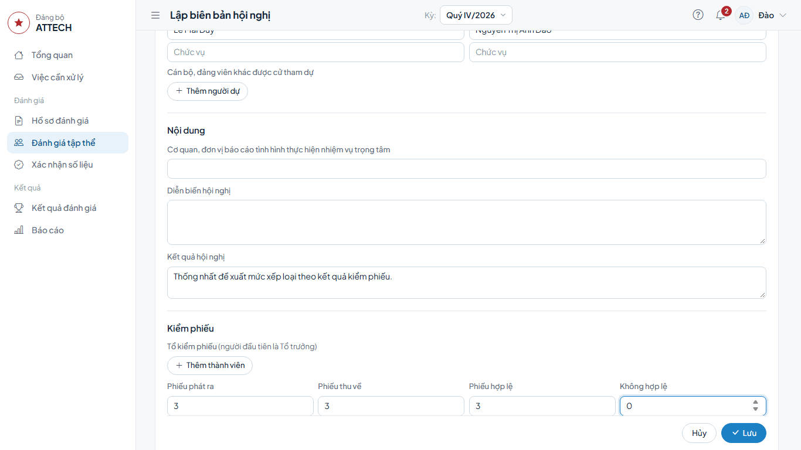
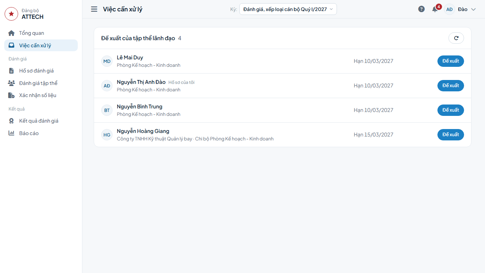
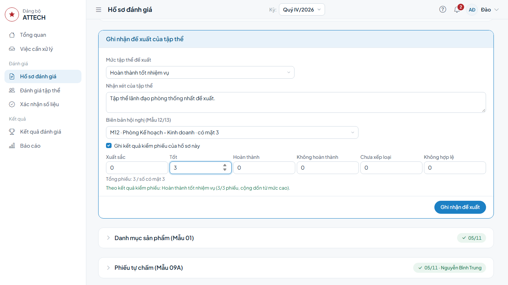

# Hướng dẫn cho thư ký hội nghị

Dành cho thư ký hội nghị tập thể lãnh đạo: thư ký phòng, trung tâm; với hội nghị cấp Công ty, thư ký là cán bộ Phòng TCCB-LĐ hoặc cán bộ công tác Đảng ở Văn phòng được phân công (vai trò **Cán bộ giúp việc đánh giá**). Hệ thống không bỏ phiếu điện tử: hội nghị họp và bỏ phiếu kín như thường lệ, thư ký ghi lại biên bản và kết quả vào hệ thống.

Hồ sơ của chính bạn: làm theo [Hướng dẫn cho người được đánh giá](can-bo.md).

Gặp lỗi hoặc chỗ khó hiểu: ghi vào phiếu góp ý `phieu-gop-y.xlsx`.

## Cần biết trước

- Thứ tự: in phiếu kín trắng (Mẫu 11) → họp, kiểm phiếu → lập biên bản (Mẫu 12 hoặc 13) → ghi đề xuất vào từng hồ sơ.
- Lập biên bản trước rồi mới ghi đề xuất: khi ô **Biên bản hội nghị (Mẫu 12/13)** trên hồ sơ có dấu \*, chưa có biên bản của đơn vị thì không ghi đề xuất được.
- Hội nghị có xét cả cán bộ là Bí thư chi bộ kiêm lãnh đạo bộ phận (ví dụ Đài trưởng kiêm Bí thư chi bộ): vẫn kiểm phiếu người đó trong cùng hội nghị, cùng biên bản. Đề xuất của người đó do Trưởng đơn vị ghi (ví dụ Trưởng trung tâm Bảo đảm kỹ thuật), không phải việc của bạn.
- Hồ sơ chờ bạn ở **Việc cần xử lý**, nhóm **Đề xuất của tập thể lãnh đạo**.
- Khi biên bản họp là bắt buộc, bạn được ghi cả hồ sơ của chính mình (ví dụ Phó Bí thư chi bộ làm thư ký và cũng được đánh giá): mức ghi nhận phải đúng kết quả kiểm phiếu trong biên bản. Riêng thao tác trả lại hồ sơ của chính mình vẫn bị chặn; hồ sơ diện Trưởng đơn vị đề xuất do Trưởng đơn vị ghi.

## 1. In phiếu kín trắng (Mẫu 11)

Cách 1: menu **Báo cáo** → dòng **Mẫu 11** → **Tải Word**.

Cách 2: menu **Đánh giá tập thể** → thẻ **Biên bản hội nghị** → nút **⋯** ở dòng biên bản → **Tải Mẫu 11 phiếu trắng (Word)**.

## 2. Lập biên bản hội nghị (Mẫu 12, 13)

**Khi nào:** sau khi hội nghị họp và kiểm phiếu xong.

1. Bấm menu **Đánh giá tập thể** → thẻ **Biên bản hội nghị** → bấm **Lập biên bản**.

2. Phần **Thông tin hội nghị**:
   - **Biểu mẫu**: **Mẫu 12 — Biên bản hội nghị** hoặc **Mẫu 13 — Biên bản kiểm phiếu**.
   - **Hội nghị**: **Tập thể lãnh đạo, quản lý (đề xuất)**.
   - **Đơn vị tổ chức**: chọn **Phòng / đơn vị** rồi chọn đơn vị của hội nghị; hội nghị cấp Công ty chọn **Cấp Công ty**. Biên bản chỉ dùng được cho hồ sơ của cán bộ thuộc đơn vị đã chọn.
   - **Bắt đầu**, **Kết thúc**, **Địa điểm**.
3. Phần **Thành phần**: **Triệu tập**, **Có mặt** (ô **Vắng mặt** tự tính), **Lý do vắng mặt**, **Chủ trì hội nghị**, **Thư ký hội nghị** kèm chức vụ; người dự khác thì thêm ở **Cán bộ, đảng viên khác được cử tham dự**.
4. Phần **Nội dung**: **Diễn biến hội nghị**, **Kết quả hội nghị**.
5. Phần **Kiểm phiếu**: thêm **Tổ kiểm phiếu** (người đầu tiên là Tổ trưởng); nhập **Phiếu phát ra**, **Phiếu thu về**, **Phiếu hợp lệ**, **Không hợp lệ**. Phiếu hợp lệ cộng không hợp lệ phải bằng phiếu thu về.
6. Mẫu 13: phần **Số phiếu theo từng hồ sơ** (bắt buộc) hiện danh sách hồ sơ của đơn vị; nhập số phiếu cho từng người, ít nhất một hồ sơ.
7. Bấm **Lưu**.

**Xong thì thấy:** biên bản hiện trong thẻ **Biên bản hội nghị**. Nút **⋯** ở dòng biên bản để **Sửa**, **Tải Mẫu 12 (Word)** hoặc **Tải Mẫu 13 (Word)**.

## 3. Ghi đề xuất của tập thể vào hồ sơ

1. **Việc cần xử lý** → nhóm **Đề xuất của tập thể lãnh đạo** → dòng cán bộ → bấm **Đề xuất**.

2. Trong khung **Ghi nhận đề xuất của tập thể**:
   - chọn **Mức tập thể đề xuất**;
   - ghi **Nhận xét của tập thể**;
   - ô **Biên bản hội nghị (Mẫu 12/13) \***: chọn biên bản vừa lập (biên bản Mẫu 13 đã nhập số phiếu của người này thì ô được chọn sẵn);
   - nhập số phiếu của hồ sơ này ở các ô **Xuất sắc**, **Tốt**, **Hoàn thành**, **Không hoàn thành**, **Chưa xếp loại**, **Không hợp lệ**. Ô biên bản không có dấu \* thì có thể không gắn biên bản; muốn ghi số phiếu thì tích **Ghi kết quả kiểm phiếu của hồ sơ này**.
3. Dòng dưới các ô cho biết **Tổng phiếu … / số có mặt …** và mức theo kết quả kiểm phiếu. Mức bạn chọn phải khớp mức đó.
4. Bấm **Ghi nhận đề xuất** → **Đồng ý**.

**Xong thì thấy:** hồ sơ chuyển sang **Thẩm định**, chờ Phòng TCCB-LĐ. Làm lần lượt cho từng hồ sơ còn lại trong nhóm.

**Lỗi thường gặp:**

- Nút **Ghi nhận đề xuất** bị khóa, dưới ô biên bản ghi "Chưa có biên bản họp ở bước này": lập biên bản trước (mục 2) với **Hội nghị** là **Tập thể lãnh đạo, quản lý (đề xuất)**, rồi mở lại hồ sơ.
- Báo "Chọn biên bản họp và nhập kết quả kiểm phiếu của hồ sơ này": chọn biên bản và nhập số phiếu rồi bấm lại.
- Báo ghi nhận đề xuất không thành công vì chưa có biên bản ghi kết quả kiểm phiếu của hồ sơ: biên bản đã chọn không thuộc đơn vị của cán bộ hoặc chưa có số phiếu. Chọn đúng biên bản của đơn vị và nhập số phiếu.
- Báo tổng số phiếu vượt số người có mặt: kiểm lại số phiếu hoặc ô **Có mặt** trong biên bản.
