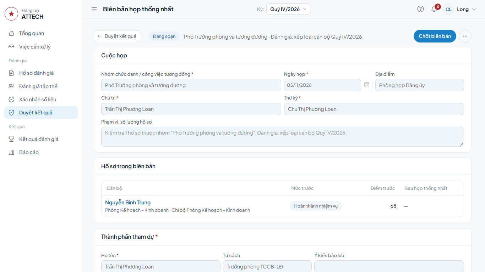
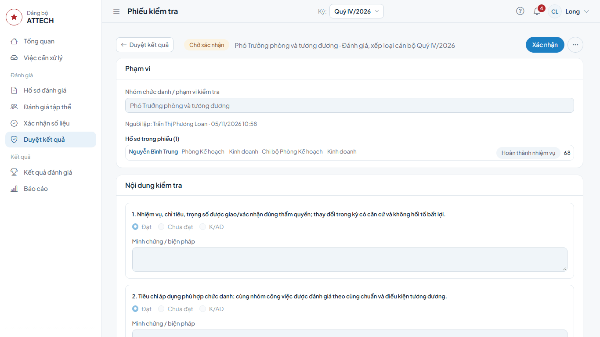
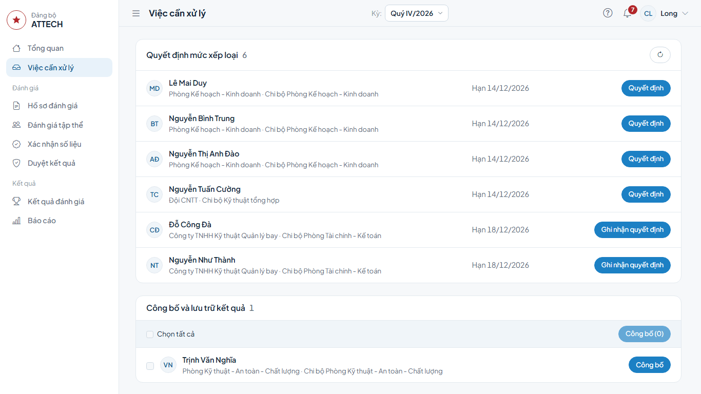
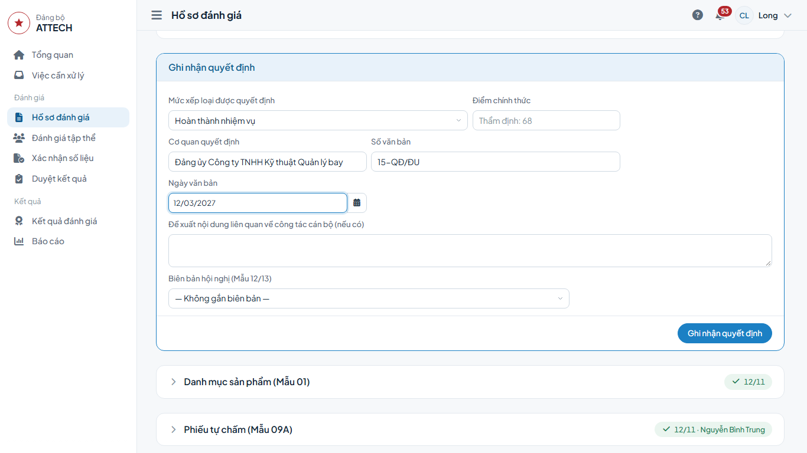
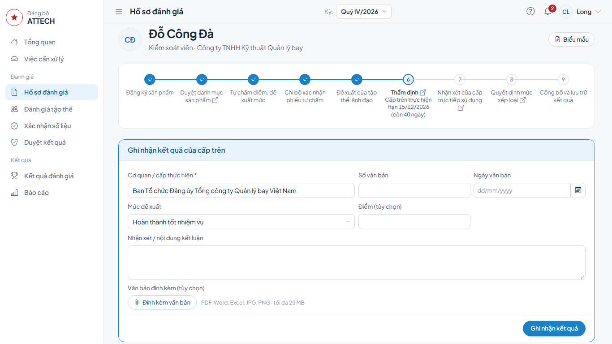
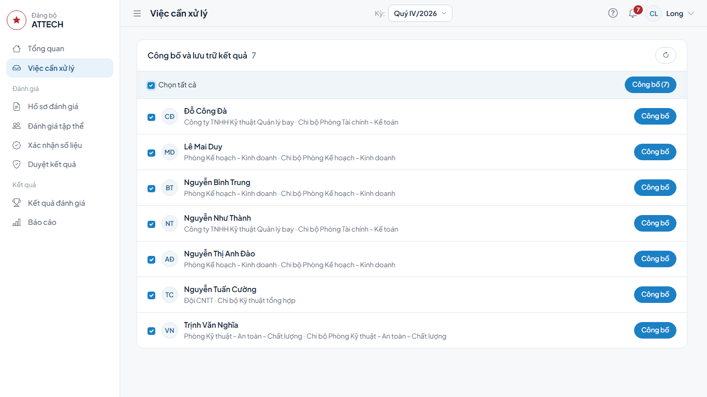
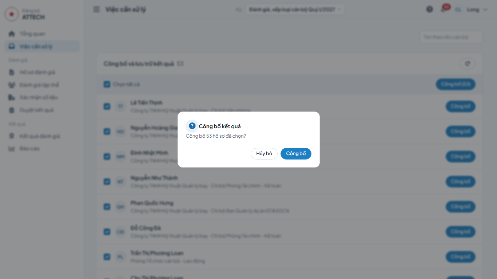
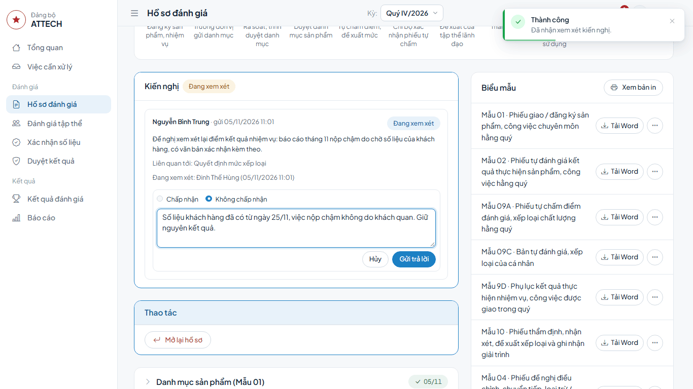
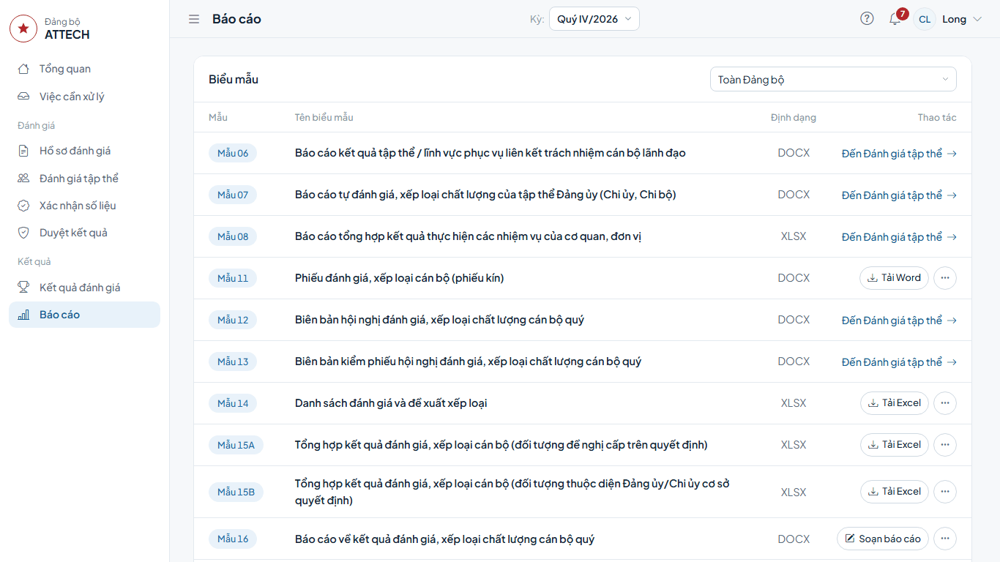

# Hướng dẫn cho Văn phòng Đảng ủy

Dành cho cán bộ Văn phòng được giao: chốt biên bản họp thống nhất, xác nhận phiếu kiểm tra, ghi quyết định, ghi nhận kết quả của cấp trên, công bố, xử lý kiến nghị, xuất báo cáo và biểu mẫu.

Cán bộ công tác Đảng được phân công giúp việc đánh giá (thư ký hội nghị cấp Công ty, rà soát, thẩm định): xem [Hướng dẫn cho thư ký hội nghị](thu-ky.md) và [Hướng dẫn cho Phòng TCCB-LĐ](tham-dinh.md).

Gặp lỗi hoặc chỗ khó hiểu: ghi vào phiếu góp ý `phieu-gop-y.xlsx`.

## Cần biết trước

- Không ai làm bước trên hồ sơ của chính mình. Người lập biên bản, phiếu không tự chốt, tự xác nhận.
- Trang **Tổng quan** cho biết số hồ sơ đang ở từng bước và hồ sơ nào chậm hạn, ai phải làm.
- Người đã ghi một bước (ví dụ ghi quyết định) không xử lý kiến nghị về chính bước đó; kiến nghị ấy hiện ở **Việc cần xử lý** của người khác trong Văn phòng.
- Thứ tự trước khi ghi quyết định: Phòng TCCB-LĐ lập biên bản họp thống nhất → bạn chốt → Phòng TCCB-LĐ lập phiếu kiểm tra → bạn xác nhận → ghi quyết định. Thiếu một việc thì nút **Ghi nhận quyết định** bị khóa, dải vàng trên hồ sơ ghi lý do.

## 1. Chốt biên bản họp thống nhất (Mẫu 20)

1. Menu **Duyệt kết quả** → thẻ **Họp thống nhất** → bấm vào biên bản ở trạng thái **Đang soạn**.
2. Xem cuộc họp, hồ sơ trong biên bản, thành phần tham dự, kết quả chung.
3. Bấm **Chốt biên bản** → **Chốt biên bản**. Mức ở cột **Sau họp thống nhất** được áp vào hồ sơ.

**Xong thì thấy:** biên bản ghi **Đã chốt** kèm tên bạn và thời gian.

**Nút bị khóa:** dòng đầu trang ghi còn thiếu gì (chủ trì, thư ký, thành phần tham dự…). Báo người lập bổ sung.

Hồ sơ trong biên bản đã có quyết định thì không áp lại mức; hồ sơ đó ghi **Đã có quyết định, giữ nguyên**.

## 2. Xác nhận phiếu kiểm tra (Mẫu 19)

1. Menu **Duyệt kết quả** → thẻ **Kiểm tra** → bấm vào phiếu chờ xác nhận.
2. Xem 10 mục kiểm tra và kết luận.
3. Bấm **Xác nhận** → **Xác nhận**. Phiếu cần sửa: **⋯** → **Trả lại** → ghi lý do → **Trả lại**; phiếu về người lập.

## 3. Ghi quyết định mức xếp loại

**Khi nào:** sau khi Đảng ủy họp quyết định.

1. **Việc cần xử lý** → nhóm **Quyết định mức xếp loại** → dòng cán bộ → bấm **Quyết định**.

2. Chọn **Mức xếp loại được quyết định**.
3. **Điểm chính thức**: để trống là lấy điểm thẩm định.
4. **Cơ quan quyết định** đã điền sẵn; nhập **Số văn bản**, **Ngày văn bản**.
5. **Đề xuất nội dung liên quan về công tác cán bộ (nếu có)**.
6. **Biên bản hội nghị (Mẫu 12/13)**: chọn biên bản hội nghị Đảng ủy nếu đã lập.
7. Bấm **Ghi nhận quyết định** → **Đồng ý**.

**Xong thì thấy:** hồ sơ chuyển sang nhóm **Công bố và lưu trữ kết quả**.

## 4. Ghi nhận kết quả của cấp trên

Với cán bộ thuộc diện cấp trên duyệt, thẩm định, nhận xét hoặc quyết định (ví dụ Phó Giám đốc, Kiểm soát viên), cấp trên làm ngoài hệ thống; bạn ghi lại kết quả.

1. **Việc cần xử lý** → dòng cán bộ có nút **Ghi nhận …** (ví dụ **Ghi nhận thẩm định**, **Ghi nhận quyết định**).
2. Khung **Ghi nhận kết quả của cấp trên**: **Cơ quan / cấp thực hiện** (bắt buộc), **Số văn bản**, **Ngày văn bản**, mức (**Mức đề xuất** hoặc mức được quyết định), **Điểm (tùy chọn)**, **Nhận xét / nội dung kết luận**.
3. Có văn bản của cấp trên thì bấm **Đính kèm văn bản**.
4. Bấm **Ghi nhận kết quả**.

### Danh mục sản phẩm do cấp trên duyệt

Áp dụng cho cán bộ mà danh mục sản phẩm do cấp trên duyệt (ví dụ Chủ tịch, Giám đốc, Kiểm soát viên). Bạn không làm được trên hồ sơ của chính mình.

**Cấp trên duyệt có sửa danh mục:** trước khi ghi nhận kết quả duyệt, cập nhật danh mục cho khớp.

1. Mở hồ sơ (đang ở **Duyệt danh mục sản phẩm**) → khung **Cập nhật danh mục** → bấm **Cập nhật danh mục**.
2. Sửa, thêm, xóa sản phẩm và trọng số như lúc đăng ký; dòng **Tổng trọng số** phải đúng số tối đa.
3. Bấm **Lưu danh mục** → **Đồng ý**. Hồ sơ vẫn ở bước duyệt danh mục; lịch sử ghi **Cập nhật danh mục theo kết quả duyệt** kèm tên bạn.
4. Ghi nhận kết quả duyệt ở khung **Ghi nhận kết quả của cấp trên** như trên.

**Cấp trên duyệt điều chỉnh sau khi danh mục đã duyệt:** khối **Điều chỉnh việc trong quý** → **Ghi điều chỉnh đã duyệt** (hoặc **Ghi nhận việc đột xuất**) → nhập nội dung, bảng trọng số, lý do → nhập **Cơ quan phê duyệt** (điền sẵn cơ quan đã duyệt danh mục), **Số văn bản**, **Ngày văn bản** → **Ghi và áp dụng**. Danh mục cập nhật ngay, đề nghị có nhãn **Đã duyệt**; phiếu Mẫu 04/05 in cơ quan kèm số, ngày văn bản ở ô người phê duyệt.

## 5. Công bố kết quả

**Khi nào:** sau khi ghi quyết định. Người **Chưa xếp loại** cũng phải công bố.

Công bố nhiều hồ sơ cùng lúc:

1. **Việc cần xử lý** → nhóm **Công bố và lưu trữ kết quả**.
2. Tích từng hồ sơ, hoặc tích **Chọn tất cả**.
3. Bấm **Công bố (…)** (số trong ngoặc là số hồ sơ đã chọn) → **Công bố**.

**Xong thì thấy:** thông báo "Đã công bố … hồ sơ."; nhóm biến khỏi danh sách. Hồ sơ nào không công bố được thì hiện ngay dưới thanh chọn kèm lý do.

Công bố từng hồ sơ: bấm **Công bố** ở cuối dòng.

**Cần sửa sau khi công bố:** mở hồ sơ → **Mở lại hồ sơ** → chọn **Quay về bước** → ghi **Lý do (bắt buộc)** → **Mở lại hồ sơ**.

## 6. Xử lý kiến nghị

1. **Việc cần xử lý** → nhóm **Kiến nghị chờ xử lý** → bấm **Xử lý kiến nghị**.
2. Trong khối **Kiến nghị** của hồ sơ: bấm **Nhận xem xét**.
3. Xem xét xong: bấm **Trả lời kiến nghị** → chọn **Chấp nhận** hoặc **Không chấp nhận** → ghi **Nội dung trả lời** → **Gửi trả lời**.
4. Chấp nhận và cần sửa kết quả: bấm **Mở lại hồ sơ theo kiến nghị**. Ô **Quay về bước** đã chọn sẵn bước sớm nhất mà kiến nghị nêu, đổi nếu cần; ghi lý do → **Mở lại hồ sơ**.

**Xong thì thấy:** cán bộ thấy câu trả lời ngay trong khối **Kiến nghị** của hồ sơ.

## 7. Báo cáo và xuất biểu mẫu

Menu **Báo cáo**. Ô ở góc phải bảng chọn phạm vi: **Toàn Đảng bộ** hoặc một chi bộ, đảng bộ bộ phận.

| Biểu mẫu | Làm gì |
|---|---|
| Mẫu 14, 15A, 15B | Bấm **Tải Excel**. |
| Mẫu 16 | Bấm **Soạn báo cáo** → điền phần nhập tay → **Lưu nháp** → **Tải Word**. Còn thay đổi chưa lưu thì nút tải bị khóa. |
| Quyết định | Quyết định xếp loại kèm Phụ lục kết quả: **Tải Word**. |
| Mẫu 11 | Phiếu kín trắng: **Tải Word**. |
| Mẫu 06, 07, 08, 12, 13 | Bấm **Đến Đánh giá tập thể**, tải ở đó. |

Bản PDF: nút **⋯** cạnh nút tải. Phần **Báo cáo nội bộ** có **Danh sách cán bộ**, **Bảng tổng hợp xếp loại** và bảng kiểm soát tỷ lệ **Hoàn thành xuất sắc nhiệm vụ** theo tổ chức Đảng.

Người chưa có quyết định được tính theo mức đề xuất gần nhất.

Phiếu của từng cán bộ (Mẫu 01, 02, 09A, 09C, 9D, 10…): mở hồ sơ → nút **Biểu mẫu** ở đầu trang → **Tải Word**.
