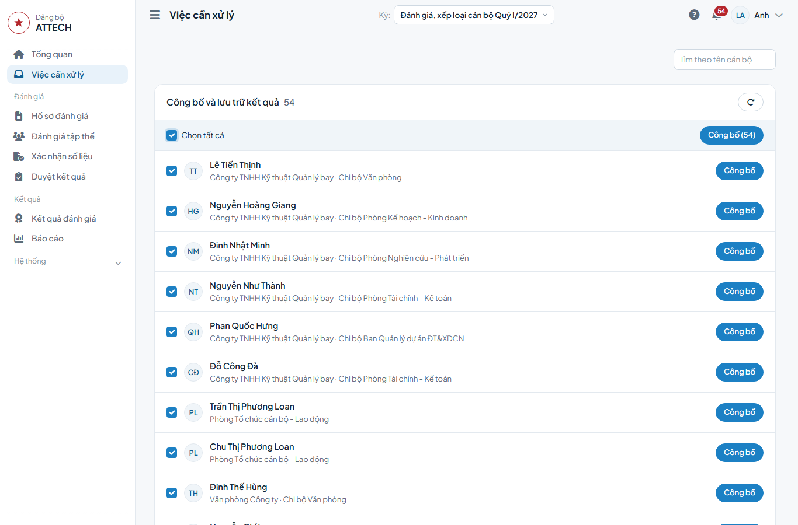

# Hướng dẫn cho Văn phòng Đảng ủy

Chương này dành cho cán bộ Văn phòng Đảng ủy được giao chốt biên bản, xác nhận phiếu, ghi quyết định, công bố kết quả và xử lý kiến nghị.

Trong mỗi kỳ, Văn phòng Đảng ủy làm 4 việc chính:
1. Chốt biên bản họp thống nhất, xác nhận phiếu kiểm tra.
2. Ghi quyết định mức xếp loại.
3. Công bố kết quả.
4. Trả lời kiến nghị.

Các việc khác chỉ làm khi phát sinh (Phần B).

## A. Việc chính

### 1. Chốt biên bản, xác nhận phiếu

Thời điểm: sau khi Phòng TCCB-LĐ lập biên bản họp thống nhất (Mẫu 20) và gửi phiếu kiểm tra (Mẫu 19); trước khi ghi quyết định.

Cách làm:
1. Vào menu **Duyệt kết quả**, ở thẻ **Họp thống nhất** bấm biên bản đang soạn.
2. Kiểm tra cuộc họp, hồ sơ, thành phần tham dự và kết quả chung.
3. Bấm **Chốt biên bản**, sau đó bấm **Chốt biên bản** trong hộp xác nhận.
4. Sang thẻ **Kiểm tra**, bấm phiếu chờ xác nhận.
5. Kiểm tra 10 mục và kết luận của phiếu.
6. Bấm **Xác nhận**, sau đó bấm **Xác nhận** trong hộp xác nhận.

Sau khi xong: mức ở cột Sau họp thống nhất áp vào hồ sơ (hồ sơ đã có quyết định giữ nguyên mức); hồ sơ trong phiếu đủ điều kiện ghi quyết định.

### 2. Ghi quyết định mức xếp loại

Thời điểm: sau khi Đảng ủy họp quyết định.

Cách làm:
1. Vào **Việc cần xử lý**, ở nhóm Quyết định mức xếp loại bấm **Quyết định** ở dòng cán bộ.
2. Đọc khối Ý kiến và giải trình (giải trình của cán bộ sau thẩm định, nếu có).
3. Nhập các ô theo bảng dưới.
4. Bấm **Ghi nhận quyết định**, sau đó bấm **Đồng ý**.

| Ô | Ghi gì |
|---|---|
| Mức xếp loại được quyết định | Mức Đảng ủy quyết định |
| Điểm chính thức | Để trống thì lấy điểm thẩm định |
| Số văn bản, Ngày văn bản | Theo văn bản quyết định; cơ quan quyết định điền sẵn |
| Đề xuất nội dung liên quan về công tác cán bộ | Nếu có; in cột 13 Mẫu 14 |
| Căn cứ quyết định mức | Bắt buộc khi mức khác mức theo điểm |
| Biên bản hội nghị (Mẫu 12/13) | Chọn biên bản hội nghị Đảng ủy nếu đã lập; tích "Ghi kết quả kiểm phiếu của hồ sơ này" để ghi số phiếu |

Sau khi xong: hồ sơ chuyển sang nhóm Công bố và lưu trữ kết quả.

### 3. Công bố kết quả

Thời điểm: sau khi ghi quyết định. Hồ sơ Chưa xếp loại cũng phải công bố.

Cách làm:
1. Vào **Việc cần xử lý**, mở nhóm Công bố và lưu trữ kết quả.
2. Tích từng hồ sơ hoặc bấm **Chọn tất cả**.
3. Bấm **Công bố (…)**, sau đó bấm **Công bố** trong hộp xác nhận.

Sau khi xong: màn hình báo số hồ sơ đã công bố; hồ sơ chưa công bố được hiện dưới thanh chọn kèm lý do. Công bố riêng một hồ sơ: bấm **Công bố** cuối dòng.

### 4. Trả lời kiến nghị

Thời điểm: khi có kiến nghị ở nhóm Kiến nghị chờ xử lý.

Cách làm:
1. Vào **Việc cần xử lý**, ở nhóm Kiến nghị chờ xử lý bấm **Xử lý kiến nghị**.
2. Ở khối Kiến nghị, bấm **Nhận xem xét**.
3. Bấm **Trả lời kiến nghị**, chọn Chấp nhận hoặc Không chấp nhận.
4. Ghi nội dung trả lời, bấm **Gửi trả lời**.

Sau khi xong: cán bộ xem câu trả lời trong khối Kiến nghị của hồ sơ. Chấp nhận và cần sửa kết quả thì mở lại hồ sơ theo kiến nghị (Phần B).

## B. Khi phát sinh

- **Hồ sơ của chính mình:** không thực hiện bước trên hồ sơ của chính mình. Người lập biên bản, phiếu không tự chốt, tự xác nhận. Biên bản hội nghị Đảng ủy: [Hướng dẫn cho thư ký hội nghị](thu-ky.md). Vai trò Cán bộ giúp việc Đảng ủy (thẩm định, lập Mẫu 06, 07, 08): [Hướng dẫn cho Phòng TCCB-LĐ](tham-dinh.md).
- **Nút Chốt biên bản bị khóa:** dòng đầu trang nêu nội dung còn thiếu (chủ trì, thư ký, thành phần…); đề nghị người lập bổ sung.
- **Phiếu kiểm tra cần sửa:** bấm **⋯**, chọn **Trả lại**, ghi lý do, bấm **Trả lại**.
- **Hồ sơ trong biên bản đã chốt bị trả lại hoặc mở lại rồi đi lại tới quyết định:** 1. Vào **Việc cần xử lý**, ở nhóm Họp thống nhất bấm **Mở lại biên bản**. 2. Bấm **⋯**, chọn **Mở lại**, ghi lý do, bấm **Mở lại**. 3. Sau khi Phòng TCCB-LĐ cập nhật, bấm **Chốt lại**.
- **Hồ sơ trong phiếu đã xác nhận đổi bước, điểm hoặc mức:** mở phiếu, bấm **⋯**, chọn **Mở lại**, ghi lý do; người lập sửa và gửi lại.
- **Cổng trước quyết định chưa đạt:** cổng bắt buộc thì nút **Ghi nhận quyết định** bị khóa, dải vàng ghi lý do; chốt biên bản, xác nhận phiếu trước. Cổng chỉ ghi nhận thì chỉ hiện dải nhắc, lịch sử hồ sơ ghi phần còn thiếu.
- **Ghi nhận kết quả của cấp trên:** khi có văn bản của cấp trên. 1. Vào **Việc cần xử lý**, bấm nút **Ghi nhận …** ở dòng cán bộ (duyệt, thẩm định, nhận xét, quyết định). 2. Nhập cơ quan, cấp thực hiện (bắt buộc), số, ngày văn bản, mức, điểm (tùy chọn), nội dung kết luận; đính kèm văn bản nếu có. 3. Bấm **Ghi nhận kết quả**, sau đó bấm **Đồng ý**. Hồ sơ Chủ tịch, Giám đốc, Kiểm soát viên ghi nhận các bước duyệt danh mục, thẩm định, nhận xét, quyết định. Hồ sơ Phó Giám đốc ghi nhận quyết định của Ban Thường vụ Đảng ủy Tổng công ty, kèm kết luận thẩm định của Ban Tổ chức Đảng ủy Tổng công ty ở ô nội dung kết luận. Bước cấp trên thực hiện không có nút trả lại; ghi nhầm thì sau khi công bố mở lại hồ sơ và ghi lại.
- **Cấp trên duyệt danh mục có sửa:** trước khi ghi nhận kết quả duyệt, mở hồ sơ, bấm **Cập nhật danh mục**, sửa sản phẩm, trọng số cho khớp (tổng trọng số bằng số tối đa), bấm **Lưu danh mục**, sau đó bấm **Đồng ý**. Cấp trên duyệt không sửa thì ghi nhận kết quả ngay.
- **Cấp trên duyệt điều chỉnh danh mục, nhiệm vụ đột xuất** (Chủ tịch, Giám đốc, Kiểm soát viên): mở hồ sơ, ở khối Điều chỉnh việc trong quý bấm **Ghi điều chỉnh đã duyệt** (hoặc **Ghi nhận việc đột xuất**); nhập nội dung, bảng trọng số, lý do, số và ngày văn bản; bấm **Ghi và áp dụng**. Danh mục cập nhật ngay; Mẫu 04, 05 in cơ quan, số, ngày văn bản ở ô người phê duyệt.
- **Phiếu xác nhận số liệu (Mẫu 03) của cơ quan ngoài hệ thống:** vào menu **Xác nhận số liệu** (hoặc nhóm Phiếu xác nhận số liệu chờ lập, xác nhận ở **Việc cần xử lý**), đối chiếu kết quả với văn bản đính kèm, bấm **Xác nhận**. Cần sửa: bấm **⋯**, chọn **Trả lại**, ghi lý do.
- **Mở lại hồ sơ đã công bố:** khi phát hiện sai sót. Mở hồ sơ, bấm **Mở lại hồ sơ**, chọn bước quay về (sớm nhất là tự chấm), ghi lý do, bấm **Mở lại hồ sơ**. Hồ sơ đi lại từ bước đã chọn; dữ liệu các bước sau được giữ để đối chiếu. Kỳ đã khóa dữ liệu hoặc đã đóng mà quay về trước thẩm định thì nhập thêm hạn mở riêng hồ sơ; kỳ đã đóng chuyển về Khóa dữ liệu. Hồ sơ Chưa xếp loại mở lại thì bỏ dấu Chưa xếp loại.
- **Chấp nhận kiến nghị và cần sửa kết quả:** bấm **Mở lại hồ sơ theo kiến nghị** (bước quay về chọn sẵn theo kiến nghị, đổi nếu cần), ghi lý do, bấm **Mở lại hồ sơ**. Người đã ghi một bước không xử lý kiến nghị về bước đó; kiến nghị chuyển tới người khác trong Văn phòng.
- **Báo cáo, xuất biểu mẫu:** vào menu **Báo cáo**, chọn phạm vi Toàn Đảng bộ hoặc một chi bộ, đảng bộ bộ phận ở ô góc phải. Mẫu 14, 15A, 15B: **Tải Excel**. Mẫu 16: **Soạn báo cáo**, điền phần nhập tay, **Lưu nháp**, rồi **Tải Word**. Quyết định xếp loại kèm Phụ lục và Mẫu 11 (phiếu kín trắng): **Tải Word**. Bản PDF: nút **⋯** cạnh nút tải. Các biểu mẫu khác tải ở nơi lập (xem [Hướng dẫn chung](huong-dan-chung.md)).
- **Quyết định xếp loại:** là bản đầy đủ của Đảng ủy Công ty, không theo ô phạm vi, cần được giao toàn công ty; còn hồ sơ chưa có quyết định thì chưa tải được, thông báo nêu tên. Đơn vị xem phần của mình bằng Mẫu 14.
- **Số liệu trên báo cáo:** Báo cáo nội bộ gồm danh sách cán bộ, bảng tổng hợp xếp loại, bảng kiểm soát tỷ lệ Hoàn thành xuất sắc theo tổ chức Đảng. Cán bộ chưa có quyết định tính theo mức đề xuất gần nhất. Diện Trưởng đơn vị đề xuất: mức Trưởng đơn vị đề xuất in ở cột đề xuất của cấp trực tiếp sử dụng (Mẫu 14 cột 10, Mẫu 11 cột 7). Văn bản của Đảng ủy in tiêu đề "ĐẢNG ỦY …".
- **Theo dõi chung:** trang **Tổng quan** thể hiện số hồ sơ ở từng bước, hồ sơ chậm hạn và người phải thực hiện.

## C. Câu hỏi thường gặp

- Nút Ghi nhận quyết định bị khóa? Biên bản họp thống nhất chưa chốt hoặc phiếu kiểm tra chưa xác nhận; dải vàng ghi lý do.
- Nút Chốt biên bản bị khóa? Biên bản còn thiếu nội dung nêu ở dòng đầu trang; đề nghị người lập bổ sung.
- Không thấy nút trả lại ở bước cấp trên thực hiện? Bước này không có trả lại; ghi nhầm thì mở lại hồ sơ sau khi công bố.
- Không tải được Quyết định? Còn hồ sơ chưa có quyết định (thông báo nêu tên), hoặc tài khoản chưa được giao phạm vi toàn công ty.
- Không thấy kiến nghị cần xử lý? Kiến nghị về bước do chính mình ghi được chuyển tới người khác trong Văn phòng.
