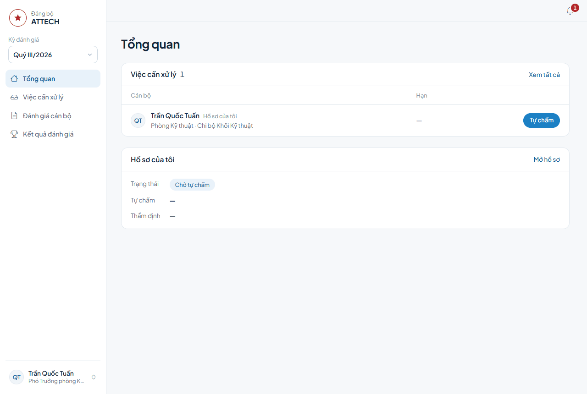
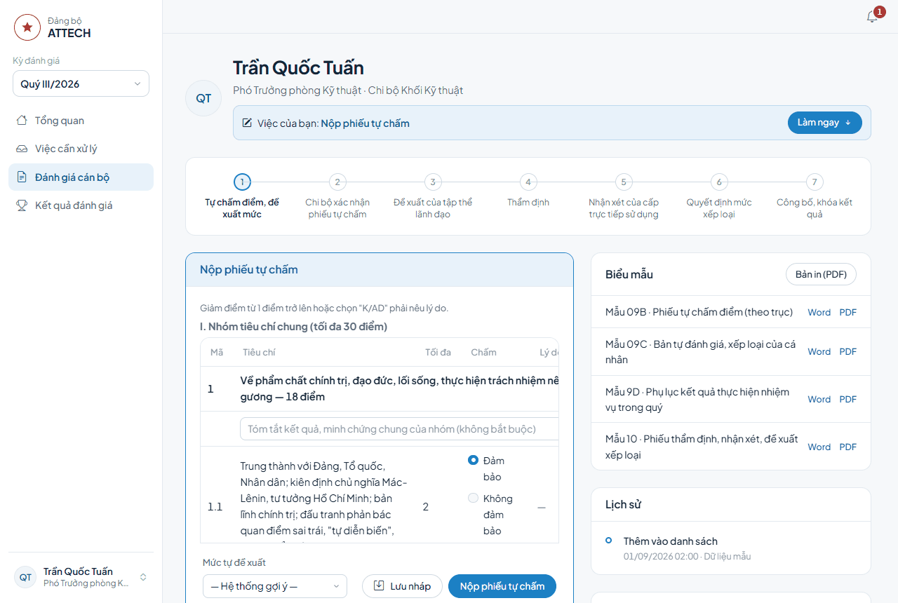
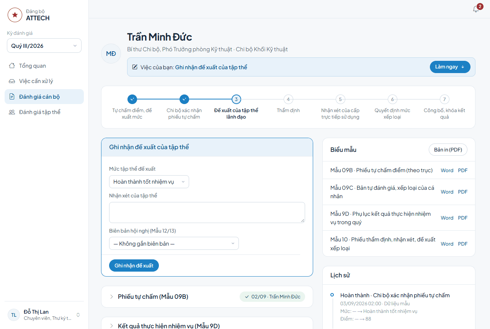
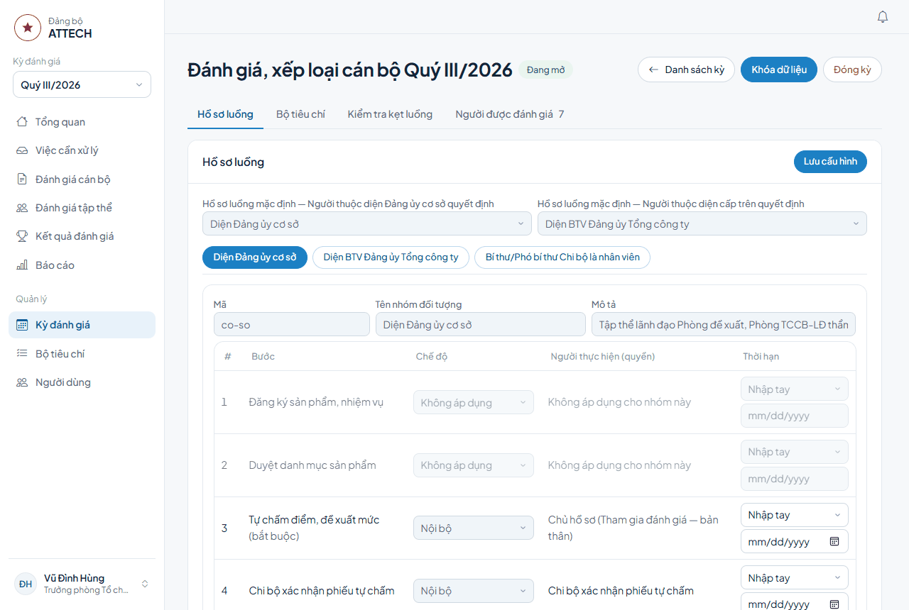
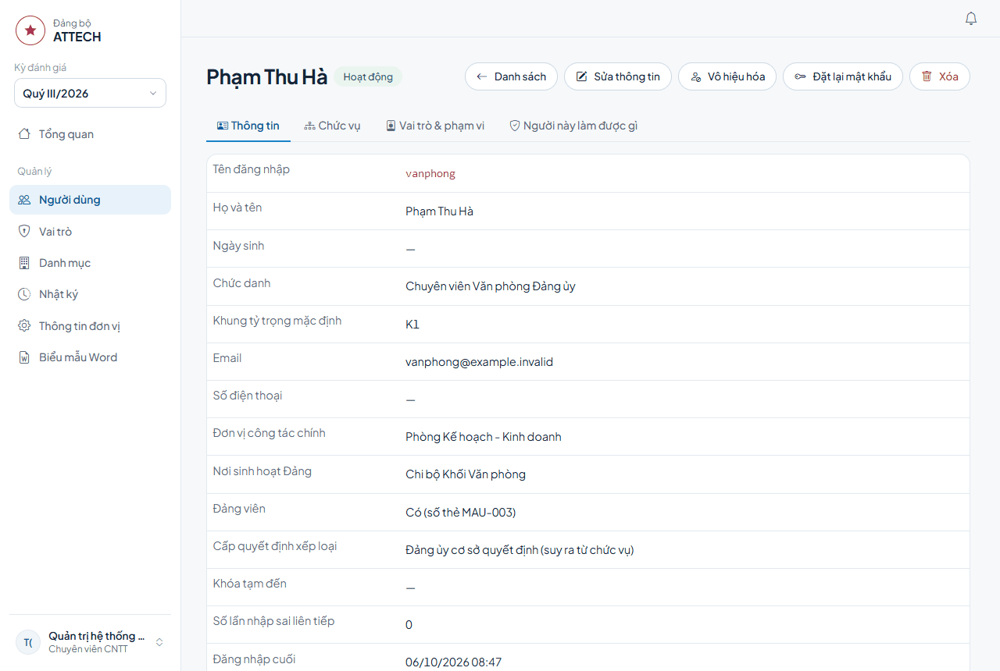

# Hướng dẫn sử dụng — Hệ thống đánh giá, xếp loại cán bộ

Tài liệu dành cho người dùng: cán bộ được đánh giá, Chi ủy, thư ký hội nghị, cơ quan thẩm định, lãnh đạo, Văn phòng Đảng ủy và quản trị hệ thống.

> Lưu ý: chức năng nhập dữ liệu từ Excel đang được phát triển, sẽ bổ sung hướng dẫn khi hoàn thành.

**Mục lục**

1. [Những điều cần biết trước](#1-những-điều-cần-biết-trước)
2. [Thao tác chung](#2-thao-tác-chung)
3. [Cán bộ được đánh giá](#3-cán-bộ-được-đánh-giá)
4. [Các bước xét duyệt](#4-các-bước-xét-duyệt)
5. [Đánh giá tập thể và biên bản hội nghị](#5-đánh-giá-tập-thể-và-biên-bản-hội-nghị)
6. [Sau khi công bố: kiến nghị và kế hoạch 30-60-90 ngày](#6-sau-khi-công-bố-kiến-nghị-và-kế-hoạch-30-60-90-ngày)
7. [Quản lý kỳ đánh giá](#7-quản-lý-kỳ-đánh-giá)
8. [Bộ tiêu chí](#8-bộ-tiêu-chí)
9. [Báo cáo](#9-báo-cáo)
10. [Quản trị hệ thống](#10-quản-trị-hệ-thống)
11. [Câu hỏi thường gặp](#11-câu-hỏi-thường-gặp)

---

## 1. Những điều cần biết trước

**Mỗi người thấy menu và nút khác nhau.** Hệ thống chỉ hiện những gì bạn được giao. Ví dụ: cán bộ thường chỉ thấy *Tổng quan*, *Việc cần xử lý*, *Đánh giá cán bộ*, *Kết quả đánh giá*. Người quản lý kỳ thấy thêm nhóm *Quản lý*. Nếu thiếu một mục cần dùng, hãy liên hệ quản trị hệ thống.

**Nút thao tác trên hồ sơ do hệ thống quyết định.** Nút chỉ hiện khi hồ sơ đang ở đúng bước của bạn, bạn được giao bước đó trong phạm vi đơn vị của hồ sơ, và kỳ còn cho phép thao tác. Bạn không bao giờ thấy nút xét duyệt trên hồ sơ của chính mình.

**Các bước của một hồ sơ** (tùy nhóm đối tượng, một số bước có thể không áp dụng hoặc do cấp trên thực hiện):

| # | Bước | Ai làm |
|---|---|---|
| 1 | Tự chấm điểm, đề xuất mức | Chính cán bộ |
| 2 | Chi bộ xác nhận phiếu tự chấm | Chi ủy / Bí thư Chi bộ |
| 3 | Đề xuất của tập thể lãnh đạo | Thư ký tập thể lãnh đạo ghi nhận kết quả hội nghị |
| 4 | Thẩm định | Cơ quan thẩm định (Phòng Tổ chức cán bộ - Lao động) hoặc cấp trên |
| 5 | Nhận xét của cấp trực tiếp sử dụng | Giám đốc (hoặc Trưởng phòng, tùy nhóm) hoặc cấp trên |
| 6 | Quyết định mức xếp loại | Người ghi nhận quyết định của Đảng ủy, hoặc kết quả của cấp trên |
| 7 | Công bố, khóa kết quả | Văn phòng Đảng ủy |

Khi kỳ áp dụng đăng ký sản phẩm đầu quý, trước bước 1 còn có *Đăng ký sản phẩm, nhiệm vụ* và *Duyệt danh mục sản phẩm*.

**Trạng thái kỳ đánh giá:**

| Trạng thái | Ý nghĩa với người dùng |
|---|---|
| Dự thảo | Đang chuẩn bị. Chưa ai thao tác trên hồ sơ. |
| Đang mở | Các bước chạy bình thường. |
| Khóa dữ liệu | Cán bộ không sửa phiếu tự chấm được nữa. Chỉ các bước từ Thẩm định trở đi còn thao tác. |
| Đã đóng | Mọi hồ sơ đã công bố. Chỉ còn mở lại hồ sơ để đính chính. |

---

## 2. Thao tác chung

### 2.1 Đăng nhập

1. Mở địa chỉ hệ thống do Văn phòng Đảng ủy hoặc bộ phận CNTT cung cấp.
2. Nhập **Tên đăng nhập** (hoặc email) và **Mật khẩu**, bấm Enter.
3. Lần đầu đăng nhập, hoặc sau khi được đặt lại mật khẩu, hệ thống yêu cầu đổi mật khẩu ngay.

Nhập sai mật khẩu nhiều lần liên tiếp, tài khoản bị khóa tạm. Chờ hết thời gian khóa hoặc nhờ quản trị mở khóa.

### 2.2 Đổi mật khẩu và xem thông tin tài khoản

Bấm vào tên của bạn ở góc dưới thanh bên trái → **Tài khoản**. Trang có ba phần:

- **Thông tin cá nhân**: họ tên, tên đăng nhập, chức danh, phòng, Chi bộ (chỉ xem; cần sửa thì báo quản trị).
- **Vai trò**: vai trò bạn đang được giao và phạm vi.
- **Mật khẩu**: nhập mật khẩu hiện tại, mật khẩu mới (tối thiểu 8 ký tự, có cả chữ và số), xác nhận rồi bấm **Đổi mật khẩu**. Các phiên đăng nhập khác của bạn sẽ bị đăng xuất.

Đăng xuất: bấm vào tên của bạn → **Đăng xuất**.

### 2.3 Chọn kỳ đánh giá

Ô **Kỳ đánh giá** ở đầu thanh bên trái (ví dụ "Quý III/2026"). Mọi trang (Tổng quan, Việc cần xử lý, Đánh giá cán bộ, Báo cáo…) hiển thị dữ liệu của kỳ đang chọn. Kỳ không ở trạng thái Đang mở có ghi kèm trạng thái, ví dụ "(Khóa dữ liệu)".

### 2.4 Tổng quan

Trang đầu tiên sau khi đăng nhập. Tùy vai trò, trang có:

- **Việc cần xử lý**: các hồ sơ đang chờ bạn, kèm hạn. Bấm **Xem tất cả** để mở danh sách đầy đủ.
- **Hồ sơ của tôi**: trạng thái, điểm tự chấm, điểm thẩm định của hồ sơ bạn. Bấm **Mở hồ sơ**.
- **Số liệu hồ sơ** (người xem được nhiều hồ sơ): số hồ sơ Đang tự chấm, Đang xét duyệt, Bị trả lại, Đã công bố.
- **Tiến độ theo Chi bộ**: số hồ sơ và tỷ lệ đã công bố của từng Chi bộ.
- **Quản trị** (quản trị hệ thống): số tài khoản, phòng/đơn vị, Chi bộ.

### 2.5 Việc cần xử lý

Menu **Việc cần xử lý** liệt kê mọi hồ sơ đang chờ chính bạn, nhóm theo bước (ví dụ "Tự chấm điểm, đề xuất mức", "Đề xuất của tập thể lãnh đạo", "Kiến nghị chờ xử lý", "Kế hoạch 30-60-90 ngày cần lập / duyệt"). Cột **Hạn** hiện thời hạn của bước; quá hạn hiện màu đỏ. Bấm vào dòng để mở hồ sơ.

### 2.6 Nhắc việc (chuông)

Biểu tượng chuông ở góc trên bên phải. Con số đỏ là tổng việc đang chờ bạn. Bấm vào chuông để xem nhanh: số việc theo từng loại, số việc **Quá hạn**, việc sắp tới hạn, **Kiến nghị**, **Kế hoạch cần lập/duyệt**, **Kế hoạch chờ xác nhận**. Bấm một dòng để mở danh sách tương ứng.

---

## 3. Cán bộ được đánh giá

### 3.1 Mở hồ sơ của tôi

Menu **Đánh giá cán bộ** → khối **Hồ sơ của tôi** → **Mở hồ sơ**. Cũng có thể mở từ Tổng quan hoặc Việc cần xử lý.

Bạn chỉ có hồ sơ khi người quản lý kỳ đã thêm bạn vào kỳ. Không thấy hồ sơ → xem [Câu hỏi thường gặp](#11-câu-hỏi-thường-gặp).

### 3.2 Đọc trang hồ sơ

Từ trên xuống:

- **Dòng trạng thái** dưới họ tên:
  - **"Việc của bạn: …"** kèm nút **Làm ngay** — đến lượt bạn. Bấm **Làm ngay** để cuộn tới khu nhập liệu.
  - **"Đang ở bước n – … · Chờ: …"** — hồ sơ đang chờ người khác; dòng này cho biết chờ ai và hạn của bước.
  - **"Đã công bố kết quả"** kèm mức xếp loại chính thức.
- **Thanh các bước** (vòng tròn đánh số): bước đã xong có dấu tích, bước đang làm sáng màu kèm hạn (đỏ khi quá hạn). Rê chuột vào một bước để xem ai làm, lúc nào. **Bấm vào bước** đã xong hoặc đang làm để nhảy tới nội dung của bước đó.
- **Khung thao tác** (chỉ hiện khi đến lượt bạn).
- **Các khối nội dung** của từng bước: Phiếu tự chấm, Kết quả thực hiện nhiệm vụ (Mẫu 9D), Bản tự đánh giá (Mẫu 09C), Xác nhận của Chi bộ, Đề xuất của tập thể lãnh đạo, Thẩm định… Bấm tiêu đề để mở/thu gọn.
- Cột bên phải: **Biểu mẫu** (tải Word/PDF), **Lịch sử** (ai làm gì, lúc nào, điểm và mức thay đổi ra sao), **Thông tin** (kỳ, phòng, Chi bộ, thẩm quyền, nhóm đối tượng).

### 3.3 Đăng ký sản phẩm đầu quý (Mẫu 01)

Trong 5 ngày làm việc đầu quý, khi kỳ có bước đăng ký sản phẩm:

1. Mở hồ sơ, phần **Đăng ký sản phẩm, nhiệm vụ**. Mỗi sản phẩm là một khung riêng.
2. Nhập đủ các ô như phiếu giấy: tên sản phẩm, **loại việc** (trọng tâm / thường xuyên), **vai trò** (chủ trì / phối hợp), trục kết quả, trọng số, thời hạn, chuẩn đạt, tiêu chí vượt chuẩn, nguồn dữ liệu / minh chứng, thẩm quyền xác nhận. Mã SP không bắt buộc; thời hạn để trống là ngày cuối kỳ.
3. Bấm **Thêm dòng** hoặc **Xóa** để đủ 3–7 sản phẩm. Tổng trọng số phải đúng 70; ô tổng chuyển đỏ khi chưa đủ.
4. Bấm **Nộp danh mục**. Thiếu ô nào, hệ thống báo đúng dòng và ô đó.

Việc đột xuất giao thêm trong quý không đăng ký ở đây.

### 3.4 Tự chấm điểm

Khung **Nộp phiếu tự chấm** gồm các phần sau.

**I. Nhóm tiêu chí chung**

- Mỗi tiêu chí con chọn **Đảm bảo**, **Không đảm bảo** hoặc **K/AD** (không áp dụng).
- Chọn *Không đảm bảo*, *K/AD*, hoặc giảm từ 1 điểm trở lên → bắt buộc ghi **Lý do**.
- Dưới tên mỗi nhóm có ô *Tóm tắt kết quả, minh chứng chung của nhóm* (không bắt buộc).
- Dòng *Cộng tiêu chí chung (tạm tính)* tự cập nhật.

**II. Kết quả thực hiện nhiệm vụ — chấm theo trục**

Mỗi trục (T1…T6) có ô điểm (không vượt điểm tối đa ghi bên cạnh, ví dụ "/ 15") và ba ô: *Mục tiêu, nhiệm vụ đề ra*; *Tóm tắt kết quả sản phẩm thực tế; tài liệu minh chứng*; *Ghi chú*. Dòng *Cộng các trục (tạm tính)* tự cập nhật.

**Mẫu 09C — Bản tự đánh giá**

- Ô **Nhận xét chung** cho phần I (đếm ký tự, có giới hạn). Đọc phần lưu ý in nghiêng bên dưới để viết đúng yêu cầu.
- Các mục khác của Mẫu 09C (nếu bộ tiêu chí có) hiện ngay bên dưới; mục có dấu \* là bắt buộc khi nộp.

**Nhiệm vụ và kết quả theo trục (Mẫu 09C, 9D)**

Với mỗi trục:

1. Bấm **Thêm nhiệm vụ**. Nhập nội dung nhiệm vụ, tình hình và kết quả thực hiện.
2. Chọn mức tự đánh giá của nhiệm vụ ở ô **Mức** (Mức 1, Mức 2, Mức 3). Rê chuột vào ô để xem ý nghĩa từng mức.
3. Cần chia nhỏ → bấm **Thêm ý** dưới nhiệm vụ; mỗi ý có thể chọn mức riêng.
4. Dùng nút mũi tên để đổi thứ tự, nút ✕ để xóa nhiệm vụ hoặc ý.
5. Phần **Dòng Trục n — Mẫu 9D** là dòng tóm tắt của trục trong Phụ lục 9D: *Tình hình thực hiện*, *Sản phẩm hoàn thành*, *Đánh giá tiến độ*, *Thời hạn hoàn thành*, *Ghi chú*. Bấm **Lấy tình hình từ nhiệm vụ** để điền nhanh ô *Tình hình thực hiện* từ các nhiệm vụ đã nhập, rồi sửa lại nếu cần.

**Xem trước và đề xuất mức**

- Bấm **Xem trước mục I Mẫu 09C** để xem đoạn văn sẽ in ra.
- Dòng *Tổng điểm tạm tính* cho biết mức theo điểm.
- Ô **Mức tự đề xuất**: để "Hệ thống gợi ý" thì dùng mức theo điểm; hoặc chọn mức khác.

**Lưu nháp và Nộp**

- **Lưu nháp**: lưu lại để làm tiếp sau, hồ sơ vẫn ở bước tự chấm. Phiếu nháp chưa được tính vào điểm, mức ở danh sách. Còn thay đổi chưa lưu thì cạnh nút hiện "Có thay đổi chưa lưu", và hệ thống hỏi lại nếu bạn rời trang.
- **Nộp phiếu tự chấm**: hệ thống hiện tổng điểm, mức đề xuất và nhắc nếu còn thiếu Mẫu 09C hoặc 9D. Bấm **Nộp phiếu** để chuyển hồ sơ sang bước kế tiếp. **Sau khi nộp, bạn không sửa được** trừ khi bị trả lại.

Nếu hệ thống báo hồ sơ đã bị thay đổi ở nơi khác (ví dụ bạn mở hai cửa sổ), bấm **Tải lại hồ sơ** rồi làm lại thao tác.

### 3.5 Tải biểu mẫu Word/PDF

Khối **Biểu mẫu** ở cột phải liệt kê các mẫu áp dụng cho hồ sơ (ví dụ Mẫu 09B, 09C, 9D, 10). Bấm **Word** để tải tệp .docx (sửa, in được), **PDF** để tải bản PDF. Nút **Bản in (PDF)** mở bản xem trước ngay trên màn hình.

Thông tin trên biểu mẫu (họ tên, ngày sinh, chức vụ Đảng / chính quyền / đoàn thể, đơn vị) lấy từ hồ sơ cán bộ. Thiếu hoặc sai → xem [Câu hỏi thường gặp](#11-câu-hỏi-thường-gặp).

### 3.6 Khi hồ sơ bị trả lại

Chi bộ (khi xác nhận) hoặc cơ quan thẩm định có thể trả lại phiếu kèm lý do. Khi đó:

- Đầu trang hồ sơ hiện khung đỏ **"Bị trả lại: …"** với lý do.
- Hồ sơ quay về bước tự chấm, dòng trạng thái lại là **"Việc của bạn: Nộp phiếu tự chấm"**.
- Sửa theo lý do rồi **Nộp phiếu tự chấm** lại.

### 3.7 Sau khi công bố

- **Xem kết quả**: dòng trạng thái của hồ sơ hiện "Đã công bố kết quả" và mức chính thức. Menu **Kết quả đánh giá** hiện danh sách kết quả đã công bố trong phạm vi bạn được xem (luôn có kết quả của bạn); lọc theo đơn vị và mức.
- **Gửi kiến nghị** và **xác nhận kế hoạch 30-60-90 ngày**: xem [mục 6](#6-sau-khi-công-bố-kiến-nghị-và-kế-hoạch-30-60-90-ngày).

---

## 4. Các bước xét duyệt

Cách làm chung cho mọi bước xét duyệt:

1. Mở **Việc cần xử lý** (hoặc chuông nhắc việc), bấm vào hồ sơ.
2. Đọc dòng **"Việc của bạn: …"**, bấm **Làm ngay**.
3. Xem các khối nội dung các bước trước (phiếu tự chấm, Mẫu 9D, Mẫu 09C…) và biểu mẫu bên phải nếu cần.
4. Nhập nội dung trong khung thao tác và bấm nút ghi nhận.

### 4.0 Duyệt danh mục sản phẩm

- **Duyệt danh mục**: xem danh mục sản phẩm cán bộ đăng ký, nhập *Ý kiến* (nếu có) rồi bấm **Duyệt danh mục**.
- **Tỷ lệ 4 mặt chấm** (khi bộ tiêu chí cho phép): mở khối này để xem tỷ lệ A-B-C-D của khung và sửa cho riêng hồ sơ, mỗi mặt trong biên độ cho phép, tổng phải bằng 100%. Không mở hoặc không sửa thì giữ nguyên. **Dùng tỷ lệ của khung** để quay về tỷ lệ gốc. Tỷ lệ đã sửa được dùng khi cán bộ tự chấm và hiện "(đã điều chỉnh)" trên hồ sơ.
- **Trả lại danh mục**: bấm nút trả lại ở chân khung, nhập lý do (bắt buộc).

Muốn xem tất cả hồ sơ trong phạm vi (không chỉ hồ sơ chờ mình): menu **Đánh giá cán bộ** → bảng **Hồ sơ trong phạm vi**, lọc theo Phòng, Chi bộ, trạng thái. Trang này còn có bảng kiểm soát tỷ lệ Hoàn thành xuất sắc theo Chi bộ.

### 4.1 Chi bộ xác nhận phiếu tự chấm

- **Xác nhận phiếu tự chấm**: nhập *Ý kiến* (nếu có) rồi bấm nút xác nhận.
- **Trả lại phiếu tự chấm**: bấm nút trả lại ở chân khung, nhập lý do (bắt buộc). Hồ sơ về lại cán bộ.

### 4.2 Đề xuất của tập thể lãnh đạo (thư ký ghi nhận)

Hệ thống không tổ chức bỏ phiếu điện tử. Thư ký ghi lại **kết quả** của hội nghị:

1. Nên lập trước **biên bản hội nghị** ở trang *Đánh giá tập thể* (xem [mục 5.2](#52-biên-bản-hội-nghị-và-kiểm-phiếu-mẫu-12-13)).
2. Trong hồ sơ: chọn **Mức tập thể đề xuất**, nhập **Nhận xét của tập thể**.
3. Chọn **Biên bản hội nghị (Mẫu 12/13)** đã lập. Khi đã gắn biên bản, phần **Ghi kết quả kiểm phiếu của hồ sơ này** hiện ra: nhập số phiếu Xuất sắc, Tốt, Hoàn thành, Không HT, Chưa đánh giá, Không hợp lệ. Tổng số phiếu không vượt số người có mặt.
4. Bấm **Ghi nhận đề xuất**.

### 4.3 Thẩm định

- Nhập **Điểm thẩm định** (mặc định bằng điểm tự chấm), chọn **Mức đề xuất**, nhập **Ý kiến thẩm định**.
- Khung hiện độ chênh lệch so với điểm tự chấm. Chênh lệch từ ngưỡng quy định trở lên (hoặc làm đổi mức, nếu bộ tiêu chí quy định) → bắt buộc nhập **nội dung giải trình, căn cứ**. Nội dung này in ở Mẫu 10.
- Bấm **Ghi nhận thẩm định**.
- Cần cán bộ sửa phiếu → **Trả lại để chủ hồ sơ sửa**, nhập lý do.

### 4.4 Nhận xét của cấp trực tiếp sử dụng

Chọn **Mức đề xuất** (mặc định theo mức thẩm định), nhập **Nhận xét**, bấm **Ghi nhận nhận xét**. Với nhóm đối tượng mà Trưởng phòng đề xuất thay Giám đốc, Trưởng phòng làm bước này theo cách tương tự.

### 4.5 Quyết định mức xếp loại

Người được giao ghi nhận quyết định của Đảng ủy:

1. Chọn **Mức xếp loại được quyết định**.
2. **Điểm chính thức (tùy chọn)** — để trống thì lấy điểm thẩm định.
3. Nhập **Cơ quan quyết định**, **Số văn bản**, **Ngày văn bản**; gắn **Biên bản hội nghị** và ghi kết quả kiểm phiếu nếu có.
4. Ô **Đề xuất nội dung liên quan về công tác cán bộ (nếu có)** — in ở cột cuối Mẫu 14.
5. Bấm **Ghi nhận quyết định**.

### 4.6 Bước do cấp trên thực hiện

Với nhóm đối tượng mà thẩm định, nhận xét hoặc quyết định do cấp trên làm (ví dụ diện Ban Thường vụ Đảng ủy Tổng công ty), thanh bước ghi "Cấp trên thực hiện". Người được giao (thường là Văn phòng Đảng ủy) bấm **Ghi nhận kết quả của cấp trên** và nhập:

- **Cơ quan / cấp thực hiện** (bắt buộc), **Số văn bản**, **Ngày văn bản**;
- **Mức đề xuất** hoặc **Mức xếp loại được quyết định**, **Điểm (tùy chọn)**;
- **Nhận xét / nội dung kết luận**;
- **Đính kèm văn bản (tùy chọn)** — bấm **Bỏ tệp** để gỡ tệp vừa chọn.

Bước do cấp trên thực hiện không trả lại được.

### 4.7 Công bố, khóa kết quả

Văn phòng Đảng ủy bấm **Công bố, khóa kết quả**. Hồ sơ bị khóa, kết quả hiện ở trang *Kết quả đánh giá*.

Cần đính chính sau công bố: **Mở lại hồ sơ**, chọn bước quay về và nhập lý do (bắt buộc). Lý do được ghi vào Lịch sử.

---

## 5. Đánh giá tập thể và biên bản hội nghị

Menu **Đánh giá tập thể** (trang "Đánh giá tập thể & Hội nghị"). Mỗi người chỉ thấy phần được giao.

### 5.1 Hồ sơ tự đánh giá tập thể (Mẫu 07, 08)

1. Bấm **Lập hồ sơ tập thể**, chọn loại biểu mẫu:
   - **Mẫu 07 — Tự đánh giá của tập thể Đảng ủy (Chi ủy, Chi bộ)**: chọn tổ chức Đảng, nhập các mục A (ưu điểm, hạn chế, khắc phục, giải trình, trách nhiệm, phương hướng) và điểm B (nhóm tiêu chí chung /30, kết quả nhiệm vụ /70).
   - **Mẫu 08 — Tổng hợp kết quả nhiệm vụ của cơ quan, đơn vị**: chọn phòng/đơn vị, nhập các dòng nhiệm vụ.
2. Bấm **Lưu hồ sơ tập thể**.
3. Trong danh sách **Hồ sơ tập thể**: **Sửa**, tải **Word**, **PDF** (Mẫu 08 có thêm **Excel**).

### 5.2 Biên bản hội nghị và kiểm phiếu (Mẫu 12, 13)

1. Bấm **Lập biên bản hội nghị**.
2. Chọn **Hội nghị**: *Tập thể lãnh đạo, quản lý (đề xuất)* hoặc *Đảng ủy/Chi ủy cơ sở (quyết định)*; chọn đơn vị tổ chức.
3. Nhập thời gian bắt đầu/kết thúc, địa điểm, số triệu tập, có mặt, vắng mặt và lý do, người dự khác (**Thêm người dự**), chủ trì, thư ký, nội dung.
4. Phần Mẫu 13: **Thêm thành viên Tổ kiểm phiếu** (người đầu tiên là Tổ trưởng), nhập *Phiếu phát ra*, *Phiếu thu về*, *Phiếu hợp lệ*, *Phiếu không hợp lệ*.
5. Nhập **Diễn biến hội nghị**, **Kết quả hội nghị**, bấm **Lưu biên bản**.
6. Ghi kết quả kiểm phiếu của từng cán bộ trong hồ sơ của người đó (xem [mục 4.2](#42-đề-xuất-của-tập-thể-lãnh-đạo-thư-ký-ghi-nhận)).
7. Trong danh sách **Biên bản đã lập**: **Sửa**, tải **Mẫu 12**, **Mẫu 13** (Word) hoặc **PDF**. Mẫu 13 chỉ có khi biên bản đã có kết quả kiểm phiếu.

---

## 6. Sau khi công bố: kiến nghị và kế hoạch 30-60-90 ngày

### 6.1 Kiến nghị về kết quả

**Cán bộ gửi kiến nghị:**

1. Mở hồ sơ đã công bố → khối **Kiến nghị** → **Gửi kiến nghị**.
2. Nhập **Nội dung kiến nghị** (điểm/mức nào cần xem xét lại, căn cứ), chọn **Kiến nghị liên quan tới bước**, đính kèm **Tệp minh chứng (tùy chọn)**.
3. Bấm **Gửi kiến nghị**. Trong khi chờ xử lý, kết quả của bạn ở trang *Kết quả đánh giá* có ghi chú "Đang xem xét kiến nghị". Mỗi lúc chỉ gửi được một kiến nghị đang xử lý.

**Người xử lý kiến nghị** (thấy ở *Việc cần xử lý* → "Kiến nghị chờ xử lý"):

1. Bấm **Nhận xem xét**.
2. Bấm **Trả lời kiến nghị**, chọn **Chấp nhận** hoặc **Không chấp nhận**, nhập nội dung trả lời có căn cứ (bắt buộc), **Gửi trả lời**.
3. Chấp nhận và cần sửa kết quả → **Mở lại hồ sơ theo kiến nghị**: hồ sơ quay về bước được chọn để làm lại.

Bạn không xử lý được kiến nghị của chính mình, hoặc kiến nghị liên quan tới bước bạn đã làm.

### 6.2 Kế hoạch hỗ trợ, khắc phục 30-60-90 ngày (Mẫu 17)

Bắt buộc với cán bộ có mức xếp loại theo quy định của bộ tiêu chí (mặc định: Hoàn thành nhiệm vụ, Không hoàn thành nhiệm vụ). Khối **Kế hoạch 30-60-90 ngày (Mẫu 17)** nằm trên trang hồ sơ đã công bố.

- **Người lập** (lãnh đạo trực tiếp, thấy ở *Việc cần xử lý* → "Kế hoạch 30-60-90 ngày cần lập / duyệt"):
  1. **Lập kế hoạch**: chọn người trực tiếp hỗ trợ, giám sát, ngày bắt đầu; nhập từng mốc 30 / 60 / 90 ngày (hạn chế cần khắc phục, mục tiêu/sản phẩm, biện pháp và đào tạo hỗ trợ, phối hợp/giám sát). **Lưu kế hoạch**.
  2. **Sửa kế hoạch** khi cần, rồi **Duyệt kế hoạch**.
  3. Đến hạn từng mốc: **Ghi kết quả**. Mốc 90 ngày: **Ghi kết quả & đóng kế hoạch**.
- **Cán bộ**: sau khi kế hoạch được duyệt, nhập ý kiến (tùy chọn) và bấm **Xác nhận cam kết khắc phục**.
- Tải kế hoạch: nút **Word**, **PDF** trong khối.

---

## 7. Quản lý kỳ đánh giá

Dành cho người được giao quản lý kỳ. Menu **Quản lý → Kỳ đánh giá**.

### 7.1 Tạo kỳ

1. Bấm **Tạo kỳ**.
2. Nhập **Năm**, **Quý**, **Từ ngày**, **Đến ngày**, **Tên kỳ**.
3. Chọn **Bộ tiêu chí** (đã xuất bản; mặc định là bộ mới nhất). Bộ quyết định có bước đăng ký sản phẩm hay không: bộ Mẫu 09A có bước đăng ký, duyệt sản phẩm đầu quý; bộ Mẫu 09B không có, tự chấm theo trục.
4. Bấm **Tạo kỳ (dự thảo)**; trang cấu hình kỳ mở ra để thiết lập tiếp.

### 7.2 Cấu hình hồ sơ luồng (tab "Hồ sơ luồng")

Mỗi **hồ sơ luồng** là cách xét duyệt cho một nhóm đối tượng, ví dụ *Diện Đảng ủy cơ sở*, *Diện BTV Đảng ủy Tổng công ty*, *Bí thư/Phó bí thư Chi bộ là nhân viên*.

- Hai ô **Hồ sơ luồng mặc định** chọn nhóm cho người thuộc diện Đảng ủy cơ sở quyết định và người thuộc diện cấp trên quyết định.
- Bấm tên một hồ sơ luồng để sửa. Với mỗi bước:
  - **Chế độ**: *Nội bộ* (làm trong hệ thống), *Cấp trên thực hiện* (chỉ ghi nhận kết quả), *Không áp dụng*. Bước có ghi "(bắt buộc)" không tắt được; bước có ghi "(theo bộ tiêu chí)" (đăng ký, duyệt sản phẩm) do bộ tiêu chí của kỳ quyết định — đổi bộ ở tab **Bộ tiêu chí**.
  - **Người thực hiện (quyền)**: quyền mà người làm bước cần có.
  - **Thời hạn**: chọn *Nhập tay* rồi nhập ngày, hoặc chọn quy tắc (*Ngày làm việc thứ … đầu quý*, *Ngày … tháng cuối quý*, *… ngày làm việc trước đầu quý*) rồi bấm **Áp dụng quy tắc** để điền ngày. Hệ thống tự bỏ qua thứ Bảy, Chủ nhật và ngày nghỉ trong *Danh mục → Ngày nghỉ*. Sau đó vẫn sửa từng ngày được.
- **Chặn hoàn thành bước khi đã quá thời hạn**: bật thì hết hạn sẽ không làm được bước; tắt thì chỉ cảnh báo.
- Bấm **Lưu cấu hình**.

Sau khi mở kỳ chỉ sửa được thời hạn.

### 7.3 Bộ tiêu chí của kỳ (tab "Bộ tiêu chí")

Chọn **Chọn bộ đã xuất bản** khi kỳ còn Dự thảo. Bấm **Xem nội dung** để kiểm tra. Kỳ chưa chọn bộ thì chưa mở được. Đã mở kỳ thì không đổi bộ được.

### 7.4 Người được đánh giá (tab "Người được đánh giá")

- Thêm theo đơn vị: chọn **Phòng** / **Chi bộ**, chọn **Hồ sơ luồng khi thêm** (hoặc *Mặc định theo cấp quyết định*), bấm **Thêm cả đơn vị**.
- Thêm từng người: nhập **Tên / tài khoản**, bấm **Tìm cán bộ**, đánh dấu người cần thêm, bấm **Thêm … người đã chọn**.
- Trên từng dòng:
  - **Đổi hồ sơ luồng** (bắt buộc lý do). Đánh dấu nhiều dòng để **Đổi hồ sơ luồng hàng loạt**.
  - **Sửa ảnh chụp**: sửa Phòng, Chi bộ, Khung tỷ trọng, Cấp quyết định của hồ sơ trong kỳ (bắt buộc lý do).
  - **Bỏ**: bỏ người khỏi kỳ.

### 7.5 Kiểm tra kẹt luồng và mở kỳ

- Tab **Kiểm tra kẹt luồng** liệt kê hồ sơ có bước **không ai làm được** (chưa ai được giao vai trò có quyền cần thiết trong phạm vi của hồ sơ). Mỗi dòng ghi hồ sơ, hồ sơ luồng, bước sẽ kẹt, quyền cần có, phạm vi. Cách sửa: nhờ quản trị **gán vai trò** phù hợp, hoặc đổi hồ sơ luồng của người đó.
- Bấm **Mở kỳ**. Còn cảnh báo kẹt luồng thì hệ thống không mở; nếu vẫn cần mở, dùng **Mở kỳ bắt buộc** và nhập lý do.

### 7.6 Khóa dữ liệu, mở lại kỳ, đóng kỳ

- **Khóa dữ liệu**: chốt dữ liệu; cán bộ không sửa phiếu được nữa, các bước từ Thẩm định trở đi vẫn làm tiếp.
- **Mở lại kỳ** (khi đang Khóa dữ liệu): cho cán bộ sửa lại; bắt buộc lý do.
- **Đóng kỳ**: chỉ đóng được khi mọi hồ sơ đã công bố.

---

## 8. Bộ tiêu chí

Menu **Quản lý → Bộ tiêu chí**. Bộ tiêu chí chứa toàn bộ nội dung chấm: tiêu chí chung, trục kết quả, khung tỷ trọng, thang quy đổi, mức xếp loại, tham số và biểu mẫu áp dụng.

- Danh sách hiện trạng thái (*Bản nháp*, *Đã xuất bản*, *Lưu trữ*), mẫu tự chấm (09A/09B), kỳ đang dùng.
- Bộ **đã xuất bản không sửa được**. Muốn thay đổi: bấm **Nhân bản** để có bản nháp mới.
- Trong bản nháp, sửa các phần:
  - **Mã bộ**, **Tên bộ**, **Mẫu tự chấm** (09A — chấm theo nhiệm vụ; 09B — chấm trực tiếp theo trục).
  - **Nhóm tiêu chí chung**: **Thêm nhóm**, **Thêm tiêu chí con**, cách chấm (*Đảm bảo / Không đảm bảo* hoặc *Nhập điểm*), điểm tối đa.
  - **Trục kết quả**: **Thêm trục**, tên, nội dung áp dụng, điểm tối đa, tiêu đề và gợi ý in trên Mẫu 09B.
  - **Biểu mẫu cá nhân áp dụng cho hồ sơ**; các mục của Mẫu 09C (tiêu đề, câu dẫn, lưu ý, số ký tự tối đa, bắt buộc khi nộp); các mức tự đánh giá nhiệm vụ (Mức 1, 2, 3 và nhãn).
  - **Khung tỷ trọng A-B-C-D**, **Khung mặc định**, **Thang quy đổi**, **Mức xếp loại** (từ điểm, điều kiện kèm theo).
  - **Tham số**: giảm từ bao nhiêu điểm phải nêu lý do, **Điều chỉnh tỷ lệ A-B-C-D (± điểm %)** — biên độ người duyệt danh mục được sửa tỷ lệ 4 mặt chấm cho từng hồ sơ (để trống = không cho sửa), cho phép K/AD, ngưỡng giải trình khi thẩm định, công khai kết quả kèm điểm, mức bắt buộc lập kế hoạch 30-60-90 ngày…
- Bấm **Lưu bản nháp**. Khi xong, bấm **Xuất bản**. Còn lỗi thì hệ thống liệt kê lỗi cần sửa.
- **Lưu trữ**: ẩn bộ không dùng nữa (kỳ đang dùng bộ không bị ảnh hưởng).

Kỳ chụp lại nội dung bộ khi chọn và khi mở kỳ, nên sửa bộ sau đó không làm thay đổi kỳ đã mở.

---

## 9. Báo cáo

Menu **Báo cáo**. Chọn phạm vi ở đầu trang (toàn Đảng bộ hoặc một tổ chức Đảng), báo cáo lấy theo kỳ đang chọn.

| Báo cáo | Lấy ở đâu |
|---|---|
| Mẫu 07, 08, 12, 13 | Nút dẫn sang trang *Đánh giá tập thể* (xuất theo từng hồ sơ/biên bản) |
| Mẫu 11 — Phiếu đánh giá, xếp loại cán bộ | **Word**, **PDF** |
| Mẫu 14 — Danh sách đánh giá và đề xuất xếp loại | **Excel**, **PDF** |
| Mẫu 15A, 15B — Tổng hợp kết quả theo diện quyết định | **Excel**, **PDF** |
| Mẫu 16 — Báo cáo kết quả đánh giá, xếp loại | **Soạn báo cáo** (nhập phần lời văn, lưu nháp), rồi **Word**, **PDF** |
| Danh sách cán bộ (nội bộ) | **Excel** |
| Kiểm soát tỷ lệ Hoàn thành xuất sắc theo tổ chức Đảng (nội bộ) | **Excel**, **PDF** |

**Soạn Mẫu 16**: số liệu tự điền. Bạn nhập số văn bản, kính gửi, ngày hội nghị, các đề xuất mục III, người ký. Ô để trống sẽ dùng nội dung mẫu. Bấm lưu bản nháp trước khi xuất.

Mẫu 15A, 15B thống kê theo mã chức danh. Cán bộ chưa có mã chức danh được liệt kê riêng ở trang tính "Kiểm tra dữ liệu" để bổ sung chức vụ.

---

## 10. Quản trị hệ thống

### 10.1 Người dùng

Menu **Quản lý → Người dùng**. Lọc theo đơn vị, tổ chức Đảng, trạng thái; bấm **Chi tiết** để mở.

- **Tạo tài khoản**: nhập tên đăng nhập, họ tên, **ngày sinh**, chức danh, email, đơn vị công tác chính, nơi sinh hoạt Đảng, khung tỷ trọng mặc định… Hệ thống cấp mật khẩu tạm; người dùng phải đổi khi đăng nhập lần đầu.
- Trang chi tiết có các nút **Sửa thông tin**, **Vô hiệu hóa**, **Đặt lại mật khẩu**, **Xóa** và các tab:
  - **Thông tin**: thông tin hồ sơ cán bộ, cấp quyết định xếp loại, tình trạng khóa đăng nhập.
  - **Chức vụ**: **Thêm chức vụ** (chức vụ Đảng gắn tổ chức Đảng, chức vụ chính quyền gắn đơn vị, chức vụ đoàn thể gắn một trong hai), ngày bắt đầu/kết thúc, căn cứ văn bản. Dùng **Kết thúc chức vụ** khi thôi giữ; **Xóa** chỉ khi nhập nhầm. Phía trên có **Cấp quyết định xếp loại** và **Kiểu trình bày phiếu tự đánh giá** (mặc định theo chức vụ); bấm **Thay đổi** để đặt riêng cho cán bộ khi cần (cấp quyết định phải ghi lý do).
  - **Vai trò & phạm vi**: các bản gán vai trò của người này.
  - **Người này làm được gì**: tra cứu quyền thực tế và phạm vi.

Cấp quyết định xếp loại được suy ra từ chức vụ đang giữ. Thay đổi chức vụ chỉ áp dụng cho hồ sơ đánh giá tạo sau.

### 10.2 Vai trò và bản gán phạm vi

Menu **Quản lý → Vai trò**.

- **Tạo vai trò**, đặt tên và mô tả.
- Mở vai trò → tab **Ma trận quyền**: đánh dấu quyền theo nhóm (Quản trị hệ thống, Danh mục, Kỳ đánh giá, Bộ tiêu chí, Đánh giá cá nhân, Đánh giá tập thể, Hội nghị kiểm phiếu, Báo cáo), bấm **Lưu quyền**. Quyền ghi "Chỉ Toàn công ty" chỉ có tác dụng khi gán phạm vi toàn công ty.
- Tab **Người được gán**: danh sách bản gán. **Gán vai trò** gồm:
  - Người được gán, vai trò;
  - **Loại phạm vi**: *Toàn công ty*, *Đơn vị chính quyền* hoặc *Tổ chức Đảng* — phạm vi đơn vị **gồm cả các đơn vị cấp dưới**;
  - **Hiệu lực từ ngày**, **Đến hết ngày** (để trống = không thời hạn), **Ghi chú** (ví dụ số quyết định).
- Bản gán đã tạo chỉ sửa được thời hạn. Muốn đổi người, vai trò hay phạm vi: kết thúc bản gán cũ và tạo bản gán mới.
- Vai trò "Quản trị hệ thống" được bảo vệ, không xóa được. Vai trò này không xem được nội dung đánh giá.

Thay đổi vai trò, bản gán có hiệu lực ngay, người dùng không cần đăng nhập lại.

### 10.3 Danh mục

Menu **Quản lý → Danh mục**, gồm các tab:

- **Đơn vị chính quyền**, **Tổ chức Đảng**: hai cây nhiều cấp. **Thêm đơn vị gốc**, thêm đơn vị con, sửa, đổi đơn vị cha, ngừng hoạt động. **Mở rộng** / **Thu gọn** để xem cây.
- **Loại đơn vị**: Công ty, Phòng, Chi bộ…
- **Chức vụ**: tên, bên (Đảng / chính quyền / đoàn thể), **Mã chức danh (15A/15B)**, thẩm quyền quyết định xếp loại mặc định. Chức vụ đã từng gán cho cán bộ không xóa được, chỉ chuyển sang **Ngừng dùng**. Mỗi chức vụ chọn được **Kiểu trình bày biểu mẫu tự đánh giá**.
- **Kiểu trình bày biểu mẫu**: cách in Mẫu 09B, 09C, 9D — tiêu đề Mẫu 09B (Chi bộ hay Đảng ủy), ô xác nhận của chi bộ, chức vụ một dòng hay 3 dòng, dòng ngày trên Mẫu 9D, chữ ghi khi không có chức vụ. Cán bộ giữ nhiều chức vụ khác kiểu thì dùng kiểu có thứ tự nhỏ hơn; chức vụ chưa gắn kiểu dùng kiểu mặc định. Dùng **Nhân bản** để tạo kiểu mới từ kiểu có sẵn.
- **Ngày nghỉ**: khai báo ngày lễ, Tết, nghỉ bù (thứ Bảy, Chủ nhật đã được loại sẵn). Dùng khi tính thời hạn các bước.

### 10.4 Thông tin đơn vị

Menu **Quản lý → Thông tin đơn vị**. Sửa tên tổ chức Đảng cấp trên, tên Đảng bộ, tên đầy đủ của công ty, đơn vị chủ quản cấp trên, tên viết tắt, địa danh, tên hiển thị của hệ thống. Các thông tin này in trên mọi biểu mẫu, báo cáo và hiện trên giao diện. Bấm **Lưu thay đổi** (hoặc **Hoàn tác**).

### 10.5 Biểu mẫu Word

Menu **Quản lý → Biểu mẫu Word**. Mỗi biểu mẫu có:

- **File đang dùng** / **File gốc**: tải về để sửa trong Word. Nên sửa từ file đang dùng và giữ nguyên các ô dữ liệu (tag).
- **Tải lên**: chọn tệp .docx → **Kiểm tra** → **Tải lên**. Tệp có lỗi (tag lạ, không mở được) sẽ không được lưu; thiếu tag chỉ cảnh báo.
- **Lịch sử**: các phiên bản đã tải lên; **Kích hoạt** lại phiên bản cũ.
- **Dùng file gốc**: quay về file mẫu đi kèm phần mềm.
- **Tag**: danh sách ô dữ liệu của biểu mẫu.
- Dòng **Thiếu n tag so với file gốc**: file đang dùng thiếu ô dữ liệu mà phiên bản phần mềm mới cần; phiếu xuất ra sẽ thiếu nội dung tương ứng. Tải **File gốc**, sửa lại rồi tải lên, hoặc bấm **Dùng file gốc**.

### 10.6 Nhật ký

Menu **Quản lý → Nhật ký**:

- **Nhật ký thao tác**: ai tạo/sửa/xóa gì, lúc nào. Lọc theo đối tượng, Id đối tượng, bấm **Tra cứu**.
- **Nhật ký đăng nhập**: từng lần đăng nhập — thời điểm, tài khoản, kết quả, địa chỉ IP, trình duyệt.

---

## 11. Câu hỏi thường gặp

**Tôi không thấy nút thao tác trên hồ sơ.**
Kiểm tra lần lượt:
- Dòng trạng thái có ghi "Việc của bạn" không? Nếu ghi "Chờ: …" thì hồ sơ đang ở bước của người khác.
- Hồ sơ có phải của chính bạn không? Bạn không xét duyệt được hồ sơ của mình.
- Kỳ đang chọn có ở trạng thái *Đang mở* không? Kỳ *Dự thảo* chưa ai thao tác được; kỳ *Khóa dữ liệu* thì cán bộ không sửa phiếu được.
- Bạn đã được gán vai trò đúng phạm vi đơn vị của hồ sơ chưa? Nhờ quản trị xem tab **Người này làm được gì**.

**Tôi không thấy hồ sơ của mình.**
Người quản lý kỳ chưa thêm bạn vào kỳ, hoặc bạn đang chọn nhầm kỳ ở ô *Kỳ đánh giá*.

**Biểu mẫu in ra thiếu ngày sinh.**
Ngày sinh lấy từ hồ sơ cán bộ. Quản trị vào **Người dùng → Chi tiết → Sửa thông tin**, nhập **Ngày sinh**, rồi tải lại biểu mẫu.

**Biểu mẫu in ra thiếu hoặc sai chức vụ Đảng / chính quyền / đoàn thể.**
Chức vụ lấy từ tab **Chức vụ** của người dùng. Quản trị vào **Người dùng → Chi tiết → Chức vụ → Thêm chức vụ**. Chức vụ chưa có trong danh sách thì thêm ở **Danh mục → Chức vụ** trước (chọn đúng bên Đảng / chính quyền / đoàn thể).

**Tên Đảng bộ, tên công ty, địa danh trên biểu mẫu bị sai.**
Sửa ở **Quản lý → Thông tin đơn vị**.

**Kỳ đã khóa dữ liệu, tôi cần sửa phiếu tự chấm.**
Liên hệ người quản lý kỳ. Họ có thể **Mở lại kỳ** (có lý do), hoặc người thẩm định trả lại phiếu để bạn sửa.

**Kỳ đã đóng, cần đính chính một hồ sơ.**
Người có quyền mở lại hồ sơ dùng **Mở lại hồ sơ**, chọn bước quay về và nhập lý do.

**Lưu nháp rồi nhưng danh sách vẫn chưa có điểm của tôi.**
Đúng như vậy. Điểm và mức chỉ được tính sau khi bấm **Nộp phiếu tự chấm**.

**Hệ thống báo hồ sơ đã được thay đổi ở nơi khác.**
Người khác (hoặc bạn ở cửa sổ khác) vừa cập nhật hồ sơ. Bấm **Tải lại hồ sơ** và làm lại thao tác.

**Không mở được kỳ vì "kẹt luồng".**
Xem tab **Kiểm tra kẹt luồng** của kỳ: mỗi dòng cho biết bước nào không ai làm được và quyền cần có. Nhờ quản trị gán vai trò đúng phạm vi, rồi kiểm tra lại.

**Quên mật khẩu hoặc tài khoản bị khóa.**
Liên hệ quản trị hệ thống để **Đặt lại mật khẩu** hoặc chờ hết thời gian khóa tạm.
